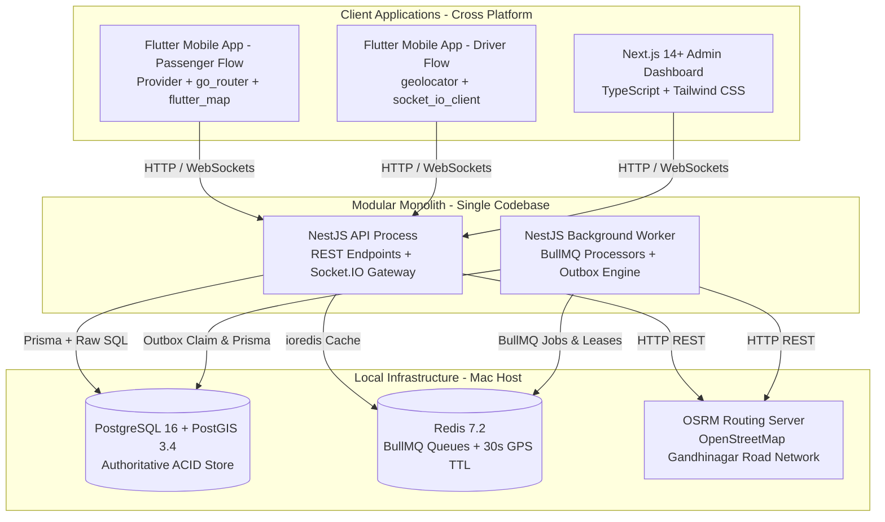

# On-Demand Aggregation Platform for Last-Mile Connectivity Using Shared Micro-Mobility

[](./docs/ARCHITECTURE_DECISIONS.md)
[-blue)](./docs/TRD.md)
[-orange)](./docs/DETAILED_ARCHITECTURE.md)
[](./docs/HLD.md)

---

## 1. Executive Summary and Problem Statement

Suburban university campuses and suburban transit hubs—such as **Pandit Deendayal Energy University (PDEU)** in Gandhinagar, Gujarat—suffer from severe "last-mile" transportation inefficiencies. Hundreds of students, faculty, and daily commuters exit transit gates simultaneously heading along common corridors (e.g., Bhaijipura, Kudasan, Koba Circle, Infocity).

### The Traditional Dilemma
- **High Individual Cost:** Commuters take private point-to-point autos or taxis costing ₹80–₹120 per ride.
- **Low Vehicle Utilization:** Autos frequently carry only a single commuter, worsening road congestion and carbon emissions.
- **Sidewalk Chaos:** Informal street haggling and manual coordination waste 15–30 minutes at campus gates.

### The Platform Solution
This platform automates dynamic demand aggregation for shared micro-mobility vehicles (4-passenger electric rickshaws, bike taxis, and micro-shuttle vans):
1. **Geofenced Campus Aggregation:** Validates commuters at a dedicated campus transit hub via a strict 150-meter backend GPS geofence.
2. **Upfront Consent & Automatic Grouping:** Commuters give upfront consent to grouping, capped fares, and maximum 25% individual detours at booking. No fragile post-matching passenger voting rounds are used.
3. **OSRM Permutation Route Solver:** Evaluates road-network travel time matrices ($k! \le 24$ permutations) to select the optimal drop-off sequence that minimizes vehicle travel time while respecting detour limits.
4. **Proportional Solo-Fare Allocation:** Divides shared trip costs equitably based on individual benchmark solo travel costs, saving commuters 25%–40% on every ride.
5. **Sequential 1-to-1 Driver Dispatch:** Dispatches formed groups to available, verified drivers one at a time with a 20-second timer, atomically locking driver reservations.
6. **Cash-Only Settlement & ₹30 Cancellation Ledger:** Audits physical cash collections and manages post-assignment late cancellation penalties through an automated next-ride surcharge recovery ledger.

---

## 2. Approved Technology Stack (Strict ₹0 Budget)

The entire architecture is designed to execute locally on an Apple Silicon Mac host and physical iPhone/Android clients over a shared local Wi-Fi router with zero subscription costs:



- **Mobile Clients:** Flutter, Dart, Provider (state management), go_router (navigation), Dio (HTTP client), socket_io_client (WebSockets), flutter_secure_storage (Keychain/KeyStore), geolocator (GPS tracking), flutter_map (OpenStreetMap tile rendering).
- **Admin Dashboard:** Next.js 14+ (App Router), TypeScript, Tailwind CSS.
- **Backend Framework:** NestJS 10+ modular monolith (dual entry points: `start:api` and `start:worker`).
- **Persistence & Spatial Engine:** PostgreSQL 16+, PostGIS 3.4+, Prisma ORM with selective raw SQL for row locking and spatial containment (`ST_DWithin`, `ST_Contains`).
- **Asynchronous Processing:** Redis 7.2+, BullMQ 5+, Transactional Outbox Pattern.
- **Routing Engine:** Open Source Routing Machine (OSRM 5.27+) running locally on OpenStreetMap road network extracts.
- **Authentication:** Google OAuth 2.0 with platform JWT access/refresh token rotation.

---

## 3. Authoritative Documentation Index

This repository contains an exhaustive, implementation-ready architectural specification designed to serve as the single source of truth for engineering teams and AI coding agents:

| Document | Primary Focus & System Domain |
|---|---|
| [**AGENTS.md**](./AGENTS.md) | **Mandatory AI Agent Directives**, architectural guardrails, and implementation rules. |
| [**docs/PRD.md**](./docs/PRD.md) | **Product Requirements Document:** Problem statement, personas, user journeys, upfront consent rules, cancellation fee policies, and acceptance criteria. |
| [**docs/TRD.md**](./docs/TRD.md) | **Technical Requirements Document:** Technology selection rationale, modular monolith constraints, PostGIS spatial strategy, BullMQ outbox, and ₹0 demo runbook. |
| [**docs/HLD.md**](./docs/HLD.md) | **High-Level Design:** C4 Level 1–3 diagrams, module dependency graphs, end-to-end data flows, and inter-module communication contracts. |
| [**docs/DETAILED_ARCHITECTURE.md**](./docs/DETAILED_ARCHITECTURE.md) | **Detailed Architecture & Low-Level Design:** 14 module deep dives, permutation routing math, proportional fare formula, 22-failure matrix, 18 Mermaid sequence diagrams, and QA test plan. |
| [**docs/API_DESIGN.md**](./docs/API_DESIGN.md) | **REST & Realtime API Contract:** Base path `/api/v1`, full request/response DTOs, HTTP error envelopes, and Socket.IO event catalog. |
| [**docs/DATABASE_DESIGN.md**](./docs/DATABASE_DESIGN.md) | **Database Design & ERD:** Complete 21-entity specifications, PostgreSQL types, constraints, partial unique indexes, and concurrency invariants. |
| [**docs/ARCHITECTURE_DECISIONS.md**](./docs/ARCHITECTURE_DECISIONS.md) | **Architecture Decision Records (ADRs):** Comprehensive log of 25 approved decisions and explicit pending parameter classifications. |

---

## 4. Repository Structure

```text
.
├── AGENTS.md                          # Persistent instructions for AI coding agents
├── README.md                          # Project overview and documentation index
├── docs/                              # Authoritative system design specifications
│   ├── PRD.md                         # Product Requirements Document
│   ├── TRD.md                         # Technical Requirements Document
│   ├── HLD.md                         # High-Level Design (C4 & Architecture)
│   ├── DETAILED_ARCHITECTURE.md       # Algorithms, Workflows, Sockets & Failures
│   ├── API_DESIGN.md                  # Complete REST & Socket.IO API Contract
│   ├── DATABASE_DESIGN.md             # PostgreSQL Schema, PostGIS & Indexes
│   └── ARCHITECTURE_DECISIONS.md      # Master ADR Log (Approved vs Pending)
│
├── apps/                              # Implementation source trees (Deferred)
│   ├── backend/                       # NestJS Modular Monolith (API & Worker)
│   │   ├── prisma/                    # Schema, migrations, and PostGIS seed
│   │   └── src/                       # 14 domain modules & infrastructure
│   ├── mobile/                        # Flutter iOS/Android application
│   │   └── lib/                       # Passenger & Driver feature flows
│   └── admin/                         # Next.js TypeScript administration portal
│       └── app/                       # Dashboard, approvals, and fee reviews
```

---

## 5. Development Setup and Prerequisites

### Local Demonstration Hardware & Tools
- **Host Machine:** Apple Silicon Mac (macOS Sonoma / Sequoia).
- **Client Devices:** Physical iPhone and/or Android smartphones connected to the same Wi-Fi router.
- **System Binaries:**
  - Xcode 15+ and Command Line Tools.
  - Flutter SDK 3.22+ and Dart 3.4+.
  - Node.js 20+ (LTS) and npm.
  - PostgreSQL 16+ with PostGIS 3.4+ (`brew install postgresql@16 postgis`).
  - Redis 7.2+ (`brew install redis`).
  - OSRM Backend (`brew install osrm-backend`).

### Project Status
- **Current Phase:** System Architecture, System Design, and Technical Documentation Complete.
- **Next Phase:** Database initialization, Prisma migrations, and baseline service bootstrapping.
- **Rule:** No premature application coding or scaffolding is to begin without explicit project alignment against this documentation pack.

---

*On-Demand Aggregation Platform for Last-Mile Connectivity Using Shared Micro-Mobility*

