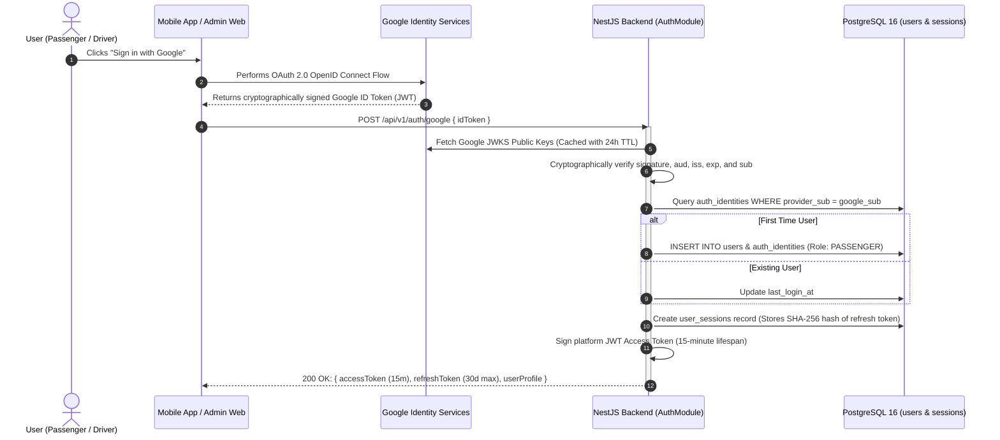
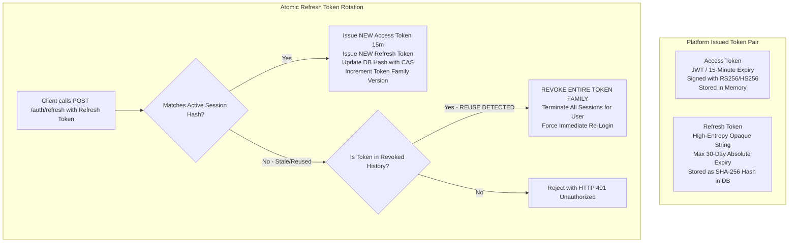
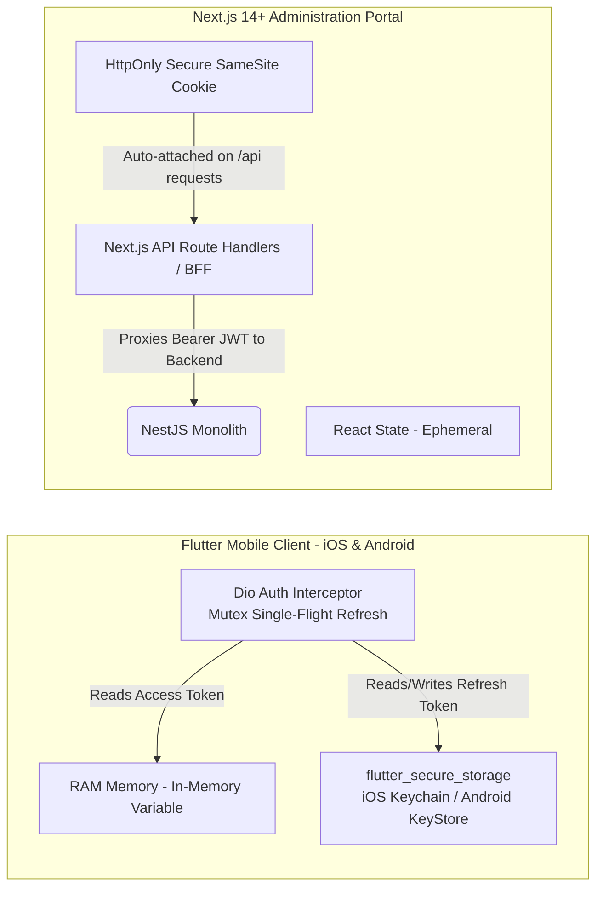
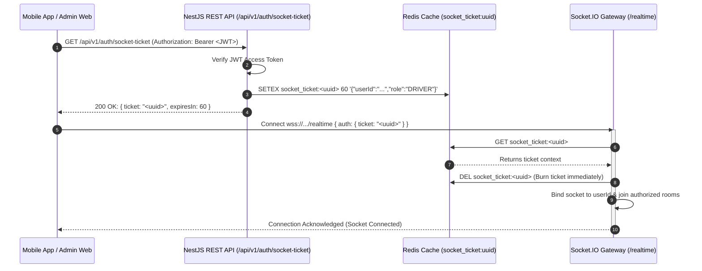

# Authentication and Session Security Specification

## On-Demand Aggregation Platform for Last-Mile Connectivity Using Shared Micro-Mobility

---

## 1. Identity Verification via Google OAuth 2.0

The platform adopts **Google Identity Services (OAuth 2.0 / OpenID Connect)** as the sole external identity provider, eliminating password storage, credential stuffing vulnerabilities, and SMS OTP gateway costs.



### 1.1 Backend Verification Rules
When an ID token is received at `POST /api/v1/auth/google`, `AuthService` validates:
1. **Signature Verification:** Validates the RSA signature against Google's public JSON Web Key Set (JWKS) fetched from `https://www.googleapis.com/oauth2/v3/certs`.
2. **Issuer Verification:** `iss` must strictly equal `https://accounts.google.com` or `accounts.google.com`.
3. **Audience Verification:** `aud` must match the authorized client IDs configured in `.env` (`GOOGLE_CLIENT_ID_IOS`, `GOOGLE_CLIENT_ID_ANDROID`, `GOOGLE_CLIENT_ID_WEB`).
4. **Token Expiration:** `exp` must be in the future.
5. **Stable Subject Identifier:** Maps Google's immutable `sub` claim to an internal user UUID. Client-provided email addresses are never trusted as primary keys because Google account emails can change.

---

## 2. Platform Token Lifecycle and Rotation



### 2.1 Access Token Specifications
- **Format:** Standard JSON Web Token (JWT).
- **Lifespan:** Exactly **15 minutes** (900 seconds).
- **Claims:**
  ```json
  {
    "sub": "user-uuid",
    "email": "aarav@pdeu.ac.in",
    "role": "PASSENGER",
    "driverVerificationStatus": "APPROVED",
    "sessionId": "session-uuid",
    "iat": 1731844800,
    "exp": 1731845700
  }
  ```

### 2.2 Rotating Refresh Token and Family Tracking
- **Format:** 256-bit cryptographically secure pseudorandom hex string (`crypto.randomBytes(32).toString('hex')`).
- **Absolute Lifespan:** Maximum **30 days** from initial login.
- **Database Hashing:** The database **never stores plain-text refresh tokens**. Only the SHA-256 hash (`crypto.createHash('sha256').update(token).digest('hex')`) is persisted in `user_sessions`.
- **Automatic Reuse Detection:**
  Each session maintains a `token_family_id`. When a refresh token is presented:
  - If the token matches the active session hash, it is burned and replaced with a newly issued refresh token.
  - If a token that has **already been rotated** is presented again, the backend flags a **replay attack / credential theft**. The backend immediately invalidates the entire token family (`UPDATE user_sessions SET revoked_at = NOW() WHERE token_family_id = :familyId`), instantly terminating all sessions for that account.

---

## 3. Client-Side Token Storage Architecture



### 3.1 Flutter Mobile Storage Implementation
- **Access Token:** Kept in **RAM memory** within the application state service. Never written to unencrypted local storage.
- **Refresh Token:** Stored in hardware-backed secure storage via `flutter_secure_storage`:
  - **iOS:** Apple Keychain Services (protected with `kSecAttrAccessibleAfterFirstUnlock`).
  - **Android:** Android KeyStore with EncryptedSharedPreferences (AES-256 GCM).
- **Single-Flight Dio Interceptor:**
  When a REST call encounters HTTP 401 Unauthorized, the Dio interceptor locks its internal queue (`async_mutex`), issues a single `POST /api/v1/auth/refresh` request, updates the in-memory token, and replays all pending queued requests without triggering parallel refresh storms.

### 3.2 Next.js Admin Web Portal Security
- **Strictly No `localStorage`:** Storing JWTs or refresh tokens in browser `localStorage` or `sessionStorage` is strictly prohibited to eliminate Cross-Site Scripting (XSS) token theft.
- **HttpOnly Secure Cookies:** Authentication tokens are stored in browser cookies configured with:
  ```http
  Set-Cookie: __Host-refresh_token=<token>; Path=/; Secure; HttpOnly; SameSite=Lax; Max-Age=2592000
  ```
- **Backend-For-Frontend (BFF) Pattern:** Next.js Route Handlers (`app/api/auth/*`) receive the cookie, extract the token, attach it as an `Authorization: Bearer` header, and forward the request to the NestJS backend on `127.0.0.1:3000`.

---

## 4. Realtime Socket Ticket Authentication

WebSocket connections cannot send custom HTTP authorization headers during standard browser/client handshake upgrades without exposing tokens in server access logs. The platform implements **Single-Use Socket Tickets**:



### 4.1 Ticket Constraints
- **Lifespan:** Exactly **60 seconds**.
- **Single-Use:** Deleted from Redis upon first verification (`DEL`), preventing replay attacks.
- **Context Binding:** Cryptographically bound to the authenticated user ID, session ID, and active roles.

---

## 5. Role-Based Access Control (RBAC) and Zero-Trust Guardrails

### 5.1 System Roles
- `PASSENGER`: Default role assigned to all authenticated users.
- `DRIVER`: Users who possess a registered, approved vehicle and driver profile.
- `ADMIN`: Authorized campus security and facility transport officers.

### 5.2 Zero Frontend Trust Enforcement
- **Client App Mode is Not a Security Boundary:** In the Flutter mobile app, toggling between "Passenger Mode" and "Driver Mode" is strictly a UI/UX layout state.
- **Server-Side Enforcement:** Every mutating driver endpoint (`POST /drivers/*`, `POST /trips/:id/*`) verifies:
  1. The user's role includes `DRIVER`.
  2. The user's `driver_profiles` record in PostgreSQL has `verification_status = 'APPROVED'`.
  3. The driver is not suspended or blacklisted.
- **Commuter Booking Ownership:** A passenger can never cancel, query, or mutate another commuter's booking (`WHERE passenger_id = req.user.id`).

---

*End of Authentication and Session Security Specification*
