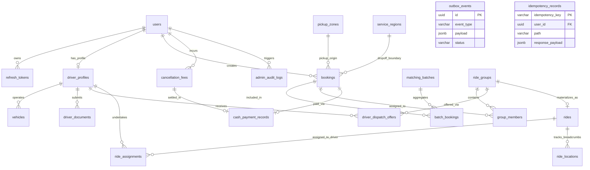

# Database Design Specification

## On-Demand Aggregation Platform for Last-Mile Connectivity Using Shared Micro-Mobility

---

## 1. Storage Strategy and Technology Stack

The data architecture adheres to a strict division of responsibilities:
1. **Authoritative Persistence Layer (PostgreSQL 16+ & PostGIS 3.4+):**
   - Serves as the sole authoritative single source of truth for all business entities, financial ledgers, booking lifecycles, and driver assignments.
   - All critical state transitions execute under ACID transaction boundaries.
   - Geospatial operations (geofence distance validation and service polygon containment) are computed natively using PostGIS spatial functions on **SRID 4326** (WGS 84).
2. **Ephemeral In-Memory Cache Layer (Redis 7.2+):**
   - Caches volatile real-time driver GPS coordinates with an automated 30-second TTL.
   - Backs BullMQ job queues and distributed batch execution leases.
   - Contains no irreversible business state; if Redis is completely flushed or restarted, PostgreSQL retains 100% of platform data integrity.
3. **ORM & Query Execution Strategy (Prisma ORM & Controlled Raw SQL):**
   - Standard CRUD operations, type generation, and relational navigation are managed via Prisma.
   - Raw SQL (`$queryRaw` and `$executeRaw`) is strictly utilized for:
     - PostGIS spatial functions (`ST_DWithin`, `ST_Contains`, `ST_MakePoint`).
     - Pessimistic row-level locking (`SELECT ... FOR UPDATE`).
     - Outbox queue claiming with `SELECT ... FOR UPDATE SKIP LOCKED`.
     - Partial unique index enforcement and conditional atomic updates.

---

## 2. Complete Entity-Relationship Diagram (ERD)



---

## 3. Comprehensive Entity Specifications

### 3.1 `users`
- **Module Owner:** `UsersModule` / `AuthModule`
- **Purpose:** Central identity table representing all system actors (Passengers, Drivers, Administrators).

| Column Name | Data Type | Constraints | Description |
|---|---|---|---|
| `id` | `UUID` | `PK, DEFAULT gen_random_uuid()` | Immutable internal identifier |
| `google_sub` | `VARCHAR(255)` | `NOT NULL, UNIQUE` | Stable external subject identifier from Google OAuth |
| `email` | `VARCHAR(255)` | `NOT NULL, UNIQUE` | User email address |
| `full_name` | `VARCHAR(255)` | `NOT NULL` | User full name from Google profile |
| `avatar_url` | `TEXT` | `NULL` | Profile picture URL |
| `role` | `VARCHAR(50)` | `NOT NULL, DEFAULT 'PASSENGER'` | System role: `PASSENGER`, `DRIVER`, `ADMIN` |
| `phone_number` | `VARCHAR(20)` | `NULL` | Optional contact number |
| `is_active` | `BOOLEAN` | `NOT NULL, DEFAULT true` | Account active state |
| `created_at` | `TIMESTAMPTZ` | `NOT NULL, DEFAULT NOW()` | Record creation timestamp |
| `updated_at` | `TIMESTAMPTZ` | `NOT NULL, DEFAULT NOW()` | Record last update timestamp |

---

### 3.2 `refresh_tokens`
- **Module Owner:** `AuthModule`
- **Purpose:** Securely tracks active refresh tokens for session rotation and instant logout revocation.

| Column Name | Data Type | Constraints | Description |
|---|---|---|---|
| `id` | `UUID` | `PK, DEFAULT gen_random_uuid()` | Primary key |
| `user_id` | `UUID` | `NOT NULL, FK -> users(id) ON DELETE CASCADE` | Associated user |
| `token_hash` | `VARCHAR(255)` | `NOT NULL, UNIQUE` | SHA-256 hash of issued refresh token |
| `expires_at` | `TIMESTAMPTZ` | `NOT NULL` | Hard expiration timestamp (7 days) |
| `revoked_at` | `TIMESTAMPTZ` | `NULL` | Revocation timestamp |
| `created_at` | `TIMESTAMPTZ` | `NOT NULL, DEFAULT NOW()` | Creation timestamp |

---

### 3.3 `driver_profiles`
- **Module Owner:** `DriversModule`
- **Purpose:** Stores driver-specific operational metadata, onboarding status, and live availability.

| Column Name | Data Type | Constraints | Description |
|---|---|---|---|
| `id` | `UUID` | `PK, DEFAULT gen_random_uuid()` | Primary key |
| `user_id` | `UUID` | `NOT NULL, UNIQUE, FK -> users(id) ON DELETE RESTRICT` | Associated user |
| `license_number` | `VARCHAR(100)` | `NOT NULL, UNIQUE` | Driving license identifier |
| `verification_status` | `VARCHAR(50)` | `NOT NULL, DEFAULT 'PENDING'` | `PENDING`, `APPROVED`, `REJECTED`, `SUSPENDED` |
| `operational_status` | `VARCHAR(50)` | `NOT NULL, DEFAULT 'OFFLINE'` | `OFFLINE`, `AVAILABLE`, `RESERVED`, `ON_TRIP` |
| `is_online` | `BOOLEAN` | `NOT NULL, DEFAULT false` | Driver manual online/offline switch |
| `verified_at` | `TIMESTAMPTZ` | `NULL` | Timestamp of administrator approval |
| `verified_by_user_id` | `UUID` | `NULL, FK -> users(id)` | Admin user who approved the driver |
| `rejection_reason` | `TEXT` | `NULL` | Administrator reason if rejected or suspended |
| `created_at` | `TIMESTAMPTZ` | `NOT NULL, DEFAULT NOW()` | Record creation timestamp |
| `updated_at` | `TIMESTAMPTZ` | `NOT NULL, DEFAULT NOW()` | Record last update timestamp |

---

### 3.4 `vehicles`
- **Module Owner:** `VehiclesModule`
- **Purpose:** Physical vehicle details, registration plate numbers, and verified seating capacity.

| Column Name | Data Type | Constraints | Description |
|---|---|---|---|
| `id` | `UUID` | `PK, DEFAULT gen_random_uuid()` | Primary key |
| `driver_profile_id` | `UUID` | `NOT NULL, FK -> driver_profiles(id) ON DELETE RESTRICT` | Owning driver profile |
| `registration_number`| `VARCHAR(50)` | `NOT NULL, UNIQUE` | Vehicle license plate (e.g., GJ-01-XX-XXXX) |
| `vehicle_type` | `VARCHAR(50)` | `NOT NULL, DEFAULT 'E_RICKSHAW'` | `E_RICKSHAW`, `BIKE_TAXI`, `SHUTTLE_VAN` |
| `passenger_capacity` | `INTEGER` | `NOT NULL, CHECK (passenger_capacity >= 1 AND passenger_capacity <= 8)` | Maximum paying passenger seats (Default: 4) |
| `make_model` | `VARCHAR(100)` | `NOT NULL` | E.g., 'Mahindra Treo Auto' |
| `is_active` | `BOOLEAN` | `NOT NULL, DEFAULT true` | Active operational status |
| `created_at` | `TIMESTAMPTZ` | `NOT NULL, DEFAULT NOW()` | Creation timestamp |

---

### 3.5 `driver_documents`
- **Module Owner:** `DriversModule`
- **Purpose:** References to uploaded verification documents for administrator review.

| Column Name | Data Type | Constraints | Description |
|---|---|---|---|
| `id` | `UUID` | `PK, DEFAULT gen_random_uuid()` | Primary key |
| `driver_profile_id` | `UUID` | `NOT NULL, FK -> driver_profiles(id) ON DELETE CASCADE` | Owning driver profile |
| `document_type` | `VARCHAR(50)` | `NOT NULL` | `DRIVING_LICENSE`, `VEHICLE_RC`, `VEHICLE_INSURANCE` |
| `document_url` | `TEXT` | `NOT NULL` | Storage URL / path |
| `verification_status`| `VARCHAR(50)` | `NOT NULL, DEFAULT 'PENDING'` | `PENDING`, `VERIFIED`, `REJECTED` |
| `uploaded_at` | `TIMESTAMPTZ` | `NOT NULL, DEFAULT NOW()` | Upload timestamp |

---

### 3.6 `pickup_zones`
- **Module Owner:** `LocationsModule`
- **Purpose:** Configuration of authorized transit aggregation hubs (e.g., PDEU Main Gate).

| Column Name | Data Type | Constraints | Description |
|---|---|---|---|
| `id` | `UUID` | `PK, DEFAULT gen_random_uuid()` | Primary key |
| `name` | `VARCHAR(100)` | `NOT NULL, UNIQUE` | E.g., 'PDEU Main Transit Zone' |
| `center_point` | `geometry(Point, 4326)`| `NOT NULL` | Canonical center coordinate |
| `radius_meters` | `INTEGER` | `NOT NULL, DEFAULT 150` | Geofence validation radius (Pilot: 150m) |
| `is_active` | `BOOLEAN` | `NOT NULL, DEFAULT true` | Active state |
| `created_at` | `TIMESTAMPTZ` | `NOT NULL, DEFAULT NOW()` | Creation timestamp |

---

### 3.7 `service_regions`
- **Module Owner:** `LocationsModule`
- **Purpose:** PostGIS polygon bounding the authorized drop-off territory covering Gandhinagar corridors.

| Column Name | Data Type | Constraints | Description |
|---|---|---|---|
| `id` | `UUID` | `PK, DEFAULT gen_random_uuid()` | Primary key |
| `name` | `VARCHAR(100)` | `NOT NULL, UNIQUE` | E.g., 'Gandhinagar Last-Mile Boundary' |
| `boundary_polygon`| `geometry(Polygon, 4326)`| `NOT NULL` | Geographic polygon for drop-off validation |
| `is_active` | `BOOLEAN` | `NOT NULL, DEFAULT true` | Active state |
| `created_at` | `TIMESTAMPTZ` | `NOT NULL, DEFAULT NOW()` | Creation timestamp |

---

### 3.8 `bookings`
- **Module Owner:** `BookingsModule`
- **Purpose:** Authoritative individual ride requests created by passengers.

| Column Name | Data Type | Constraints | Description |
|---|---|---|---|
| `id` | `UUID` | `PK, DEFAULT gen_random_uuid()` | Primary key |
| `passenger_id` | `UUID` | `NOT NULL, FK -> users(id) ON DELETE RESTRICT` | Commuter user ID |
| `pickup_zone_id` | `UUID` | `NOT NULL, FK -> pickup_zones(id)` | Configured pickup hub |
| `passenger_pickup_location` | `geometry(Point, 4326)` | `NOT NULL` | Actual device GPS fix at booking |
| `destination_location` | `geometry(Point, 4326)` | `NOT NULL` | Selected destination coordinate |
| `requested_type` | `VARCHAR(20)` | `NOT NULL, CHECK (requested_type IN ('SHARED', 'PRIVATE'))` | Ride type |
| `status` | `VARCHAR(50)` | `NOT NULL, DEFAULT 'REQUESTED'` | `REQUESTED`, `MATCHING`, `DISPATCHING`, `CONFIRMED`, `IN_PROGRESS`, `COMPLETED`, `CANCELLED`, `EXPIRED`, `NO_DRIVER_AVAILABLE` |
| `estimated_solo_fare` | `DECIMAL(10,2)` | `NOT NULL, CHECK (estimated_solo_fare > 0)` | Disclosed benchmark solo fare |
| `final_allocated_fare`| `DECIMAL(10,2)` | `NULL, CHECK (final_allocated_fare > 0)` | Actual fare allocated after grouping |
| `max_wait_deadline` | `TIMESTAMPTZ` | `NOT NULL` | Booking creation + 120 seconds |
| `cancellation_reason` | `TEXT` | `NULL` | Reason if cancelled |
| `cancelled_at` | `TIMESTAMPTZ` | `NULL` | Cancellation timestamp |
| `created_at` | `TIMESTAMPTZ` | `NOT NULL, DEFAULT NOW()` | Booking creation timestamp |
| `updated_at` | `TIMESTAMPTZ` | `NOT NULL, DEFAULT NOW()` | Last update timestamp |

---

### 3.9 `matching_batches`
- **Module Owner:** `MatchingModule`
- **Purpose:** Audit record of periodic 60-second batch matching executions per pickup zone.

| Column Name | Data Type | Constraints | Description |
|---|---|---|---|
| `id` | `UUID` | `PK, DEFAULT gen_random_uuid()` | Primary key |
| `pickup_zone_id` | `UUID` | `NOT NULL, FK -> pickup_zones(id)` | Target pickup hub |
| `batch_status` | `VARCHAR(50)` | `NOT NULL, DEFAULT 'PENDING'` | `PENDING`, `PROCESSING`, `COMPLETED`, `FAILED` |
| `lease_token` | `VARCHAR(255)` | `NULL` | Worker lease token holding distributed lock |
| `lease_expires_at` | `TIMESTAMPTZ` | `NULL` | Lease expiration timestamp |
| `total_eligible_bookings`| `INTEGER` | `NOT NULL, DEFAULT 0` | Candidate booking count |
| `groups_formed_count` | `INTEGER` | `NOT NULL, DEFAULT 0` | Successful groups generated |
| `started_at` | `TIMESTAMPTZ` | `NOT NULL, DEFAULT NOW()` | Batch execution start |
| `completed_at` | `TIMESTAMPTZ` | `NULL` | Batch completion timestamp |

---

### 3.10 `batch_bookings`
- **Module Owner:** `MatchingModule`
- **Purpose:** Explicit join table tracking which bookings were claimed by which matching batch.

| Column Name | Data Type | Constraints | Description |
|---|---|---|---|
| `id` | `UUID` | `PK, DEFAULT gen_random_uuid()` | Primary key |
| `batch_id` | `UUID` | `NOT NULL, FK -> matching_batches(id) ON DELETE CASCADE` | Matching batch |
| `booking_id` | `UUID` | `NOT NULL, FK -> bookings(id) ON DELETE RESTRICT` | Associated booking |
| `created_at` | `TIMESTAMPTZ` | `NOT NULL, DEFAULT NOW()` | Inclusion timestamp |

---

### 3.11 `ride_groups`
- **Module Owner:** `MatchingModule` / `DispatchModule`
- **Purpose:** Formed multi-passenger groups with optimized route geometries and aggregated fares.

| Column Name | Data Type | Constraints | Description |
|---|---|---|---|
| `id` | `UUID` | `PK, DEFAULT gen_random_uuid()` | Primary key |
| `pickup_zone_id` | `UUID` | `NOT NULL, FK -> pickup_zones(id)` | Starting pickup hub |
| `group_version` | `INTEGER` | `NOT NULL, DEFAULT 1` | Increments upon passenger cancellation/recalculation |
| `status` | `VARCHAR(50)` | `NOT NULL, DEFAULT 'DISPATCHING'` | `DISPATCHING`, `ASSIGNED`, `IN_PROGRESS`, `COMPLETED`, `DISSOLVED`, `EXPIRED` |
| `route_geometry` | `jsonb` | `NOT NULL` | GeoJSON LineString of optimized OSRM route |
| `total_shared_fare` | `DECIMAL(10,2)` | `NOT NULL, CHECK (total_shared_fare > 0)` | Aggregated vehicle trip fare |
| `estimated_total_duration_sec`| `INTEGER`| `NOT NULL` | Total route travel time in seconds |
| `estimated_total_distance_meters`| `INTEGER`| `NOT NULL` | Total route road distance |
| `created_at` | `TIMESTAMPTZ` | `NOT NULL, DEFAULT NOW()` | Creation timestamp |
| `updated_at` | `TIMESTAMPTZ` | `NOT NULL, DEFAULT NOW()` | Last update timestamp |

---

### 3.12 `group_members`
- **Module Owner:** `MatchingModule`
- **Purpose:** Associates individual bookings with a formed `ride_group` and records individual drop-off order and detour.

| Column Name | Data Type | Constraints | Description |
|---|---|---|---|
| `id` | `UUID` | `PK, DEFAULT gen_random_uuid()` | Primary key |
| `ride_group_id` | `UUID` | `NOT NULL, FK -> ride_groups(id) ON DELETE CASCADE` | Owning ride group |
| `booking_id` | `UUID` | `NOT NULL, FK -> bookings(id) ON DELETE RESTRICT` | Member booking |
| `dropoff_sequence_order` | `INTEGER` | `NOT NULL, CHECK (dropoff_sequence_order >= 1 AND dropoff_sequence_order <= 4)` | Drop-off stop order (1st, 2nd, 3rd, 4th) |
| `direct_travel_time_sec` | `INTEGER` | `NOT NULL` | Direct solo trip time from OSRM |
| `shared_travel_time_sec` | `INTEGER` | `NOT NULL` | Multi-stop trip time to this drop-off |
| `calculated_detour_percent`| `DECIMAL(5,2)`| `NOT NULL, CHECK (calculated_detour_percent <= 25.00)` | Detour percentage ($\le 25\%$) |
| `individual_allocated_fare`| `DECIMAL(10,2)`| `NOT NULL, CHECK (individual_allocated_fare > 0)` | Proportional fare allocated |
| `is_active_member` | `BOOLEAN` | `NOT NULL, DEFAULT true` | Set false if passenger cancels out |
| `created_at` | `TIMESTAMPTZ` | `NOT NULL, DEFAULT NOW()` | Inclusion timestamp |

---

### 3.13 `driver_dispatch_offers`
- **Module Owner:** `DispatchModule`
- **Purpose:** Records sequential 1-to-1 offers sent to eligible drivers with a 20-second countdown timer.

| Column Name | Data Type | Constraints | Description |
|---|---|---|---|
| `id` | `UUID` | `PK, DEFAULT gen_random_uuid()` | Primary key |
| `ride_group_id` | `UUID` | `NOT NULL, FK -> ride_groups(id) ON DELETE CASCADE` | Offered group |
| `group_version` | `INTEGER` | `NOT NULL` | Version of group when offer was created |
| `dispatch_attempt_id` | `UUID` | `NOT NULL` | UUID grouping sequential cascade attempts |
| `driver_id` | `UUID` | `NOT NULL, FK -> driver_profiles(id) ON DELETE RESTRICT` | Target driver |
| `status` | `VARCHAR(50)` | `NOT NULL, DEFAULT 'PENDING'` | `PENDING`, `ACCEPTED`, `REJECTED`, `EXPIRED`, `WITHDRAWN` |
| `offered_at` | `TIMESTAMPTZ` | `NOT NULL, DEFAULT NOW()` | Offer timestamp |
| `expires_at` | `TIMESTAMPTZ` | `NOT NULL` | Hard timeout: `offered_at` + 20 seconds |
| `responded_at` | `TIMESTAMPTZ` | `NULL` | Driver response timestamp |

---

### 3.14 `ride_assignments`
- **Module Owner:** `DispatchModule`
- **Purpose:** Durable association of a reserved driver to a ride group upon successful acceptance.

| Column Name | Data Type | Constraints | Description |
|---|---|---|---|
| `id` | `UUID` | `PK, DEFAULT gen_random_uuid()` | Primary key |
| `ride_group_id` | `UUID` | `NOT NULL, UNIQUE, FK -> ride_groups(id) ON DELETE RESTRICT` | Assigned group |
| `driver_id` | `UUID` | `NOT NULL, FK -> driver_profiles(id) ON DELETE RESTRICT` | Winning driver |
| `status` | `VARCHAR(50)` | `NOT NULL, DEFAULT 'ASSIGNED'` | `ASSIGNED`, `ARRIVED`, `IN_PROGRESS`, `COMPLETED`, `CANCELLED` |
| `assigned_at` | `TIMESTAMPTZ` | `NOT NULL, DEFAULT NOW()` | Assignment timestamp |
| `arrived_at` | `TIMESTAMPTZ` | `NULL` | Driver arrival at PDEU pickup |
| `started_at` | `TIMESTAMPTZ` | `NULL` | Trip start timestamp |
| `completed_at` | `TIMESTAMPTZ` | `NULL` | Trip completion timestamp |

---

### 3.15 `rides`
- **Module Owner:** `DispatchModule` / `BookingsModule`
- **Purpose:** Operational representation of the physical trip executed by the driver.

| Column Name | Data Type | Constraints | Description |
|---|---|---|---|
| `id` | `UUID` | `PK, DEFAULT gen_random_uuid()` | Primary key |
| `ride_group_id` | `UUID` | `NOT NULL, UNIQUE, FK -> ride_groups(id) ON DELETE RESTRICT` | Materialized group |
| `status` | `VARCHAR(50)` | `NOT NULL, DEFAULT 'CONFIRMED'` | `CONFIRMED`, `DRIVER_ARRIVING`, `IN_PROGRESS`, `COMPLETED`, `CANCELLED` |
| `total_passengers` | `INTEGER` | `NOT NULL, CHECK (total_passengers >= 1 AND total_passengers <= 4)` | Active passenger count |
| `current_stop_order`| `INTEGER` | `NOT NULL, DEFAULT 0` | Index of active drop-off stop |
| `created_at` | `TIMESTAMPTZ` | `NOT NULL, DEFAULT NOW()` | Ride creation timestamp |
| `updated_at` | `TIMESTAMPTZ` | `NOT NULL, DEFAULT NOW()` | Last update timestamp |

---

### 3.16 `ride_locations`
- **Module Owner:** `LocationsModule`
- **Purpose:** Low-frequency durable GPS snapshots (every 15–30 seconds) persisted in PostgreSQL for route audits.

| Column Name | Data Type | Constraints | Description |
|---|---|---|---|
| `id` | `BIGSERIAL` | `PK` | Sequential primary key |
| `ride_id` | `UUID` | `NOT NULL, FK -> rides(id) ON DELETE CASCADE` | Associated ride |
| `location` | `geometry(Point, 4326)` | `NOT NULL` | Coordinate fix |
| `heading` | `DECIMAL(5,2)` | `NULL` | Compass heading (0–360) |
| `speed_mps` | `DECIMAL(6,2)` | `NULL` | Speed in meters per second |
| `recorded_at` | `TIMESTAMPTZ` | `NOT NULL, DEFAULT NOW()` | Timestamp of fix |

---

### 3.17 `cancellation_fees`
- **Module Owner:** `PaymentsModule` / `FaresModule`
- **Purpose:** Authoritative financial ledger tracking late-cancellation penalties incurred by passengers.

| Column Name | Data Type | Constraints | Description |
|---|---|---|---|
| `id` | `UUID` | `PK, DEFAULT gen_random_uuid()` | Primary key |
| `passenger_id` | `UUID` | `NOT NULL, FK -> users(id) ON DELETE RESTRICT` | Liable passenger |
| `original_booking_id`| `UUID` | `NOT NULL, FK -> bookings(id) ON DELETE RESTRICT` | Booking where cancellation occurred |
| `amount` | `DECIMAL(10,2)` | `NOT NULL, DEFAULT 30.00, CHECK (amount > 0)` | Fixed late-cancellation fee (₹30) |
| `status` | `VARCHAR(50)` | `NOT NULL, DEFAULT 'OUTSTANDING'` | `OUTSTANDING`, `COLLECTED`, `WAIVED` |
| `collected_booking_id`| `UUID` | `NULL, FK -> bookings(id)` | Subsequent booking where fee was collected |
| `waived_by_user_id` | `UUID` | `NULL, FK -> users(id)` | Admin who waived fee |
| `waiver_reason` | `TEXT` | `NULL` | Documented reason for waiver |
| `created_at` | `TIMESTAMPTZ` | `NOT NULL, DEFAULT NOW()` | Creation timestamp |
| `collected_at` | `TIMESTAMPTZ` | `NULL` | Collection timestamp |
| `waived_at` | `TIMESTAMPTZ` | `NULL` | Waiver timestamp |

---

### 3.18 `cash_payment_records`
- **Module Owner:** `PaymentsModule`
- **Purpose:** Audit record of physical cash collected by drivers upon drop-off.

| Column Name | Data Type | Constraints | Description |
|---|---|---|---|
| `id` | `UUID` | `PK, DEFAULT gen_random_uuid()` | Primary key |
| `booking_id` | `UUID` | `NOT NULL, UNIQUE, FK -> bookings(id) ON DELETE RESTRICT` | Associated booking |
| `driver_id` | `UUID` | `NOT NULL, FK -> driver_profiles(id) ON DELETE RESTRICT` | Collecting driver |
| `fare_amount` | `DECIMAL(10,2)` | `NOT NULL, CHECK (fare_amount >= 0)` | Base ride fare |
| `cancellation_fee_amount`| `DECIMAL(10,2)`| `NOT NULL, DEFAULT 0.00, CHECK (cancellation_fee_amount >= 0)` | Past late fee collected |
| `total_cash_collected` | `DECIMAL(10,2)` | `NOT NULL, CHECK (total_cash_collected = fare_amount + cancellation_fee_amount)` | Total cash handed over |
| `payment_status` | `VARCHAR(50)` | `NOT NULL, DEFAULT 'PAID'` | `PAID`, `DISPUTED` |
| `confirmed_at` | `TIMESTAMPTZ` | `NOT NULL, DEFAULT NOW()` | Confirmation timestamp |

---

### 3.19 `outbox_events`
- **Module Owner:** `InfrastructureModule`
- **Purpose:** Implements the Transactional Outbox Pattern for guaranteed asynchronous job publication.

| Column Name | Data Type | Constraints | Description |
|---|---|---|---|
| `id` | `UUID` | `PK, DEFAULT gen_random_uuid()` | Primary key |
| `event_type` | `VARCHAR(100)` | `NOT NULL` | E.g., 'BOOKING_CREATED', 'GROUP_FORMED' |
| `aggregate_type` | `VARCHAR(100)` | `NOT NULL` | E.g., 'BOOKING', 'RIDE_GROUP' |
| `aggregate_id` | `UUID` | `NOT NULL` | Target aggregate ID |
| `payload` | `jsonb` | `NOT NULL` | Serialized event data |
| `status` | `VARCHAR(50)` | `NOT NULL, DEFAULT 'PENDING'` | `PENDING`, `PUBLISHED`, `FAILED` |
| `retry_count` | `INTEGER` | `NOT NULL, DEFAULT 0` | Publish retry count |
| `last_error` | `TEXT` | `NULL` | Error details if publishing failed |
| `created_at` | `TIMESTAMPTZ` | `NOT NULL, DEFAULT NOW()` | Creation timestamp |
| `published_at` | `TIMESTAMPTZ` | `NULL` | Successful BullMQ enqueue timestamp |

---

### 3.20 `idempotency_records`
- **Module Owner:** `InfrastructureModule`
- **Purpose:** Prevents duplicate state mutations caused by network retries or double-taps.

| Column Name | Data Type | Constraints | Description |
|---|---|---|---|
| `idempotency_key` | `VARCHAR(255)` | `PK` | Client-provided unique key |
| `user_id` | `UUID` | `NOT NULL, FK -> users(id)` | Owning user |
| `request_path` | `VARCHAR(255)` | `NOT NULL` | Target endpoint |
| `request_hash` | `VARCHAR(64)` | `NOT NULL` | SHA-256 hash of request body |
| `status_code` | `INTEGER` | `NOT NULL` | Cached HTTP status code |
| `response_payload`| `jsonb` | `NOT NULL` | Cached HTTP response payload |
| `created_at` | `TIMESTAMPTZ` | `NOT NULL, DEFAULT NOW()` | Creation timestamp |

---

### 3.21 `admin_audit_logs`
- **Module Owner:** `AdminModule`
- **Purpose:** Immutable audit record of privileged administrator actions (driver vetting, fee waivers).

| Column Name | Data Type | Constraints | Description |
|---|---|---|---|
| `id` | `UUID` | `PK, DEFAULT gen_random_uuid()` | Primary key |
| `admin_user_id` | `UUID` | `NOT NULL, FK -> users(id)` | Acting administrator |
| `action_type` | `VARCHAR(100)` | `NOT NULL` | E.g., 'APPROVE_DRIVER', 'WAIVE_CANCELLATION_FEE' |
| `target_entity_type`| `VARCHAR(100)` | `NOT NULL` | Target entity table |
| `target_entity_id` | `UUID` | `NOT NULL` | Target record UUID |
| `metadata` | `jsonb` | `NOT NULL` | Contextual details and reasons |
| `created_at` | `TIMESTAMPTZ` | `NOT NULL, DEFAULT NOW()` | Audit timestamp |

---

## 4. Critical Database Invariants and Exact SQL Definitions

The integrity of the platform is strictly guaranteed at the PostgreSQL database engine level using partial unique indexes, check constraints, and transactional row-level locking.

### 4.1 Invariant 1: Exactly One Active Booking per Passenger
A passenger can never have multiple simultaneous active bookings. Completed, cancelled, or expired bookings are historical:
```sql
CREATE UNIQUE INDEX idx_unique_active_passenger_booking 
ON bookings (passenger_id) 
WHERE status IN ('REQUESTED', 'MATCHING', 'DISPATCHING', 'CONFIRMED', 'IN_PROGRESS');
```

### 4.2 Invariant 2: A Booking Belongs to At Most One Active Group
A booking can never be claimed by two active ride groups simultaneously:
```sql
CREATE UNIQUE INDEX idx_unique_active_booking_in_group 
ON group_members (booking_id) 
WHERE is_active_member = true;
```

### 4.3 Invariant 3: Exactly One Active Assignment per Driver
A driver can never be actively assigned to more than one ride at any given moment:
```sql
CREATE UNIQUE INDEX idx_unique_active_driver_assignment 
ON ride_assignments (driver_id) 
WHERE status IN ('ASSIGNED', 'ARRIVED', 'IN_PROGRESS');
```

### 4.4 Invariant 4: Exactly One Active Assignment per Ride Group
A ride group can never be assigned to more than one driver:
```sql
CREATE UNIQUE INDEX idx_unique_active_group_assignment 
ON ride_assignments (ride_group_id) 
WHERE status IN ('ASSIGNED', 'ARRIVED', 'IN_PROGRESS');
```

### 4.5 Invariant 5: A Group Has At Most ONE Pending Driver Offer at a Time
Groups are dispatched sequentially 1-to-1. Two drivers can never have simultaneous active offers for the same group:
```sql
CREATE UNIQUE INDEX idx_unique_single_pending_offer_per_group 
ON driver_dispatch_offers (ride_group_id) 
WHERE status = 'PENDING';
```

### 4.6 Invariant 6: Scoped Driver Offer Exclusion
The same driver is never repeatedly offered the same group version within a single dispatch attempt:
```sql
CREATE UNIQUE INDEX idx_unique_driver_offer_per_group_version 
ON driver_dispatch_offers (ride_group_id, group_version, dispatch_attempt_id, driver_id);
```

### 4.7 Invariant 7: A Cancellation Fee Cannot Be Collected Twice
A cancellation fee record can only be settled once. If marked `COLLECTED`, it cannot be linked to multiple subsequent bookings:
```sql
CREATE UNIQUE INDEX idx_unique_collected_booking_fee 
ON cancellation_fees (collected_booking_id) 
WHERE status = 'COLLECTED';
```

### 4.8 Invariant 8: Spatial Indexing on Pickup and Service Boundaries
High-performance PostGIS spatial queries require GiST indexes:
```sql
CREATE INDEX idx_pickup_zones_center_gist ON pickup_zones USING GIST (center_point);
CREATE INDEX idx_service_regions_boundary_gist ON service_regions USING GIST (boundary_polygon);
CREATE INDEX idx_bookings_pickup_loc_gist ON bookings USING GIST (passenger_pickup_location);
CREATE INDEX idx_bookings_dest_loc_gist ON bookings USING GIST (destination_location);
CREATE INDEX idx_ride_locations_point_gist ON ride_locations USING GIST (location);
```

---

## 5. Rationale for Removing Group Fingerprints in MVP

In previous design iterations, a dedicated `matching_group_attempts` or `group_fingerprint` table was proposed to calculate an SHA-256 hash of passenger IDs (`hash(P1+P2+P3)`). This was intended to prevent the algorithm from re-offering the exact same passenger group configuration after a passenger voted "Reject".

**Architectural Justification for Permanent Removal in MVP:**
1. **Passenger Acceptance Rounds Eliminated:** The platform no longer includes an intermediate passenger acceptance or voting stage. Commuters give upfront consent at booking. Groups form automatically and proceed directly to driver dispatch.
2. **Elimination of Passenger Rejection Loops:** Because passengers cannot reject a formed group, the failure mode where the same passengers repeatedly reject the same cluster is eliminated.
3. **Overhead & Complexity:** A dedicated fingerprint exclusion table adds unnecessary database writes, index bloat, and cache-clearing complexity without operational justification.
4. **Ordinary Operational Records Retained:** Full operational traceability is maintained via `matching_batches`, `batch_bookings`, `ride_groups`, `group_members`, and `driver_dispatch_offers`.
5. **Future Circumstances for Reintroduction:** Fingerprinting will only be re-evaluated if future commercial expansions introduce real-time passenger group re-negotiation or dynamic on-the-fly seat bidding.

---

*End of Database Design Specification*

