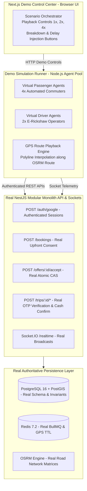
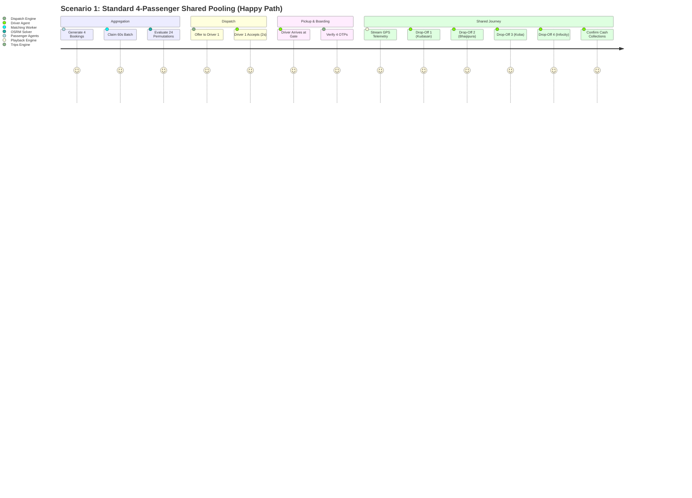
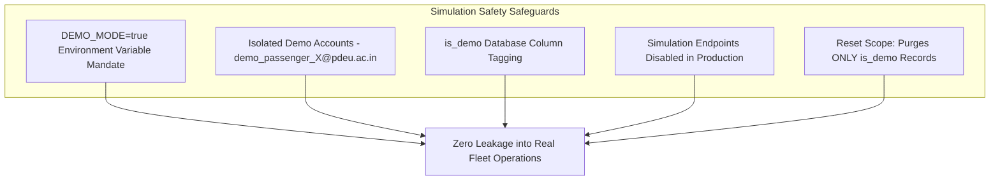

# Demo Simulation Architecture Specification

## On-Demand Aggregation Platform for Last-Mile Connectivity Using Shared Micro-Mobility

---

## 1. Purpose and Simulation Philosophy

The **Demo Simulation Architecture** enables predictable, repeatable, and interactive platform demonstrations for university evaluators without requiring 4 physical vehicles driving across Gandhinagar or 10 students standing at the campus gate.

### 1.1 The Golden Invariant: Real Backend, Real Logic
- **No Mocking of Core Business Logic:** The simulation engine executes through the **exact same NestJS backend, PostgreSQL database, PostGIS spatial queries, BullMQ workers, OSRM routing calls, proportional fare formulas, and Socket.IO gateways** as production.
- **Zero Direct Database Manipulation:** The simulator **never writes directly to database status columns** (`UPDATE bookings SET status = 'COMPLETED'`). All actions execute via authenticated REST API endpoints or authenticated WebSocket emissions.
- **The Only Simulated Element:** The origin of GPS coordinates (interpolated along real OSRM road polylines) and the timing of user button clicks (simulated virtual passengers and drivers).



---

## 2. Simulation Components

### 2.1 Next.js Demo Control Center
An interactive administrative web panel accessible at `http://localhost:3001/admin/simulation`:
- **Scenario Selector:** Dropdown menu offering pre-configured demonstration workflows (Happy Path 4-pax, Driver Rejection, Mid-Trip Breakdown, Passenger No-Show).
- **Time Acceleration Slider:** Multiplier toggles for **1x (Real-time)**, **2x (Double speed)**, and **4x (High speed)**. Accelerates GPS update intervals and waiting timers.
- **Interactive Disruption Injections:**
  - `Inject Breakdown`: Triggers an immediate mechanical failure on the active vehicle.
  - `Inject Rejection`: Forces the primary driver to reject the dispatch offer.
  - `Inject Passenger Cancellation`: Cancels Passenger 2 before or after assignment.
  - `Inject No-Show`: Simulates an unboarded commuter exceeding the 10-minute waiting window.
- **Reset Demo State:** Atomically wipes demo-tagged records (`is_demo = true`) while preserving base configuration data.

### 2.2 Virtual Passenger Agents
Autonomous software agents that simulate commuter behavior:
- Requests quotes for predefined destination corridors (Kudasan, Bhaijipura, Koba Circle, Infocity).
- Signs upfront consent and posts bookings to `POST /api/v1/bookings`.
- Automatically responds with their 4-digit OTP when the driver arrives at the pickup hub.
- Hands over simulated cash upon arrival at their destination.

### 2.3 Virtual Driver Agents
Autonomous software agents that simulate micro-mobility vehicle operators:
- Maintains online availability (`is_online = true`, `operational_status = 'AVAILABLE'`).
- Listens on `driver:{driverId}` socket rooms for `driver.offer.created`.
- Evaluates the offer and calls `POST /api/v1/drivers/offers/:id/accept` within 5 seconds.
- Simulates driving to the PDEU hub, clicking arrival, verifying OTPs, and starting the trip.

### 2.4 GPS Route Playback Engine
- When a trip starts, the playback engine extracts the GeoJSON `LineString` from `group_route_versions`.
- It calculates distance steps along the polyline corresponding to vehicle speeds (average 25 km/h for e-rickshaws).
- Every 3–5 seconds (scaled by the acceleration multiplier), it emits `driver.location.update` over WebSockets to the backend, accurately moving the vehicle along the Gandhinagar road network.

---

## 3. Pre-Configured Demonstration Scenarios



### 3.1 Scenario 1: Standard 4-Passenger Shared Corridor
- **Objective:** Demonstrates spatial clustering, permutation route optimization, 20s dispatch, OTP boarding, and proportional fare savings.
- **Steps:**
  1. 4 virtual passengers book shared rides from PDEU Main Gate heading along the Bhaijipura-Kudasan-Infocity corridor.
  2. Matching batch forms a 4-passenger group; evaluated total shared fare = ₹115.00 (passengers save 35%–50%).
  3. Offer dispatched to Driver 1; Driver 1 accepts within 3 seconds.
  4. Driver 1 arrives; all 4 passengers verify boarding via secure OTP.
  5. Vehicle navigates drop-off stops sequentially; cash confirmed per passenger; trip completed.

### 3.2 Scenario 2: Driver Rejection and Timeout Cascade
- **Objective:** Proves that driver rejection preserves passenger groups intact and cascades sequentially.
- **Steps:**
  1. Group G1 is formed and offered to Driver 1 (Rank #1).
  2. Evaluator clicks `Inject Rejection` (or allows 20s to elapse).
  3. Driver 1 offer marks `REJECTED` / `EXPIRED`.
  4. Passenger group **remains completely intact**; passengers are NOT returned to matching.
  5. Group cascades immediately to Driver 2 (Rank #2). Driver 2 accepts.

### 3.3 Scenario 3: Mid-Trip Driver Breakdown and Replacement Handover
- **Objective:** Demonstrates incident handling, manifest snapshotting, replacement dispatch, and 10% compensation discount.
- **Steps:**
  1. Vehicle departs PDEU with 3 passengers onboard.
  2. Between Stop 1 and Stop 2, evaluator clicks `Inject Breakdown`.
  3. Trip marks `INTERRUPTED`. Manifest snapshot captures remaining 2 passengers.
  4. IncidentsModule queries eligible nearby drivers and ranks by OSRM ETA.
  5. Replacement Driver (D2) receives transfer offer, accepts, and travels to breakdown location.
  6. Handover completed; trip returns to `IN_PROGRESS` (`trip.resumed` event).
  7. Onboard passengers receive an automatic **10% discount** on final fares.

### 3.4 Scenario 4: Passenger No-Show at Campus Gate
- **Objective:** Demonstrates the 10-minute waiting deadline, flat ₹30 penalty assessment, and zero-fee waiting charge capping.
- **Steps:**
  1. Driver arrives at PDEU pickup hub; waiting timer begins.
  2. Passenger 1 and 2 verify OTP and board. Passenger 3 fails to appear.
  3. Evaluator clicks `Advance Time (+10m)`.
  4. Driver app enables `DECLARE NO-SHOW`. Driver clicks button.
  5. Passenger 3 marked `NO_SHOW`; flat ₹30 fee inserted into `cancellation_fees` (`OUTSTANDING`). Waiting fee = ₹0.
  6. Vehicle departs with Passengers 1 and 2.

---

## 4. Security, Isolation, and Safety Safeguards



### 4.1 Safety Rules
1. **Disabled by Default:** The simulation engine and control endpoints are only mounted if `DEMO_MODE=true` is explicitly set in `.env`. In production (`NODE_ENV=production`), these endpoints throw HTTP 404 Not Found.
2. **Dedicated Demo Accounts:** Virtual agents authenticate using designated Google test accounts (`demo_student_1@pdeu.ac.in`, `demo_driver_1@pdeu.ac.in`).
3. **Data Tagging & Scoped Purge:** All records generated by virtual agents carry an `is_demo = true` database flag. When the evaluator clicks "Reset Demo", the backend executes:
   ```sql
   DELETE FROM bookings WHERE is_demo = true;
   DELETE FROM ride_groups WHERE is_demo = true;
   DELETE FROM trips WHERE is_demo = true;
   DELETE FROM cancellation_fees WHERE is_demo = true;
   ```
   Real student accounts, campus zone polygons, and tariff configurations remain completely untouched.

---

*End of Demo Simulation Architecture Specification*
