# Detailed Software Architecture and System Design Specification

## On-Demand Aggregation Platform for Last-Mile Connectivity Using Shared Micro-Mobility

---

## 1. Domain Module Deep Dives

The system is architected as an enterprise-grade **Modular Monolith** built on **NestJS 10+** and **TypeScript 5+**. It strictly separates business concerns into 14 cohesive domain modules with explicit ownership, dependency directions, and database boundaries.

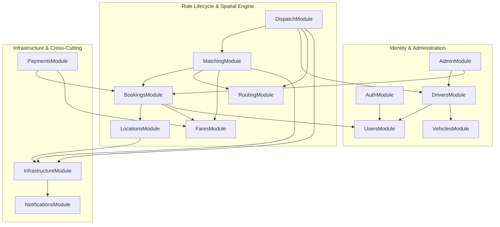

### 1.1 Detailed Module Ownership Matrix

| Module | Core Responsibilities | Owned Database Entities | Module Dependencies | Exported Services & Contracts |
|---|---|---|---|---|
| **`AuthModule`** | Google OAuth ID token verification, JWT access/refresh token generation, session rotation, logout revocation. | `refresh_tokens` | `UsersModule`, `InfrastructureModule` | `AuthService`, `JwtAuthGuard`, `RolesGuard` |
| **`UsersModule`** | User profile creation, role synchronization, profile querying, account state management. | `users` | `InfrastructureModule` | `UsersService` |
| **`DriversModule`** | Driver application lifecycle, profile details, operational status (`OFFLINE`, `AVAILABLE`, `RESERVED`, `ON_TRIP`), document tracking. | `driver_profiles`, `driver_documents` | `UsersModule`, `VehiclesModule`, `InfrastructureModule` | `DriversService`, `DriverEligibilityService` |
| **`VehiclesModule`** | Vehicle registration, seating capacity validation (1–8 seats), active vehicle linkage to drivers. | `vehicles` | `InfrastructureModule` | `VehiclesService` |
| **`BookingsModule`** | Passenger ride creation, active booking invariant enforcement, cancellation management, status state machine. | `bookings` | `UsersModule`, `LocationsModule`, `FaresModule`, `InfrastructureModule` | `BookingsService`, `BookingStateService` |
| **`LocationsModule`** | PostGIS geofence checks (150m PDEU radius), service polygon validation, driver GPS ingestion and Redis caching. | `pickup_zones`, `service_regions`, `ride_locations` | `InfrastructureModule` | `LocationsService`, `GeofenceGuard` |
| **`RoutingModule`** | Integration with local OSRM engine. Many-to-many travel time matrices (Table API) and polyline route summaries (Route API). | None (Stateless Client) | `InfrastructureModule` | `RoutingService`, `OsrmClient` |
| **`FaresModule`** | Solo fare calculation, proportional shared fare cost allocation, ₹30 late cancellation fee assessment, ledger querying. | `cancellation_fees` | `InfrastructureModule` | `FaresService`, `CancellationFeeLedgerService` |
| **`MatchingModule`** | Zone-level batch accumulation, distributed batch leases, candidate grouping, permutation route evaluation ($k! \le 24$). | `matching_batches`, `batch_bookings`, `ride_groups`, `group_members` | `BookingsModule`, `RoutingMod`, `FaresMod`, `InfraMod` | `MatchingBatchProcessor`, `PermutationSolver` |
| **`DispatchModule`** | Sequential 1-to-1 driver dispatching, 20s timeout scheduling, atomic driver reservation transactions, offer cascades. | `driver_dispatch_offers`, `ride_assignments`, `rides` | `MatchingMod`, `DriversMod`, `RoutingMod`, `InfraMod` | `DispatchService`, `DriverAssignmentService` |
| **`PaymentsModule`** | Physical cash collection auditing, fee ledger settlement (`OUTSTANDING` $\rightarrow$ `COLLECTED`), dispute records. | `cash_payment_records` | `BookingsMod`, `FaresMod`, `InfraMod` | `PaymentsService`, `CashReconciliationService` |
| **`NotificationsModule`** | Realtime Socket.IO gateway, authenticated room management, WebSocket event dispatch. | None (Ephemeral Sockets) | `InfrastructureModule` | `NotificationsGateway`, `SocketBroadcaster` |
| **`AdminModule`** | Privileged back-office operations: driver review/approval, operational metrics, fee waiver adjudication. | `admin_audit_logs` | `DriversMod`, `BookingsMod`, `PaymentsMod`, `FaresMod` | `AdminService` |
| **`InfrastructureModule`**| Central Prisma database client, Redis ioredis client, BullMQ queue instances, Transactional Outbox publisher. | `outbox_events`, `idempotency_records` | None (Foundation Layer) | `PrismaService`, `RedisService`, `OutboxService` |

---

## 2. Algorithm and Mathematics Specification

### 2.1 Zone-Level Batch Execution and Distributed Leases
To eliminate race conditions between concurrent worker processes, batch matching is serialized at the pickup zone level:
1. **Periodic Window:** Every 60 seconds (or when $\ge 4$ eligible bookings accumulate), a BullMQ job `process-zone-batch` triggers for the PDEU pickup hub (`pickup_zone_id`).
2. **Distributed Zone Lease:** The worker attempts to acquire an atomic Redis lease:
   ```text
   SET lease:matching:pdeu <worker_uuid> NX PX 30000
   ```
   If the key already exists, another worker is actively executing a batch; the job terminates safely.
3. **Cutoff Timestamp:** The worker establishes a strict cutoff timestamp $T_{\text{cutoff}} = \text{NOW}()$. All bookings created with $T \le T_{\text{cutoff}}$ are included in the batch. New bookings arriving during execution automatically enter the subsequent batch.

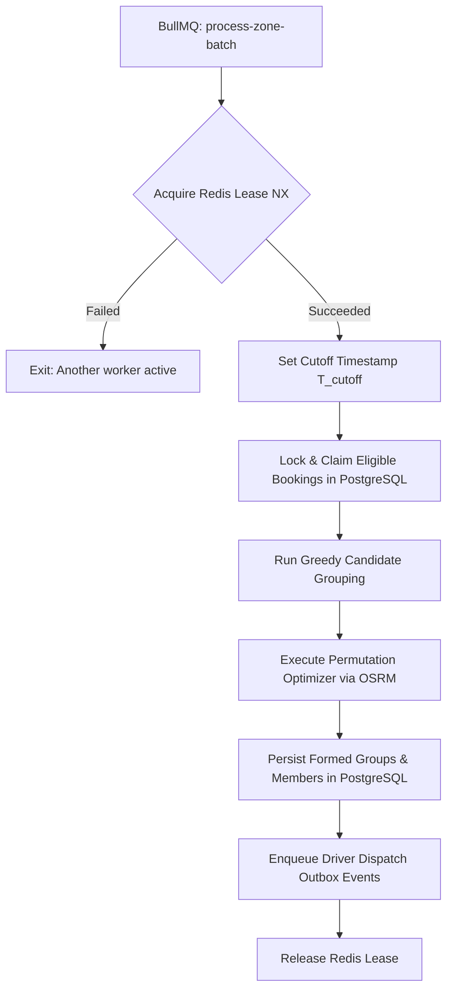

### 2.2 Greedy Candidate Grouping Algorithm
To prevent combinatorial explosion across large passenger pools, candidate clusters are selected using a greedy spatial heuristic:
1. Load all eligible `SHARED` bookings within the zone that are not currently claimed and have $T_{\text{wait}} \le 120\text{ seconds}$.
2. Sort bookings by creation timestamp ascending (oldest booking acts as the **Seed Booking** $B_{\text{seed}}$).
3. Identify candidates whose destinations are within a bounded spatial angle ($\theta \le 45^\circ$) or Euclidean distance from $B_{\text{seed}}$'s trajectory.
4. Form candidate groups of sizes $k \in \{4, 3, 2\}$.

```text
Algorithm: GreedyCandidateGrouping
Input: Eligible Bookings E, Pickup Hub P
Output: Feasible Groups G

while E is not empty do:
    seed = RemoveOldestBooking(E)
    candidates = FindNearbyCompatibleBookings(seed, E, shortlist_limit=8)
    best_group = null
    best_score = infinity

    for size k from min(4, |candidates|+1) down to 2 do:
        for each combination C in Combinations(candidates, k - 1) do:
            group_cluster = {seed} union C
            route_solution = OptimizePermutationRoute(P, group_cluster)
            if route_solution.is_feasible then
                if route_solution.total_duration < best_score then
                    best_group = route_solution
                    best_score = route_solution.total_duration
                end if
            end if
        end for
        if best_group is not null then break; // Greedily prefer larger groups (4 > 3 > 2)
    end for

    if best_group is not null then
        G.add(best_group)
        E = E \ best_group.members
    else
        // Keep seed eligible for next batch unless wait time exceeds 120s
    end if
end while
```

### 2.3 Permutation-Based Drop-Off Route Optimizer
Because all passengers share a single common origin (the PDEU pickup hub), the pickup order is constant ($P$). The optimization problem reduces to finding the optimal sequence of drop-off stops:
- For $k = 4$ passengers, the number of possible drop-off sequences is:
  $$k! = 4! = 4 \times 3 \times 2 \times 1 = 24\text{ permutations}$$
- For $k = 3$, $3! = 6$ permutations; for $k = 2$, $2! = 2$ permutations.

```mermaid
flowchart LR
    Origin[Common Pickup Hub: PDEU] --> S1[Candidate Permutation 1: P -> D1 -> D2 -> D3 -> D4]
    Origin --> S2[Candidate Permutation 2: P -> D1 -> D3 -> D2 -> D4]
    Origin --> S3[Candidate Permutation ... (Up to 24 Orders)]
    Origin --> S24[Candidate Permutation 24: P -> D4 -> D3 -> D2 -> D1]
    
    S1 & S2 & S3 & S24 --> Eval[Evaluate Detour Constraints <= 25%]
    Eval --> Pick[Select Lowest Total Vehicle Duration]
```

#### Step-by-Step Solver Execution:
1. **Single Matrix Query (OSRM Table API):** The worker calls the OSRM Table API once for the coordinate set $\{P, D_1, D_2, D_3, D_4\}$. This returns a $5 \times 5$ duration matrix $M$ where $M_{i,j}$ represents the road-network driving time from location $i$ to location $j$.
2. **Local In-Memory Permutation Enumeration:** The worker evaluates all $k!$ drop-off sequences locally in microseconds using the matrix values, calculating cumulative arrival times at each stop.
3. **Direct vs. Shared Detour Evaluation:**
   For each passenger $i$, direct travel time is $T_i^{\text{direct}} = M_{P, D_i}$.
   Shared travel time $T_i^{\text{shared}}$ is the cumulative driving time along the evaluated permutation until stop $D_i$.
   The individual detour percentage is defined as:
   $$\text{detour}_i = \left( \frac{T_i^{\text{shared}} - T_i^{\text{direct}}}{T_i^{\text{direct}}} \right) \times 100$$
4. **Feasibility Filter:** Any permutation where $\exists i : \text{detour}_i > 25.0\%$ is immediately discarded as infeasible.
5. **Objective Function Evaluation:** Among all feasible permutations, the solver selects the route minimizing total vehicle trip duration:
   $$\min_{\pi \in \Pi_{\text{feasible}}} T_{\text{total}}(\pi)$$
   *(Note: An advanced objective incorporating a passenger detour penalty coefficient $\lambda$, $J = T_{\text{total}} + \lambda \sum \text{detour}_i$, is mathematically formulated but remains PROPOSED for post-MVP tuning).*
6. **Geometry Generation (OSRM Route API):** A single call to OSRM Route API retrieves the final polyline coordinates and turn-by-turn geometry for the selected winning sequence.

---

## 3. Fare Calculation Formula and Worked Numerical Example

### 3.1 Proportional Solo-Fare Allocation Formula
To guarantee fairness, shared trip costs are allocated proportionally based on each commuter's standalone solo benchmark fare.

$$F_i = F_{\text{shared\_total}} \times \frac{\text{solo\_fare}_i}{\sum_{j=1}^{k} \text{solo\_fare}_j}$$

Where:
- $F_i$: Allocated fare charged to passenger $i$.
- $\text{solo\_fare}_i$: The benchmark fare passenger $i$ would have paid for an exclusive private ride.
- $F_{\text{shared\_total}}$: The total negotiated fare paid to the driver for the shared multi-stop journey.
- $\sum_{j=1}^{k} \text{solo\_fare}_j$: Sum of solo fares across all $k$ passengers in the group.

### 3.2 Worked Numerical Example
Consider 3 students sharing an E-Rickshaw from PDEU Main Gate:
- **Passenger 1 (Destination: Bhaijipura Cross Road):** Direct distance = 2.5 km $\rightarrow$ Solo benchmark fare = **₹60.00**
- **Passenger 2 (Destination: Kudasan Circle):** Direct distance = 4.2 km $\rightarrow$ Solo benchmark fare = **₹90.00**
- **Passenger 3 (Destination: Infocity Gate):** Direct distance = 6.0 km $\rightarrow$ Solo benchmark fare = **₹120.00**

#### Step 1: Calculate Sum of Solo Fares
$$\sum \text{solo\_fare}_j = 60.00 + 90.00 + 120.00 = ₹270.00$$

#### Step 2: Establish Total Shared Trip Fare
Assume the platform's multi-stop shared vehicle tariff yields a total driver fare of:
$$F_{\text{shared\_total}} = ₹160.00$$
*(Notice: The driver earns ₹160.00 instead of a single ₹90.00 fare, increasing earnings by 77%).*

#### Step 3: Apply Proportional Allocation
- **Passenger 1:**
  $$F_1 = 160.00 \times \frac{60.00}{270.00} = 160.00 \times 0.2222 = ₹35.55 \rightarrow \mathbf{₹36.00}$$
  *(Savings: ₹60.00 vs ₹36.00 = 40% reduction).*
- **Passenger 2:**
  $$F_2 = 160.00 \times \frac{90.00}{270.00} = 160.00 \times 0.3333 = ₹53.33 \rightarrow \mathbf{₹53.00}$$
  *(Savings: ₹90.00 vs ₹53.00 = 41% reduction).*
- **Passenger 3:**
  $$F_3 = 160.00 \times \frac{120.00}{270.00} = 160.00 \times 0.4444 = ₹71.11 \rightarrow \mathbf{₹71.00}$$
  *(Savings: ₹120.00 vs ₹71.00 = 41% reduction).*

#### Step 4: Sum and Remainder Allocation
$$36.00 + 53.00 + 71.00 = ₹160.00\text{ (Exact match)}$$
*(Pending Decision: Exact integer rounding and remainder distribution rules to the highest fare payer remain marked as PENDING).*

---

## 4. Driver Dispatch and Multi-Offer Architecture

### 4.1 The Core Distinction: Multi-Offer Capability vs. 1-to-1 Dispatch
The dispatch engine operates on a fundamental asymmetry:
- **Rule 1 (1-to-1 Group Dispatch):** A given ride group is offered to **EXACTLY ONE driver at a time**. It is never broadcast simultaneously to multiple drivers.
- **Rule 2 (Driver Multi-Offer Receipt):** A given driver **MAY RECEIVE MULTIPLE PENDING OFFERS** for different ride groups simultaneously if they are the top-ranked candidate for both.

```mermaid
flowchart TD
    subgraph Groups Waiting For Dispatch
      G1[Group 1: 3 Pax to Kudasan]
      G2[Group 2: 2 Pax to Bhaijipura]
    end

    subgraph Available Drivers
      D1[Driver 1: ETA 2 mins]
      D2[Driver 2: ETA 4 mins]
      D3[Driver 3: ETA 6 mins]
    end

    G1 -->|Offer 1 sent 1-to-1| D1
    G2 -->|Offer 2 sent 1-to-1| D1

    Note over D1: Driver 1 has 2 pending offer cards
    D1 -->|Driver 1 Accepts Offer 1| Commit[Atomic Acceptance Transaction]
    Commit --> Lock[Driver 1 Reserved for Group 1]
    Commit --> Withdraw[Offer 2 Withdrawn from Driver 1]
    Withdraw --> ReOffer[Group 2 offered 1-to-1 to Driver 2]
    ReOffer --> D2
```

### 4.2 Driver Rejection and Timeout Scenarios
1. **Explicit Rejection:**
   - Driver taps "Decline".
   - Record in `driver_dispatch_offers` transitions to `status = 'REJECTED'`.
   - Driver ID is added to the exclusion list for this group version.
   - Group remains intact. Dispatch cascades immediately to the next eligible driver.
2. **Offer Timeout (20-Second Expiry):**
   - BullMQ delayed job `handle-driver-offer-timeout` fires after 20 seconds.
   - If offer status is still `PENDING`, it transitions to `status = 'EXPIRED'`.
   - Driver ID is excluded for this group version.
   - Dispatch cascades immediately to the next eligible driver.
3. **Scoped Driver Exclusion Invariant:**
   - Exclusion is scoped strictly to `(ride_group_id, group_version, dispatch_attempt_id)`.
   - If Passenger B cancels, group version increments ($V \rightarrow V+1$). Driver D1 becomes eligible again to receive an offer for the newly reconfigured group.

---

## 5. Passenger Cancellation and Late Fee Recovery Engine

### 5.1 State-Dependent Cancellation Workflows

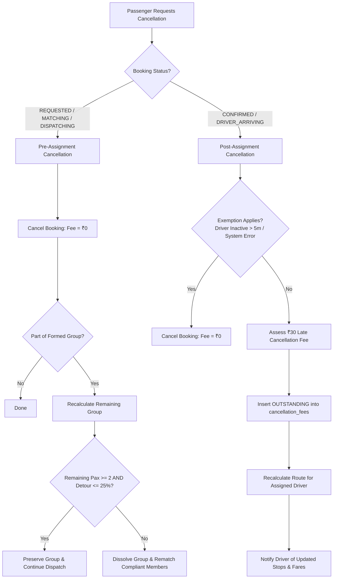

### 5.2 Next-Ride Cash Fee Recovery Pipeline
Because payments are strictly cash-settled, outstanding cancellation fees are recovered on the passenger's subsequent ride:
1. **Fee Ledger Query:** When the passenger prepares their next booking, the mobile client queries `GET /passengers/cancellation-fees/outstanding`.
2. **Transparent Upfront Disclosure:** The booking screen renders:
   - Base Ride Fare: ₹50.00
   - Prior Unpaid Fee: ₹30.00
   - **Total Payable in Cash: ₹80.00**
3. **Driver Confirmation Transaction:**
   When the driver completes the ride and calls `POST /payments/:id/confirm-cash`, PostgreSQL executes an atomic transaction:
   ```sql
   BEGIN;
   -- 1. Insert Cash Payment Record
   INSERT INTO cash_payment_records (booking_id, driver_id, fare_amount, cancellation_fee_amount, total_cash_collected, payment_status)
   VALUES (:bookingId, :driverId, 50.00, 30.00, 80.00, 'PAID');

   -- 2. Update Cancellation Fee Ledger Atomically
   UPDATE cancellation_fees 
   SET status = 'COLLECTED', collected_at = NOW(), collected_booking_id = :bookingId
   WHERE passenger_id = :passengerId AND status = 'OUTSTANDING';

   -- 3. Update Booking Payment State
   UPDATE bookings SET status = 'COMPLETED' WHERE id = :bookingId;
   COMMIT;
   ```
4. **Anti-Double-Collection Guarantee:** The database partial unique index `idx_unique_collected_booking_fee` prevents any cancellation fee from being attached to multiple bookings or marked collected twice.

---

## 6. Realtime GPS Telemetry Architecture

### 6.1 Telemetry Streaming Topology

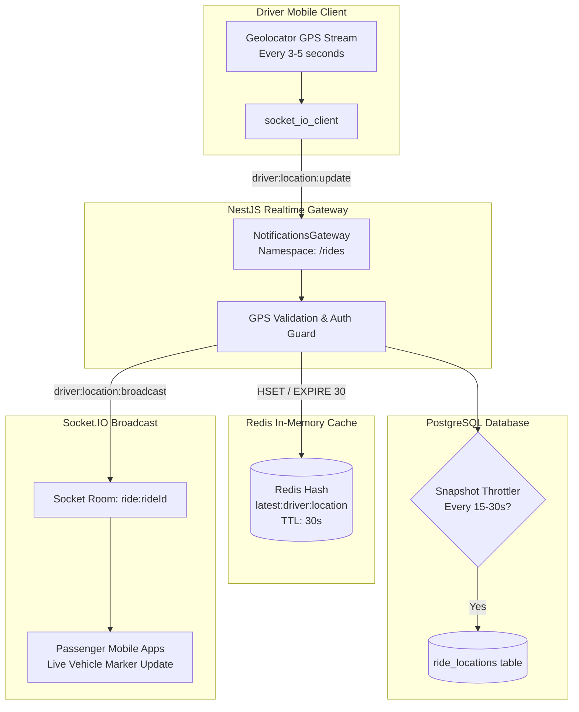

### 6.2 Connection Lifecycle and Stale GPS Detection
- **Heartbeat & Keep-Alive:** Socket.IO ping/pong intervals are configured to 10 seconds.
- **Stale GPS Trigger:** If a driver app loses connectivity (enters a cellular dead zone or battery dies), Redis TTL expires after 30 seconds.
- If the passenger app does not receive a `driver:location:broadcast` event for $> 15$ seconds, the client UI automatically displays a **"Driver GPS Signal Stale"** warning badge.
- **REST Synchronization on Reconnection:** When the mobile client re-establishes a broken network connection, it is strictly forbidden from relying on queued socket events; it executes a synchronous REST query (`GET /bookings/active`) to re-sync its state machine.

---

## 7. Comprehensive Failure Handling and Concurrency Matrix

The platform implements explicit, deterministic recovery procedures for every distributed failure scenario:

| # | Failure Scenario | Root Cause | Detection Mechanism | Database State Before Recovery | Database State After Recovery | Compensation / Recovery Strategy | Idempotency & User Outcome |
|---|---|---|---|---|---|---|---|
| **1** | API crashes after booking creation | Process crash during outbox commit | OS process monitor / HTTP 502 | `bookings` row exists; `outbox_events` is `PENDING` | `outbox_events` remains `PENDING` until worker restart | Worker background poller reads pending outbox events on restart and enqueues BullMQ matching job. | Client retries `POST /bookings` with same `Idempotency-Key`; returns existing booking. |
| **2** | API crashes after group creation | Server restart mid-dispatch | Worker lease expiry | `ride_groups` status `DISPATCHING`; no driver assigned | `ride_groups` status `DISPATCHING` | Recovery poller detects orphaned group without active dispatch offer; re-triggers driver ranking. | Passengers see status `MATCHING`; zero data loss. |
| **3** | Worker crashes while matching batch | Node process killed or OOM | Redis lease `lease:matching:pdeu` expires (30s) | `matching_batches` is `PROCESSING`; bookings claimed | Batch marked `FAILED`; bookings released back to `REQUESTED` | Subsequent batch run re-claims bookings. If max wait deadline ($120\text{s}$) exceeded, triggers private fallback. | Passengers experience brief matching delay; original booking creation timestamps preserved. |
| **4** | Worker crashes during driver dispatch | Process restart mid-offer | Delayed BullMQ job stalled check | `driver_dispatch_offers` has `status = 'PENDING'` | Offer marked `EXPIRED`; cascades to next driver | BullMQ stalled job auditor identifies timed-out offer; initiates cascade to driver D2. | Driver D1 offer dismisses; D2 receives offer. |
| **5** | Redis becomes unavailable | Redis service crash or restart | ioredis error handler trips circuit breaker | PostgreSQL state is fully consistent; Redis cache empty | PostgreSQL unaffected; Redis state rebuilt | Outbox publisher pauses; writes continue into PostgreSQL `outbox_events`. When Redis returns, publisher resumes. | Matching temporarily pauses; GPS displays "Stale GPS"; no booking loss. |
| **6** | PostgreSQL becomes unavailable | DB connectivity failure | TypeORM/Prisma connection pool error | DB inaccessible | DB restored from WAL | Fail closed immediately. REST returns `503 Service Unavailable`. In-flight transactions roll back. | Clients show retry banner; transactions roll back safely. |
| **7** | OSRM becomes unavailable | OSRM routing container crash | Circuit breaker detects 2500ms timeout | Batches accumulate in `REQUESTED` state | Unchanged | Pause matching batch processing. Do not fabricate straight-line travel times. If down $> 60\text{s}$, offer private ride or cancel. | Passenger informed that routing service is temporarily unavailable. |
| **8** | Driver disconnects during active trip | Cellular dead zone or dead phone | Socket.IO disconnect event | `rides.status = 'IN_PROGRESS'` | Unchanged | Trip remains active. Redis location key expires after 30s. Passenger app displays "Driver Signal Stale". | Driver completes trip upon reconnect; manual admin override available if required. |
| **9** | Passenger disconnects during matching | Commuter phone locks or loses signal | Socket disconnect | `bookings.status = 'MATCHING'` | Unchanged | Passenger matching and driver dispatch proceed automatically due to upfront consent. | When passenger reconnects, REST `GET /bookings/active` returns confirmed ride. |
| **10**| Socket.IO event is lost | UDP/TCP network packet drop | None (Sockets are lossy) | Consistent in DB | Consistent in DB | None needed. Critical actions require REST commands. Sockets are purely for UI notifications. | Client polling on app resume reconciles truth. |
| **11**| Duplicate API request (Double Tap) | User taps "Book Ride" twice rapidly | Unique `Idempotency-Key` constraint | First request inserts booking | Second request hits idempotency index | Database unique constraint on `idempotency_records` catches duplicate; returns cached 201 response. | User sees single booking; no double charge. |
| **12**| Duplicate BullMQ job execution | Redis network glitch or worker retry | Authoritative UUID status check | State already updated by first job | Job terminates as no-op | Job consumer reads current PostgreSQL row status. If status is already `DISPATCHING`, job exits. | Exactly-once business state mutation. |
| **13**| Two drivers accept same group simultaneously | Race condition on offer accept | Row-level locking on `ride_groups` | Both drivers see `PENDING` offer | Driver 1 assigned; Driver 2 update fails | PostgreSQL transaction locks `ride_groups` with `FOR UPDATE`. First driver updates status; second receives `409 Conflict`. | Driver 1 wins ride; Driver 2 sees "Offer Claimed by Another Driver". |
| **14**| One driver accepts two groups simultaneously | Driver taps accept on 2 offer cards | Conditional update on `driver_profiles` | Driver status `AVAILABLE` | First accept sets `RESERVED`; second hits 0 rows | Conditional update `WHERE id = :id AND operational_status = 'AVAILABLE'`. Second update affects 0 rows and aborts. | Driver assigned to first accepted group; second card dismissed. |
| **15**| Two workers process same zone batch | Clock skew or multi-worker trigger | Redis atomic `SET NX` distributed lock | No batch record | Exactly one batch created | First worker acquires `lease:matching:pdeu`. Second worker fails to acquire lock and exits immediately. | Only one matching batch runs at a time. |
| **16**| Passenger cancels racing driver acceptance | Passenger taps cancel as driver taps accept | Row lock on `bookings` and `ride_groups` | Booking `MATCHING`, Driver accepting | Whichever transaction commits first serializes | If driver accepts first: cancellation incurs ₹30 late fee. If passenger cancels first: driver accept finds member removed. | Clear, deterministic state machine outcome. |
| **17**| Passenger cancels racing group formation | Passenger cancels during batch solver | Row lock in `BookingsService.claim()` | Booking `REQUESTED` | Booking marked `CANCELLED`; solver drops it | Matching transaction checks booking status before final commit; ignores cancelled booking. | Passenger booking cancelled with zero fee. |
| **18**| Driver offer expires while driver accepting | Driver taps accept at second 20.1 | Atomic conditional check on `expires_at` | Offer `status = 'PENDING'` | Offer marked `EXPIRED` | Acceptance transaction checks `WHERE expires_at > NOW()`. If expired, returns `409 Conflict`. | Driver sees "Offer Expired"; group cascades to next driver. |
| **19**| Outbox publisher worker crashes | Worker node killed | Poller resume on startup | Events remain `status = 'PENDING'` | Events updated to `PUBLISHED` on reboot | Outbox poller scans for `PENDING` events ordered by `created_at`; enqueues into BullMQ. | Jobs guaranteed to publish; at-least-once delivery. |
| **20**| Notification delivery fails | Socket server error | None (Best-effort push) | DB state is committed | DB state is committed | Critical notifications backed by REST queries on client resume. | Zero impact on transactional integrity. |
| **21**| Redis contains stale GPS data | Driver phone abruptly shut down | Redis 30-second TTL | Volatile GPS key present | Key evicted after 30 seconds | Automated TTL removes dead keys. Passenger UI shows "Driver Offline". | Passenger alerted to lost telemetry. |
| **22**| Group becomes infeasible after cancellation | Co-passenger cancels; 1 pax remains | Re-validation engine | `ride_groups.status = 'DISPATCHING'` | Group marked `DISSOLVED`; member rematches | Remaining passenger returned to matching with original booking timestamp preserved. | Passenger notified: "Finding new companions; original deadline preserved". |

---

## 8. Complete End-to-End Sequence Diagrams

### 8.1 Workflow 1: Google OAuth Authentication
Flutter client exchanges Google ID token for platform JWT access and refresh tokens.

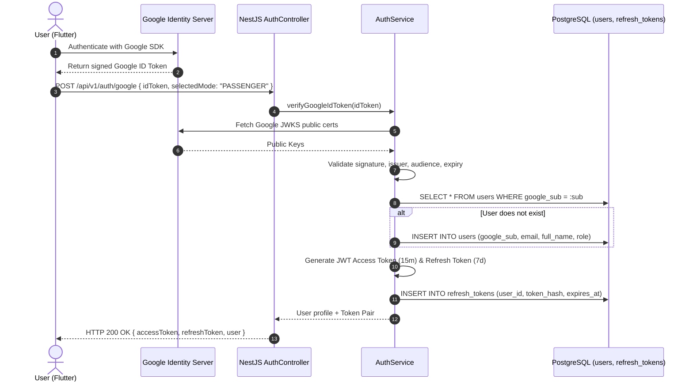

---

### 8.2 Workflow 2: Driver Onboarding and Admin Approval
Driver registers vehicle, submits documents, and waits for administrator verification before going online.

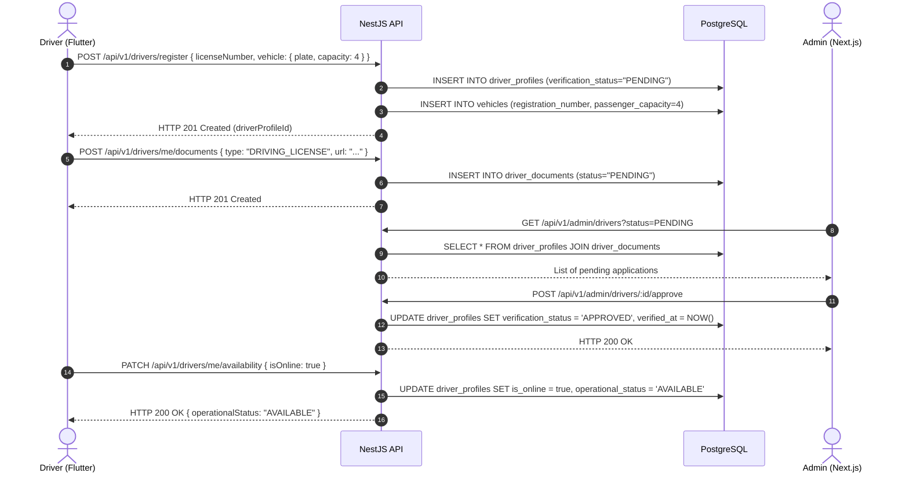

---

### 8.3 Workflow 3: Passenger SHARED Booking with Upfront Consent
Passenger books a shared ride, accepts constraints upfront, and enters the matching queue.

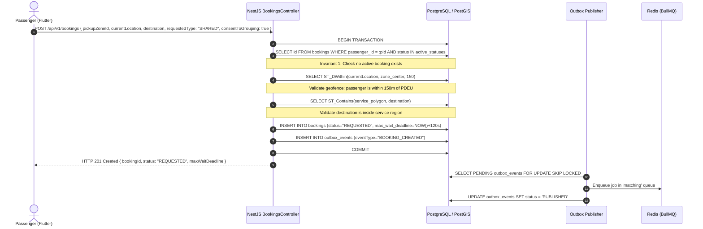

---

### 8.4 Workflow 4: Passenger PRIVATE Booking Direct Dispatch
Passenger requests an exclusive private ride, bypassing the batch matching algorithm.

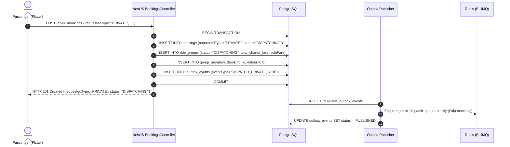

---

### 8.5 Workflow 5: Matching Batch Execution and Permutation Optimization
Worker acquires distributed zone lease, loads candidate bookings, evaluates permutations via OSRM, and creates a ride group.

```mermaid
sequenceDiagram
    autonumber
    participant WRK as Worker (MatchingProcessor)
    participant RD as Redis (Lease)
    participant PG as PostgreSQL
    participant OSRM as OSRM Table & Route API
    participant OB as Outbox Publisher

    WRK->>RD: SET lease:matching:pdeu <uuid> NX PX 30000
    RD-->>WRK: OK (Lease Acquired)
    WRK->>PG: SELECT * FROM bookings WHERE pickup_zone_id = :pdeu AND status = 'REQUESTED' FOR UPDATE
    WRK->>WRK: Form candidate cluster {B1, B2, B3}
    WRK->>OSRM: POST /table/v1/driving (PDEU + 3 destinations)
    OSRM-->>WRK: 4x4 Duration & Distance Matrix
    WRK->>WRK: Evaluate 3! = 6 drop-off permutations locally
    WRK->>WRK: Check individual detours <= 25%; pick lowest total vehicle duration
    WRK->>OSRM: GET /route/v1/driving (Optimal stop order)
    OSRM-->>WRK: Full route polyline geometry & road distance
    WRK->>PG: BEGIN TRANSACTION
    WRK->>PG: INSERT INTO ride_groups (status="DISPATCHING", total_shared_fare, route_geometry)
    WRK->>PG: INSERT INTO group_members (allocating proportional fares)
    WRK->>PG: UPDATE bookings SET status = 'MATCHING' WHERE id IN (B1, B2, B3)
    WRK->>PG: INSERT INTO outbox_events (eventType="GROUP_FORMED_DISPATCH_TRIGGERED")
    WRK->>PG: COMMIT
    WRK->>RD: DEL lease:matching:pdeu (Release Lease)
```

---

### 8.6 Workflow 6: Group Formation (Upfront Consent Path)
Illustrates how formed groups proceed immediately to driver dispatch without passenger acceptance voting.

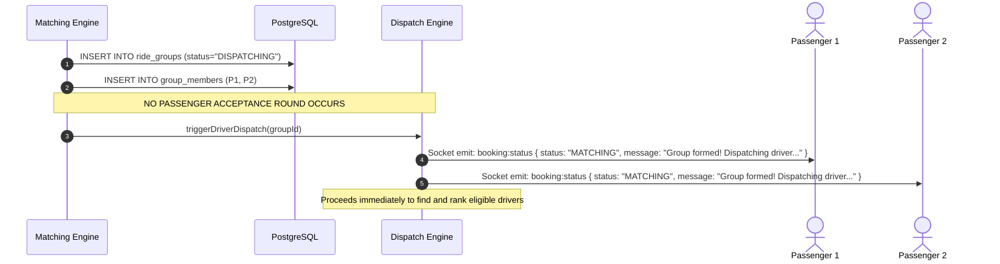

---

### 8.7 Workflow 7: Driver Dispatch (Sequential 1-to-1 Offer)
Dispatch engine ranks eligible drivers by ETA and sends an offer to the closest candidate with a 20-second timer.

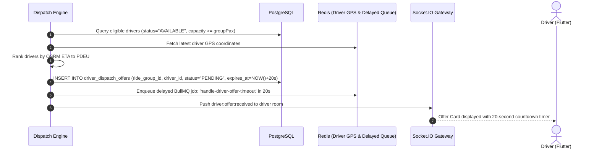

---

### 8.8 Workflow 8: Driver Rejects Dispatch Offer
Driver explicitly declines offer; group stays intact, driver is excluded, and offer cascades to next driver.

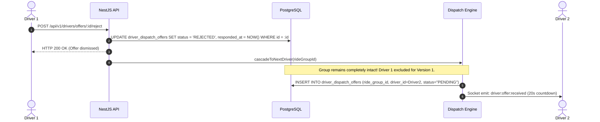

---

### 8.9 Workflow 9: Driver Offer Timeout (20-Second Expiry)
Driver fails to respond within 20 seconds; system auto-expires offer and cascades to next candidate.

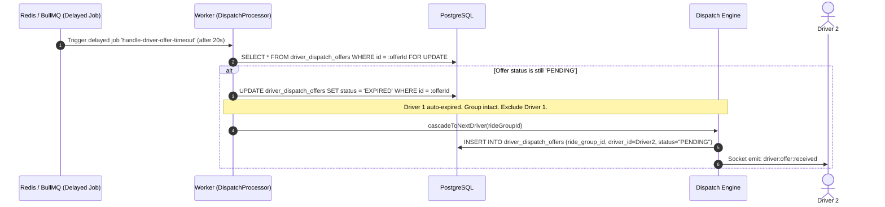

---

### 8.10 Workflow 10: Atomic Driver Acceptance Transaction
Driver accepts offer; atomic transaction locks group, reserves driver, withdraws competing offers, and confirms ride.

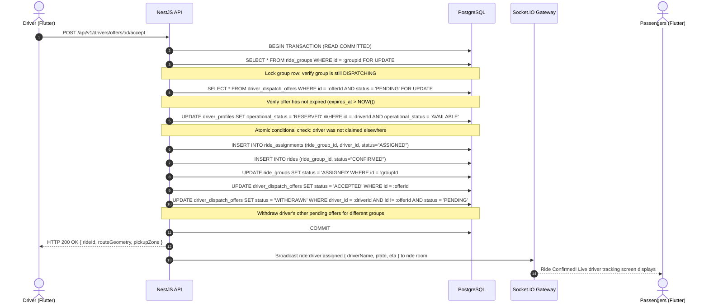

---

### 8.11 Workflow 11: Two Drivers Race to Accept the Same Group
Concurrency race where two drivers attempt to claim the same group offer simultaneously.

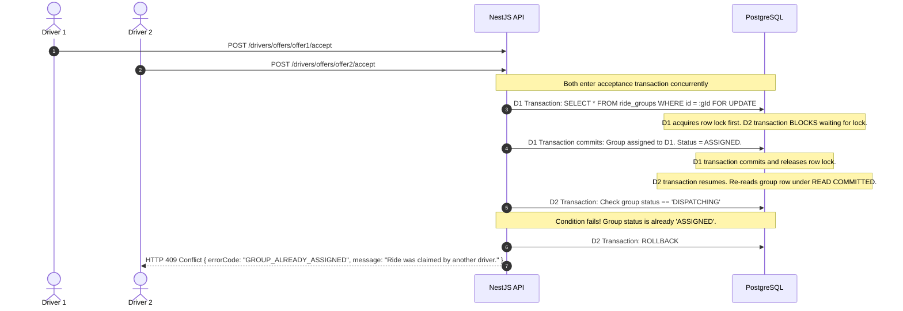

---

### 8.12 Workflow 12: Passenger Cancellation Before Driver Assignment
Passenger cancels while booking is matching or dispatching; free cancellation, group recalculated.

```mermaid
sequenceDiagram
    autonumber
    actor P1 as Passenger 1
    participant API as NestJS BookingsController
    participant PG as PostgreSQL
    participant Dispatch as Dispatch Engine
    actor P2 as Passenger 2

    P1->>API: POST /api/v1/bookings/:id/cancel
    API->>PG: BEGIN TRANSACTION
    API->>PG: UPDATE bookings SET status = 'CANCELLED' WHERE id = :p1BookingId
    API->>PG: UPDATE group_members SET is_active_member = false WHERE booking_id = :p1BookingId
    Note over API,PG: No fee assessed (driver was not yet assigned)
    API->>API: Re-evaluate remaining group feasibility (P2 alone)
    alt Remaining group < 2 passengers
        API->>PG: UPDATE ride_groups SET status = 'DISSOLVED' WHERE id = :groupId
        API->>PG: UPDATE bookings SET status = 'REQUESTED' WHERE id = :p2BookingId
        Note over API,PG: P2 returned to matching; original booking deadline preserved!
    end
    API->>PG: COMMIT
    API-->>P1: HTTP 200 OK { lateCancellationFee: 0.00 }
    API->>P2: Socket emit: booking:status { status: "MATCHING", message: "Co-passenger cancelled. Re-matching you now..." }
```

---

### 8.13 Workflow 13: Passenger Cancellation After Driver Assignment (Late Fee Assessed)
Passenger cancels after driver accepted; ₹30 late cancellation fee assessed into ledger.

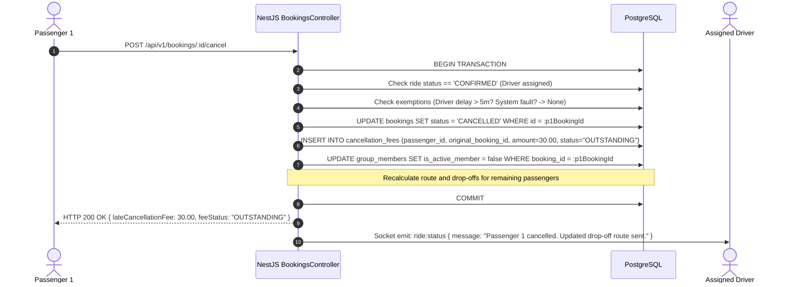

---

### 8.14 Workflow 14: Group Dissolution and Rematching
Remaining group drops below minimum size; group dissolved, remaining compliant members rematched with original deadlines preserved.

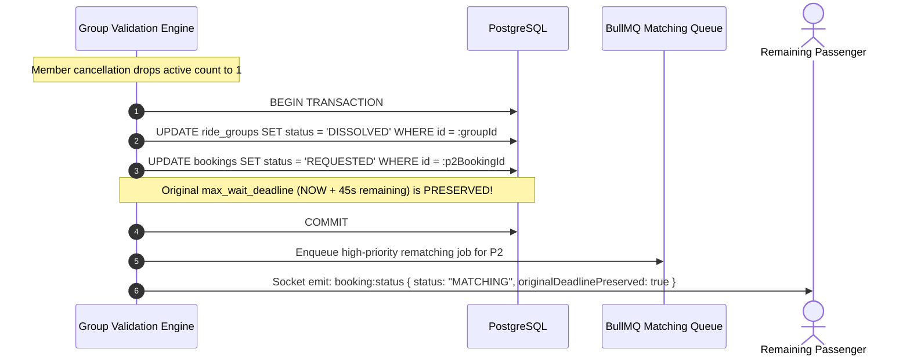

---

### 8.15 Workflow 15: Cancellation Fee Collection on Next Ride
Passenger books subsequent ride; fee added to cash breakdown; driver confirms cash; fee marked collected.

```mermaid
sequenceDiagram
    autonumber
    actor P as Passenger
    actor D as Driver
    participant API as NestJS API
    participant PG as PostgreSQL

    P->>API: POST /api/v1/bookings (New Ride)
    API->>PG: SELECT * FROM cancellation_fees WHERE passenger_id = :pId AND status = 'OUTSTANDING'
    Note over API,P: Discloses fare: Current Ride (₹50) + Unpaid Fee (₹30) = Total Cash ₹80
    API-->>P: Booking created { totalCashDue: 80.00 }

    Note over P,D: Ride completes physically. Passenger hands ₹80 cash to Driver.
    D->>API: POST /api/v1/payments/:id/confirm-cash { amountCollected: 80.00 }
    API->>PG: BEGIN TRANSACTION
    API->>PG: INSERT INTO cash_payment_records (booking_id, fare_amount=50.00, cancellation_fee_amount=30.00, total_cash_collected=80.00)
    API->>PG: UPDATE cancellation_fees SET status = 'COLLECTED', collected_at = NOW(), collected_booking_id = :newBookingId WHERE passenger_id = :pId AND status = 'OUTSTANDING'
    API->>PG: UPDATE bookings SET status = 'COMPLETED' WHERE id = :newBookingId
    API->>PG: COMMIT
    API-->>D: HTTP 200 OK (Payment settled)
```

---

### 8.16 Workflow 16: Driver GPS Update and Passenger Live Tracking
Driver streams high-frequency GPS fixes to Redis; gateway broadcasts to passengers; periodic PostgreSQL snapshot.

```mermaid
sequenceDiagram
    autonumber
    actor Driver as Driver (Flutter)
    participant SIO as Socket.IO Gateway
    participant RD as Redis (30s TTL)
    participant PG as PostgreSQL (Snapshots)
    actor Passenger as Passenger (Flutter)

    loop Every 3-5 seconds while trip is IN_PROGRESS
        Driver->>SIO: Emit driver:location:update { lat: 23.156, lng: 72.668, heading: 90 }
        SIO->>RD: HSET driver:location:<driverId> { lat, lng, heading } EX 30
        SIO->>SIO: Broadcast to room: ride:<rideId>
        SIO-->>Passenger: driver:location:broadcast { lat: 23.156, lng: 72.668, heading: 90 }
        Passenger->>Passenger: Animate vehicle marker along polyline on flutter_map
        
        opt Every 15-30 seconds or upon Stop Drop-off
            SIO->>PG: INSERT INTO ride_locations (ride_id, location, recorded_at)
        end
    end
```

---

### 8.17 Workflow 17: OSRM Failure and Circuit Breaker Recovery
OSRM service crashes; circuit breaker trips; matching pauses gracefully; resumes on restart.

```mermaid
sequenceDiagram
    autonumber
    participant Worker as Worker (Matching Engine)
    participant CB as Circuit Breaker (Opossum)
    participant OSRM as OSRM Container / Binary
    participant Alert as Admin Monitoring

    Worker->>CB: executeRoutePermutations(coords)
    CB->>OSRM: POST /table/v1/driving
    Note over CB,OSRM: OSRM is crashed (Connection Refused / 2500ms Timeout)
    OSRM-->>CB: Timeout / Error
    CB->>CB: Record failure (Failure rate > 50%) -> Transition to OPEN
    CB-->>Worker: CircuitBreakerOpenException
    Worker->>Alert: Log Alert: "Routing unavailable. Pausing matching batches."
    Note over Worker: Batches paused; no fake straight-line distances generated!

    Note over OSRM: OSRM service restarts and recovers
    Worker->>CB: executeRoutePermutations(coords) (Half-Open Probe)
    CB->>OSRM: POST /table/v1/driving
    OSRM-->>CB: 200 OK Matrix
    CB->>CB: Transition to CLOSED (Normal Operation Restored)
```

---

### 8.18 Workflow 18: API and Worker Recovery After Crash
Demonstrates zero data loss and automated state reconciliation following a host reboot.

```mermaid
sequenceDiagram
    autonumber
    actor Host as Host Mac Machine
    participant PG as PostgreSQL
    participant Worker as NestJS Worker Process
    participant RD as Redis / BullMQ

    Note over Host: System reboots abruptly due to power failure.
    Host->>PG: PostgreSQL service starts; replays WAL to recover clean ACID state.
    Host->>RD: Redis service starts.
    Host->>Worker: NestJS Worker process initializes.
    Worker->>PG: Scan matching_batches WHERE status = 'PROCESSING' AND lease_expires_at < NOW()
    Worker->>PG: UPDATE matching_batches SET status = 'FAILED' WHERE id = :stuckBatchId
    Worker->>PG: UPDATE bookings SET status = 'REQUESTED' WHERE id IN claimed_bookings
    Note over Worker,PG: Releases orphaned claims back to matching pool.
    Worker->>PG: Scan outbox_events WHERE status = 'PENDING' ORDER BY created_at
    Worker->>RD: Re-enqueue unpublished outbox jobs into BullMQ queues
    Worker->>PG: UPDATE outbox_events SET status = 'PUBLISHED'
    Note over Worker: System fully operational with 100% data integrity restored!
```

---

## 9. Testing and Quality Assurance Plan

### 9.1 Test Pyramid and Scope
The platform implements a rigorous testing strategy across four discrete testing layers:

```mermaid
flowchart TD
    subgraph Testing Pyramid
      E2E[End-to-End System Integration Tests\nFull lifecycle from booking to cash collection]
      Concurrency[Concurrency & Race Condition Tests\nSimultaneous accepts, cancels, and batch claims]
      Integration[Module Integration Tests\nPrisma constraints, PostGIS queries, BullMQ jobs]
      Unit[Unit Tests\nDetour math, permutation solver, fare formulas, DTO validation]
    end

    Unit --> Integration
    Integration --> Concurrency
    Concurrency --> E2E
```

### 9.2 Key Test Suites and Scenarios

#### 1. Unit Tests (`apps/backend/src/**/*.spec.ts`):
- `FaresService.calculateProportionalFares()`: Validates that individual fares sum to group total, proportional scaling matches solo benchmark ratios, and rounding rules don't produce fractional paise.
- `PermutationSolver.solveOptimalRoute()`: Feeds 2, 3, and 4 destination coordinates; verifies exactly $k!$ orders are tested; checks that paths violating 25% detour are discarded.
- `GeofenceGuard`: Verifies that GPS points at 149m pass and 151m fail against the PDEU 150m boundary.

#### 2. Integration Tests (`apps/backend/test/integration/**/*.spec.ts`):
- `PostGIS Validation`: Tests `ST_DWithin` and `ST_Contains` spatial queries against test PostGIS database instances.
- `Transactional Outbox`: Confirms that failing an outbox write rolls back the primary booking insertion.
- `BullMQ Idempotency`: Executes the same job ID twice; verifies PostgreSQL state is updated exactly once.

#### 3. Concurrency and Race Condition Tests:
- **Two Drivers One Group Race:** Fires 2 concurrent `POST /drivers/offers/:id/accept` requests using `Promise.all()`. Verifies exactly one receives `200 OK` and the other receives `409 Conflict`.
- **One Driver Two Groups Race:** Driver fires accept on two different offers simultaneously. Verifies driver is reserved for exactly one group.
- **Double Booking Race:** Commuter rapidly fires 2 simultaneous `POST /bookings` requests. Verifies partial unique index throws `409 Conflict`.
- **Cancellation Race:** Passenger cancels at the exact millisecond driver accepts. Verifies consistent resolution.

---

## 10. Deployment and Same-Wi-Fi Demonstration Runbook

### 10.1 Local Demonstration Infrastructure
The entire demonstration runs on an Apple Silicon Mac acting as the local server, communicating with physical iPhones over a shared local Wi-Fi router:

```mermaid
flowchart LR
    subgraph Local LAN [Local Wi-Fi Subnet - 192.168.1.0/24]
      subgraph Mac Development Host [Mac Host - LAN IP: 192.168.1.50]
        NestAPI[NestJS API / Sockets\nPort 3000]
        NestWorker[NestJS Worker\nBackground Queues]
        NextAdmin[Next.js Admin Web\nPort 3001]
        Postgres[(PostgreSQL 16 / PostGIS\nPort 5432)]
        Redis[(Redis 7.2\nPort 6379)]
        OSRM[OSRM Server\nPort 5000]
      end

      iPhone_P[Passenger iPhone\nFlutter Client\nhttp://192.168.1.50:3000]
      iPhone_D[Driver iPhone\nFlutter Client\nhttp://192.168.1.50:3000]
    end

    iPhone_P -->|Wi-Fi Direct| NestAPI
    iPhone_D -->|Wi-Fi Direct| NestAPI
    NestAPI & NestWorker --> Postgres
    NestAPI & NestWorker --> Redis
    NestAPI & NestWorker --> OSRM
```

### 10.2 Step-by-Step Demonstration Startup Sequence
1. **Network Configuration:** Connect Mac and test phones to the same Wi-Fi router. Execute `ipconfig getifaddr en0` to determine the Mac LAN IP (e.g., `192.168.1.50`). Ensure macOS firewall allows incoming connections on ports 3000, 3001, and 5000.
2. **Start Persistence Engines:**
   ```bash
   brew services start postgresql@16
   brew services start redis
   ```
3. **Start Local OSRM Routing Engine:**
   ```bash
   osrm-routed --algorithm mld /usr/local/share/osrm/gandhinagar.osrm --port 5000 --bind 0.0.0.0
   ```
4. **Run Prisma Migrations & Seed Baseline Data:**
   ```bash
   cd apps/backend
   npx prisma migrate deploy
   npm run seed:demo
   ```
5. **Start NestJS API Process:**
   ```bash
   npm run start:api
   # Verified: Listening on http://0.0.0.0:3000
   ```
6. **Start NestJS Background Worker Process:**
   ```bash
   npm run start:worker
   # Verified: BullMQ processors active for matching, dispatch, notifications
   ```
7. **Start Next.js Admin Dashboard:**
   ```bash
   cd apps/admin
   npm run dev -- -H 0.0.0.0 -p 3001
   ```
8. **Launch Flutter Clients:**
   Update `apps/mobile/.env` with `API_BASE_URL=http://192.168.1.50:3000`. Deploy to physical iPhones via Xcode.

---

*End of Detailed Software Architecture and System Design Specification*

