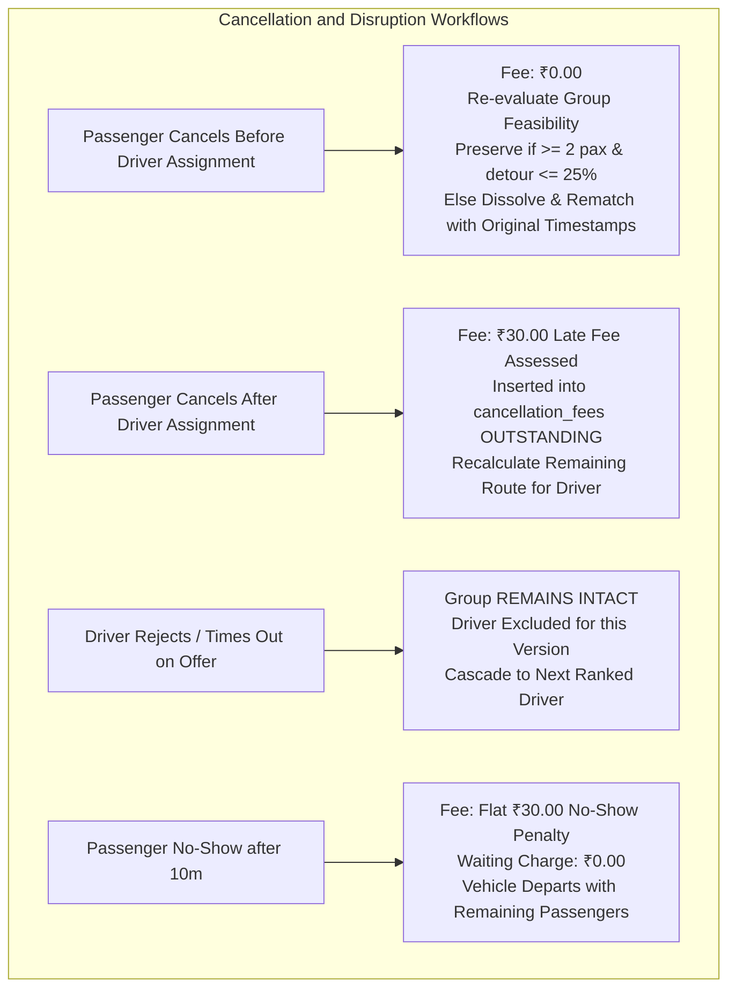

# Failure Handling and Disaster Recovery Specification

## On-Demand Aggregation Platform for Last-Mile Connectivity Using Shared Micro-Mobility

---

## 1. Mid-Trip Driver Breakdown and Replacement Engine

Vehicle breakdowns, tire blowouts, battery depletion, and mechanical stalls represent critical operational risks for shared micro-mobility. The platform implements an automated, resilient **Incident and Replacement Dispatch Engine**:

```mermaid
sequenceDiagram
    autonumber
    actor D1 as Original Driver (D1)
    participant App1 as D1 Mobile App
    participant API as NestJS Backend (IncidentsModule)
    participant DB as PostgreSQL 16 (Authoritative)
    participant OSRM as OSRM Engine
    participant Sockets as Socket.IO Gateway
    actor P as Onboard Passengers
    actor D2 as Replacement Driver (D2)
    participant App2 as D2 Mobile App

    D1->>App1: Clicks "Report Vehicle Breakdown"
    App1->>API: POST /api/v1/trips/:id/report-breakdown { incidentLocation, reason }
    
    activate API
    API->>DB: BEGIN TX: UPDATE trips SET status = 'INTERRUPTED'
    API->>DB: INSERT INTO trip_incidents (Snapshot immutable remaining onboard manifest)
    API->>DB: COMMIT TX
    API->>Sockets: Emit trip.interrupted to trip:tripId room
    Sockets-->>P: Displays "Vehicle Breakdown: Replacement En Route"
    
    API->>DB: Query online, available drivers with capacity >= onboard passenger count
    API->>OSRM: Query travel-time matrix: [Driver coordinates] -> [Incident Location]
    OSRM-->>API: Returns ETAs (D2 is closest with 3.2 min ETA)
    
    API->>DB: INSERT replacement_dispatch_attempts & replacement offer (D2)
    API->>Sockets: Emit replacement.offer to driver:D2 (20s timer)
    deactivate API

    alt Replacement Accepted
      D2->>App2: Clicks "Accept Replacement Trip"
      App2->>API: POST /api/v1/trips/:id/replacement-offers/:id/accept
      activate API
      API->>DB: BEGIN TX: INSERT replacement_driver_assignments; UPDATE trips SET active_driver_id = D2.id, status = 'IN_PROGRESS'
      API->>DB: INSERT fare_adjustments: 10% discount applied to all remaining onboard passengers
      API->>DB: COMMIT TX
      API->>Sockets: Emit trip.resumed event to trip:tripId
      Sockets-->>P: Displays "Trip Resumed: Replacement Arrived. 10% Discount Applied."
      deactivate API
      Note over D2,P: D2 completes remaining drop-offs along original sequence.
    else No Replacement Driver Available / Offers Exhausted
      Note over API: All candidate drivers rejected or timed out
      activate API
      API->>DB: BEGIN TX: UPDATE trips SET status = 'ABORTED'
      API->>DB: INSERT refund_records: All onboard passengers pay ₹0.00
      API->>DB: COMMIT TX
      API->>Sockets: Emit trip.aborted to trip:tripId
      Sockets-->>P: Displays "Trip Aborted: Please Disembark. Fare: ₹0.00."
      deactivate API
    end
```

### 1.1 Replacement Driver Eligibility Rules
When searching for a replacement vehicle to resume an interrupted shared trip, candidate drivers must satisfy:
1. `verification_status = 'APPROVED'` (Campus admin verified).
2. `is_online = true` and `operational_status = 'AVAILABLE'`.
3. Not suspended or blacklisted.
4. Active vehicle seating capacity $\ge$ count of passengers currently onboard.
5. No active assignment.
6. **OSRM ETA Ranking:** Ranked strictly by road travel time to the incident location via OSRM, **NOT** straight-line Euclidean distance.

### 1.2 Handover and Resumption Mechanics
1. **Manifest Immutability:** When the breakdown is reported, the backend captures an immutable JSON snapshot of all passengers whose individual status is `'BOARDED'` and saves it into `trip_incidents.onboard_manifest_snapshot`. Passengers already dropped off prior to the breakdown are excluded.
2. **Replacement Credentials Isolation:** The replacement driver receives the trip manifest, remaining drop-off coordinates, and optimized navigation sequence via the API, but **NEVER receives the original driver's login session or credentials**.
3. **`trip.resumed` Event:** The trip returns to status `'IN_PROGRESS'`. The resumption is an instantaneous domain event (`trip.resumed`), not a persistent database state.
4. **10% Compensation Discount:**
   - All passengers remaining onboard receive an automatic **10% discount** off their final ride fare:
     $$F_{\text{discounted}} = F_{\text{allocated}} \times 0.90$$
   - Recorded as an explicit line item in `fare_adjustments`.
   - Passengers already dropped off prior to the breakdown receive no discount.
   - Agreed fare ceilings remain binding; rounding adjustments preserve reconciliation.

### 1.3 Unresolved Failure / Aborted Trip Rules
If no replacement driver is available or all replacement offers time out:
1. Trip status transitions to `'ABORTED'`.
2. **All affected onboard passengers pay ₹0.00.**
3. If cash was handed to the original driver prior to the trip starting, a full cash refund is audited in `refund_records`.
4. Zero cancellation fees or no-show fees are charged.
5. The platform absorbs the operational cost.

---

## 2. In-Depth Failure Analysis for 10 Incident Edge Cases

| Edge Case | Failure Scenario | System Handling & State Transition | Idempotency & Data Recovery |
|---|---|---|---|
| **1. Replacement Driver Rejection** | Replacement driver explicitly declines the transfer offer. | Offer marked `REJECTED`. Driver excluded strictly for this incident attempt. System cascades immediately to the next ranked driver. | Sequential attempt ID increments; zero duplicate dispatch offers. |
| **2. Replacement Offer Timeout** | 20 seconds elapse with no response from replacement driver. | BullMQ delayed job marks offer `EXPIRED`. Cascades to next candidate driver. | Timeout job queries offer row by UUID; skips if already answered. |
| **3. Insufficient Capacity Across Available Fleet** | 3 passengers onboard, but all nearby available drivers operate 1-passenger bike taxis. | Candidate query returns zero matches. Trip immediately transitions to `'ABORTED'`. Passengers informed of ₹0 fare. | Prevents splitting passengers across multiple vehicles in MVP. |
| **4. OSRM Service Down During Breakdown** | Local OSRM engine crashes when calculating replacement ETAs. | System pauses replacement ranking for 5s (retry backoff). If down after 3 retries, marks trip `ABORTED` (₹0 fare). | Does not fabricate Euclidean routes across rivers or highways. |
| **5. Passenger Refuses Replacement Transfer** | Commuter prefers to walk or take alternative transit. | Passenger requests early departure. Driver marks passenger `'COMPLETED'` with ₹0 charge or admin issues waiver. | Prevents stranded status; records emergency departure in audit log. |
| **6. Driver Loses Connectivity While Reporting Incident** | Cell network drops at exact moment driver clicks "Report Breakdown". | Mobile app buffers request offline. Re-submits with same `Idempotency-Key` upon reconnection. | Idempotency table prevents duplicate incident records. |
| **7. Replacement Arrives but Handover is Unsafe** | Heavy rain, highway traffic, or hostile passenger prevents safe vehicle transfer. | Drivers report handover failed (`POST /trips/:id/handover-failed`). Trip marked `'ABORTED'`. Police/admin alerted. | Safety overrides trip completion; fare set to ₹0. |
| **8. Database Fails During Interruption** | PostgreSQL crashes mid-transaction during incident logging. | REST returns HTTP 503. Transaction rolls back cleanly. Incident is re-submitted upon DB restart. | WAL recovery guarantees zero orphaned records. |
| **9. Original Driver Reconnects After Replacement Dispatched** | Original driver's vehicle restarts and driver clicks "Resume Trip". | Backend rejects driver action with HTTP 409 Conflict (`TRIP_ALREADY_REASSIGNED`). Active driver is now D2. | Active driver ID lock prevents dual vehicle execution. |
| **10. Concurrent Replacement Driver Acceptances** | Two replacement drivers attempt to accept simultaneous offers. | PostgreSQL `SELECT ... FOR UPDATE` row lock ensures only the first driver sets `operational_status = 'RESERVED'`. | Second driver receives `OFFER_ALREADY_TAKEN`. |

---

## 3. Passenger and Driver Disruption Matrix



---

## 4. Infrastructure Outage and Fail-Closed Matrix

| System Component | Nature of Outage | Detection Mechanism | Immediate Fail-Safe Behavior | Recovery & Re-Synchronization |
|---|---|---|---|---|
| **PostgreSQL 16** | Process crash, disk exhaustion, reboot. | Prisma connection pool exhaustion / connection refused. | **Fail-Closed:** All mutating endpoints return HTTP 503. No business state written to Redis alone. | PostgreSQL auto-restarts via Homebrew; WAL replay restores consistency. |
| **Redis 7.2** | Daemon crash, memory exhaustion. | ioredis error listeners; BullMQ connection loss. | REST mutations continue (writing to PostgreSQL + Outbox). Telemetry falls back to in-memory sockets. Background jobs pause. | Redis restarts; BullMQ re-initializes; Outbox worker polls pending PostgreSQL events. |
| **OSRM Engine** | Engine crash, corrupted OSM extract. | HTTP 500 / timeout ($> 2000\text{ ms}$). | Circuit breaker opens. Matching batches fail safely (`FAILED`). No straight-line fares fabricated. | Restart OSRM daemon; circuit breaker half-opens after 10s. |
| **NestJS API** | Node.js unhandled rejection, OOM crash. | OS process termination; socket disconnection. | Mobile clients detect disconnect; enter exponential backoff with jitter. | Process manager restarts API; clients call `POST /sync` to restore state. |
| **NestJS Worker** | Worker crash during matching calculation. | Redis lease timeout (`lease:matching:pdeu`, 30s). | Incomplete batch marked `FAILED`. BullMQ stalled job monitor reclaims tasks. | Outbox worker resumes polling with `FOR UPDATE SKIP LOCKED`. |
| **Network Loss During Trip** | Vehicle enters cellular dead zone. | Missing socket ping (60s); stale GPS fix ($> 30\text{s}$). | Map shows "Connection Interrupted". **Vehicle trip is NOT reassigned.** | Client reconnects, fetches new socket ticket, syncs via `POST /sync`. |

---

*End of Failure Handling and Disaster Recovery Specification*
