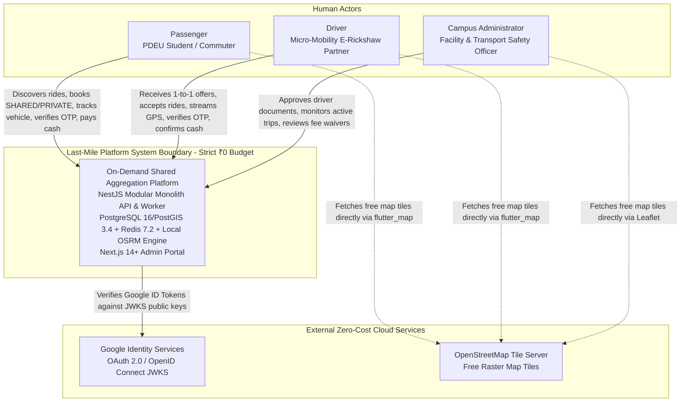
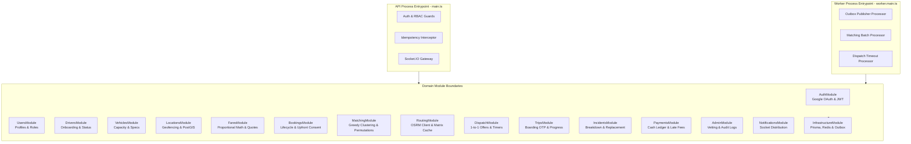
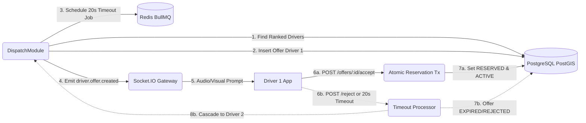
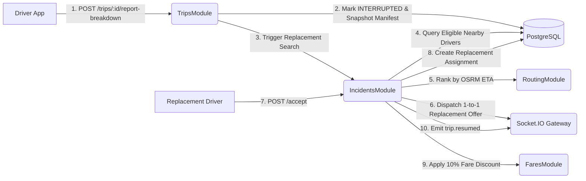
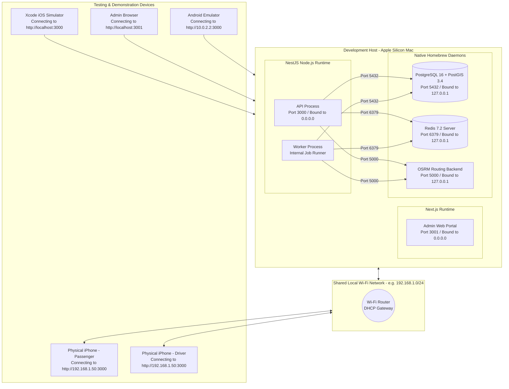

# High-Level Design (HLD) Specification

## On-Demand Aggregation Platform for Last-Mile Connectivity Using Shared Micro-Mobility

---

## 1. System Context Diagram (C4 Level 1)

The system context diagram illustrates the boundary of the Last-Mile Connectivity Platform, the external human actors who interact with it, and the minimal zero-cost external systems integrated into the ecosystem:



### 1.1 Context Rationale & Boundary Justification
- **No Third-Party Paid APIs:** Google Maps Platform, Mapbox, Twilio SMS, and Stripe/Razorpay are strictly excluded to preserve the ₹0 budget mandate.
- **Local Routing & Mapping:** OpenStreetMap regional data is processed locally by an embedded OSRM routing instance. Free OSM raster tiles are fetched directly by client map viewers without proxying through backend servers.
- **Authoritative Centralization:** All ride matching, fare allocations, driver dispatching, and cash audit tracking reside strictly within the system boundary.

---

## 2. Container Diagram (C4 Level 2)

The container diagram illustrates the high-level technical architecture, demonstrating how frontend applications, backend services, caching tiers, databases, and routing engines interact across network boundaries:

```mermaid
flowchart TB
    subgraph MobileClients [Cross-Platform Mobile Clients - Flutter]
      P_App[Passenger Mobile Application\nFlutter / Dart / Provider\ngo_router + flutter_map + Dio]
      D_App[Driver Mobile Application\nFlutter / Dart / Provider\ngeolocator + socket_io_client + Dio]
    end

    subgraph WebClients [Web Administration Portal]
      A_Web[Next.js 14+ Admin Dashboard\nReact / TypeScript / Tailwind CSS\nHttpOnly Secure Cookie Sessions]
    end

    subgraph BackendMonolith [Backend Modular Monolith - NestJS Single Codebase]
      API[NestJS API Process\nREST Endpoints (/api/v1)\nSocket.IO Gateway (/realtime)\nJWT & RBAC Guards]
      WRK[NestJS Background Worker Process\nBullMQ Job Processors\nMatching & Outbox Schedulers]
    end

    subgraph Persistence [Data, Cache & Routing Infrastructure - Local Mac Host]
      PG[(PostgreSQL 16 + PostGIS 3.4\nAuthoritative ACID Relational Store\nPartial Unique Indexes & Geofences)]
      RD[(Redis 7.2\nBullMQ Message Broker\n30s Ephemeral GPS Cache)]
      OSRM[OSRM Routing Server\nPort 5000 / HTTP REST\nGandhinagar Regional OSM Extract]
    end

    P_App & D_App -->|HTTPS REST & WSS WebSockets| API
    A_Web -->|HTTPS REST| API

    API -->|Prisma ORM & Raw SQL| PG
    API -->|ioredis GPS Cache & Socket Adapter| RD
    API -->|HTTP Table & Route REST Calls| OSRM

    WRK -->|SELECT FOR UPDATE SKIP LOCKED & Prisma| PG
    WRK -->|BullMQ Jobs & Distributed Leases| RD
    WRK -->|HTTP Travel-Time Matrix REST Calls| OSRM
```

### 2.1 Container Responsibilities

| Container | Technology Stack | Primary Operational Responsibility |
|---|---|---|
| **Passenger Mobile App** | Flutter 3.22+, Dart 3.4+, Provider, go_router, Dio, flutter_map | Authenticates via Google; requests fare quotes; creates bookings; verifies OTP; monitors vehicle arrival on live map; tracks fare breakdowns. |
| **Driver Mobile App** | Flutter 3.22+, Dart 3.4+, Provider, geolocator, socket_io_client, Dio | Submits onboarding documents; manages online availability; receives 1-to-1 dispatch offers; streams GPS fixes; verifies passenger boarding OTPs; confirms cash collections. |
| **Admin Web Portal** | Next.js 14+ (App Router), TypeScript, Tailwind CSS | Vets driver licenses and vehicle registrations; monitors active trips and vehicle telemetry; audits fee collections; grants administrative cancellation fee waivers. |
| **NestJS API Process** | NestJS 10+, TypeScript 5+, Express, Socket.IO | Terminates REST endpoints (`/api/v1`) and WebSocket connections (`/realtime`); validates geofences; enforces RBAC; manages database transactions. |
| **NestJS Worker Process** | NestJS 10+, BullMQ 5+, ioredis | Executes 60s batch matching; runs permutation route solver ($k! \le 24$); publishes transactional outbox events; enforces 20s dispatch timers. |
| **PostgreSQL 16 + PostGIS 3.4** | PostgreSQL 16.3, PostGIS 3.4.2 | Sole authoritative persistence store for users, bookings, ride groups, trips, financial ledgers, and outbox queues. Enforces 11+ partial unique constraints. |
| **Redis 7.2** | Redis 7.2+, ioredis | High-throughput broker for BullMQ job queues; holds distributed zone matching leases (`lease:matching:pdeu`); caches latest driver GPS fixes (30s TTL). |
| **OSRM Routing Engine** | OSRM 5.27+ (CH/MLD modes) | Calculates turn-by-turn road routes (`/route/v1`) and high-speed travel time matrices (`/table/v1`) using OpenStreetMap Gandhinagar road networks. |

---

## 3. Component Diagram (C4 Level 3) — Backend Modular Monolith

The backend is structured as a **NestJS Modular Monolith** where each functional domain is encapsulated within an isolated module:



### 3.1 Module Interactions and Data Contracts
1. **Synchronous In-Process Service Calls:** Modules communicate within the same Node.js process using typed TypeScript service interfaces (e.g., `BookingsService` calls `FaresService.calculateAllocatedFares()` directly in-memory).
2. **Asynchronous Cross-Boundary Outbox:** When state mutations require background processing (e.g., booking created $\rightarrow$ enqueue matching batch), the initiating module writes to `outbox_events` in the same database transaction.
3. **No Direct Inter-Module Table Tampering:** Modules strictly access other domains through exported service contracts, preventing architectural boundary erosion.

---

## 4. End-to-End Architectural Data Flows

### 4.1 Upfront Consent Booking and Permutation Matching Flow
```mermaid
flowchart LR
    A[Passenger App] -->|1. POST /fares/quotes| B(FaresModule)
    B -->|2. Get Solo Distance| C(RoutingModule -> OSRM)
    B -->|3. Return Quote [₹20, Solo]| A
    A -->|4. POST /bookings| D(BookingsModule)
    D -->|5. Validate 150m Geofence| E(LocationsModule -> PostGIS)
    D -->|6. Insert Booking & Outbox| F[(PostgreSQL)]
    G(Worker: OutboxPub) -->|7. Enqueue Matching Job| H[(Redis BullMQ)]
    I(Worker: MatchProc) -->|8. Claim Zone Batch| F
    I -->|9. OSRM Table API Matrix| C
    I -->|10. Evaluate 24 Permutations| I
    I -->|11. Persist Group & Route| F
    I -->|12. Trigger Dispatch| J(DispatchModule)
```

### 4.2 Sequential 1-to-1 Driver Dispatch Flow


### 4.3 Driver Breakdown and Replacement Dispatch Flow


---

## 5. Deployment and Network Architecture

The platform is designed to operate locally on an **Apple Silicon Mac host** with physical mobile devices connecting over a shared local Wi-Fi router:



### 5.1 Host Network Binding Strategy
- **Publicly Accessible on LAN (`0.0.0.0`):** NestJS API (`3000`) and Next.js Admin (`3001`) are bound to all network interfaces to allow physical iPhones/Android devices on the same Wi-Fi subnet to communicate.
- **Strictly Localhost Only (`127.0.0.1`):** PostgreSQL (`5432`), Redis (`6379`), and OSRM (`5000`) are bound strictly to localhost, preventing unauthorized direct database access from mobile clients or outside networks.

---

## 6. Key Architectural Trade-Offs

| Decision | Selected Approach | Rejected Alternative | Key Architectural Trade-Off |
|---|---|---|---|
| **System Topology** | NestJS Modular Monolith | Microservices Architecture | Sacrifices independent service deployability to eliminate distributed transaction latency, gRPC networking, and operational overhead. |
| **Persistence Authority** | PostgreSQL 16+ as Sole Truth | Redis-Primary Store / MongoDB | Sacrifices microsecond in-memory write speeds on telemetry to guarantee absolute ACID financial ledgers and relational constraints. |
| **Routing Computation** | Local OSRM on OpenStreetMap | Commercial Google Maps API | Sacrifices real-time traffic jam awareness to achieve 100% adherence to the ₹0 budget and sub-millisecond local matrix evaluations. |
| **Drop-Off Optimization** | Permutation Solver ($k! \le 24$) | Full Vehicle Routing Solver (VRP) | Limits vehicle capacity strictly to $k \le 4$ passengers to guarantee sub-millisecond deterministic calculation without heavy heuristic solvers. |
| **Matching Consent** | Upfront Passenger Consent | Post-Matching Group Voting | Removes passenger choice regarding specific co-passengers to eliminate fragile multi-party voting timeouts and dispatch deadlock. |
| **Payment Execution** | Cash Settlement with Surcharge Ledger | Digital Payment Gateways | Decouples ride completion from financial settlement to reflect Indian last-mile operational reality without gateway fees. |

---

*End of High-Level Design (HLD) Specification*
