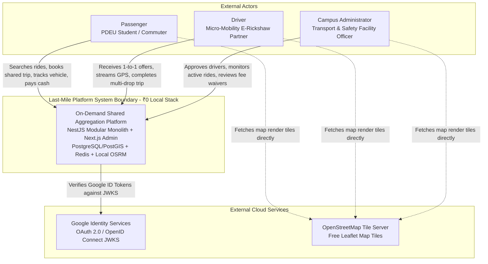
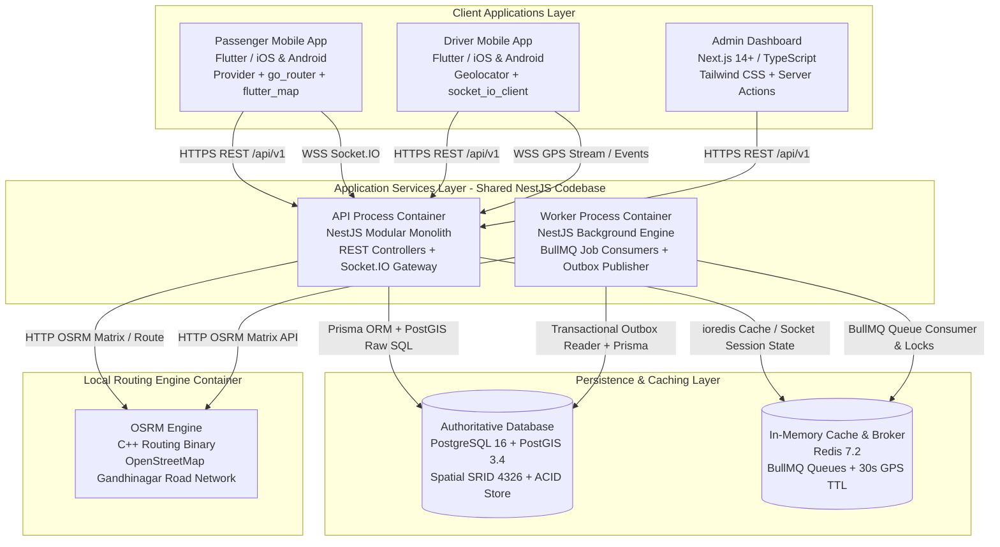
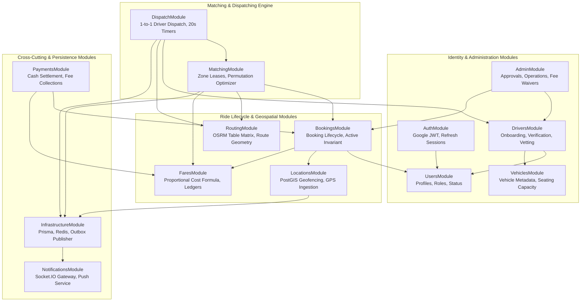
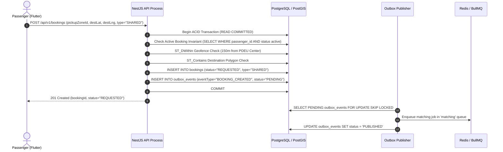
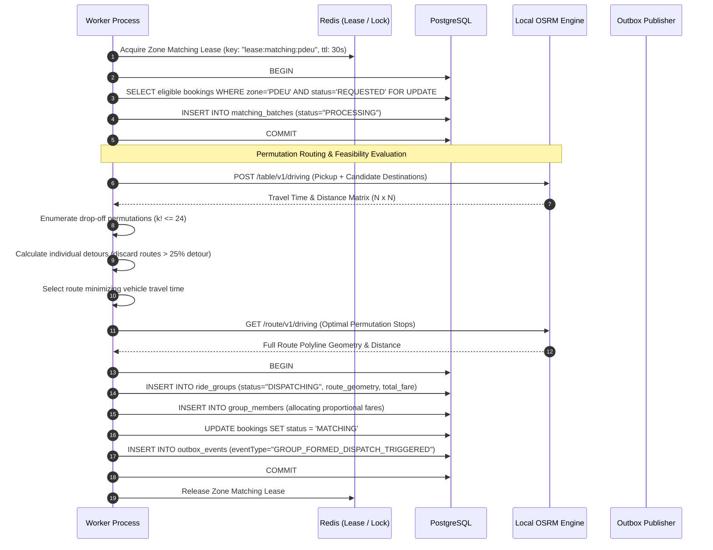
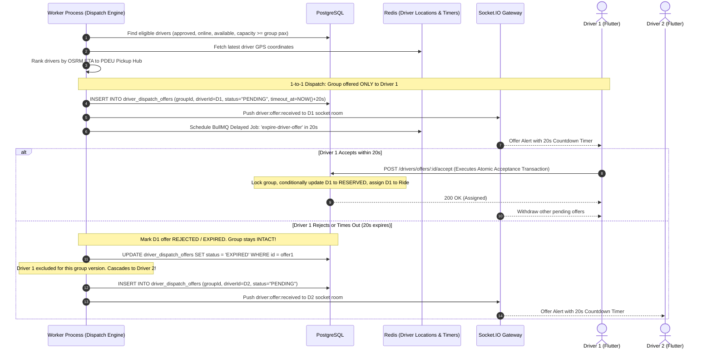
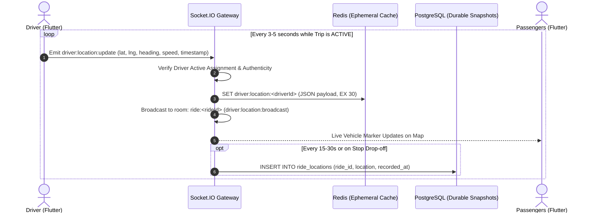
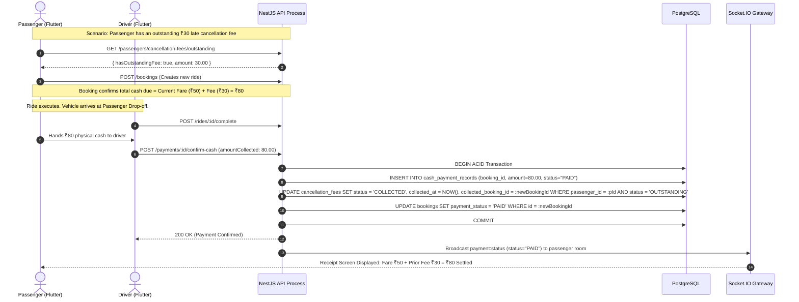

# High-Level Design (HLD)

## On-Demand Aggregation Platform for Last-Mile Connectivity Using Shared Micro-Mobility

---

## 1. System Context Diagram (C4 Level 1)

The System Context diagram illustrates the high-level boundary of the Last-Mile Micro-Mobility Platform, identifying external actors, client applications, and external identity and map tile providers:

---

## 2. Container Diagram (C4 Level 2)

The Container diagram decomposes the platform boundary into executable runtime containers, data stores, background workers, and client applications:

---

## 3. Modular Monolith Component Architecture (C4 Level 3)

The backend is organized into 14 distinct domain modules within a single NestJS application. Each module has strictly bounded responsibilities, owned entities, and well-defined export contracts.

---

## 4. Core Architectural Patterns

### 4.1 Modular Monolith with Domain-Driven Design (DDD)
- **Elimination of Distributed Transaction Overhead:** The platform coordinates bookings, matching groups, driver reservations, and payment ledgers inside atomic PostgreSQL transactions without distributed two-phase commits.
- **Strict Module Encapsulation:** Modules do not execute direct foreign database writes. If `MatchingModule` needs to claim a booking, it invokes `BookingsService.claimBookingForGroup()`, ensuring domain validation rules remain unbroken.
- **Unified Codebase:** Code duplication is eliminated; backend DTOs, database models, and enum definitions are shared between API and Worker processes.

### 4.2 Dual Process Execution Model
The backend compiles into a single set of artifacts but executes in two separate runtime roles:
1. **API Process (`main.ts`):** 
   - Handles client HTTP REST traffic and Socket.IO WebSocket connections.
   - Executes fast, synchronous OLTP database operations (User login, Booking creation, Driver acceptance, GPS ingestion).
   - Enqueues background work strictly via the Transactional Outbox.
2. **Worker Process (`worker.main.ts`):** 
   - Runs BullMQ job consumers and scheduled cron tasks.
   - Executes heavy, asynchronous compute tasks: running 60s matching batch algorithms, evaluating 24 permutation route matrices via OSRM, managing 20s driver dispatch countdowns, and running stale lease reconciliations.
   - Does not expose public HTTP ports.

### 4.3 Transactional Outbox Pattern
To eliminate dual-write hazards between PostgreSQL and Redis, all asynchronous operations commit an outbox event within the primary business transaction:
1. State mutation and outbox event insertion occur atomically in PostgreSQL.
2. A lightweight background poller in the worker process reads `PENDING` outbox records using `SELECT ... FOR UPDATE SKIP LOCKED`.
3. The poller enqueues corresponding jobs into BullMQ.
4. Upon successful Redis acknowledgment, the outbox record is marked `PUBLISHED`.
5. If the process dies, uncommitted Redis jobs are safely recovered and re-enqueued on restart.

### 4.4 Ephemeral vs. Authoritative Data Segregation
- **Authoritative Data (PostgreSQL 16 + PostGIS):** Bookings, Ride Groups, Group Memberships, Driver Assignments, Fares, Cancellation Fee Ledgers, Cash Payment Records, and User Identities.
- **Ephemeral Data (Redis 7.2):** High-frequency driver GPS locations (30s TTL), BullMQ queue job states, distributed matching batch locks (leases), and active Socket.IO connection session maps.

---

## 5. End-to-End System Data Flows

### 5.1 Ingress Booking Data Flow

### 5.2 Matching and Permutation Routing Data Flow

### 5.3 Sequential 1-to-1 Driver Dispatch Data Flow

### 5.4 Real-Time Telemetry and GPS Ingestion Data Flow

### 5.5 Cash Reconciliation and Cancellation Fee Recovery Data Flow

---

## 6. Module Communication Matrix

To preserve modular architectural purity, the table below documents the permitted communication mechanism between domain modules:

| Calling Module | Target Module | Communication Mechanism | Payload / Purpose | Consistency Guarantee |
|---|---|---|---|---|
| `BookingsModule` | `LocationsModule` | Synchronous Service Call | Validates passenger coordinates against PostGIS geofence | Immediate / Strong |
| `BookingsModule` | `FaresModule` | Synchronous Service Call | Fetches solo fare estimate and checks outstanding cancellation fees | Immediate / Strong |
| `BookingsModule` | `InfrastructureModule` | Transactional Outbox (PostgreSQL) | Writes `BOOKING_CREATED` event inside primary booking transaction | Atomic / Guaranteed |
| `MatchingModule` | `RoutingModule` | Synchronous Service Call | Calls OSRM Table matrix API to evaluate travel-time permutations | Immediate In-Memory |
| `MatchingModule` | `FaresModule` | Synchronous Service Call | Applies proportional fare allocation formula across group members | Immediate / Strong |
| `MatchingModule` | `BookingsModule` | Synchronous Service Call | Atomically updates booking statuses from `REQUESTED` to `MATCHING` | Immediate / Strong |
| `MatchingModule` | `InfrastructureModule` | Transactional Outbox (PostgreSQL) | Writes `GROUP_FORMED_DISPATCH_TRIGGERED` event | Atomic / Guaranteed |
| `DispatchModule` | `DriversModule` | Synchronous Service Call | Filters eligible drivers and ranks candidates by ETA | Immediate / Strong |
| `DispatchModule` | `InfrastructureModule` | BullMQ Job Queue (Redis) | Enqueues 20-second delayed timeout job (`handle-driver-offer-timeout`) | At-Least-Once Delivery |
| `DispatchModule` | `NotificationsModule` | Asynchronous Event via Outbox | Dispatches `driver:offer:received` Socket.IO event to driver | Eventual Real-Time |
| `LocationsModule` | `NotificationsModule` | In-Memory Gateway Broadcast | Broadcasts high-frequency GPS coordinate stream to `ride:<id>` room | Ephemeral Best-Effort |
| `PaymentsModule` | `FaresModule` | Synchronous Service Call | Updates `cancellation_fees` status from `OUTSTANDING` to `COLLECTED` | Immediate / Strong |
| `AdminModule` | `DriversModule` | Synchronous Service Call | Manages driver onboarding approval, rejection, and suspension | Immediate / Strong |

---

*End of High-Level Design (HLD)*

