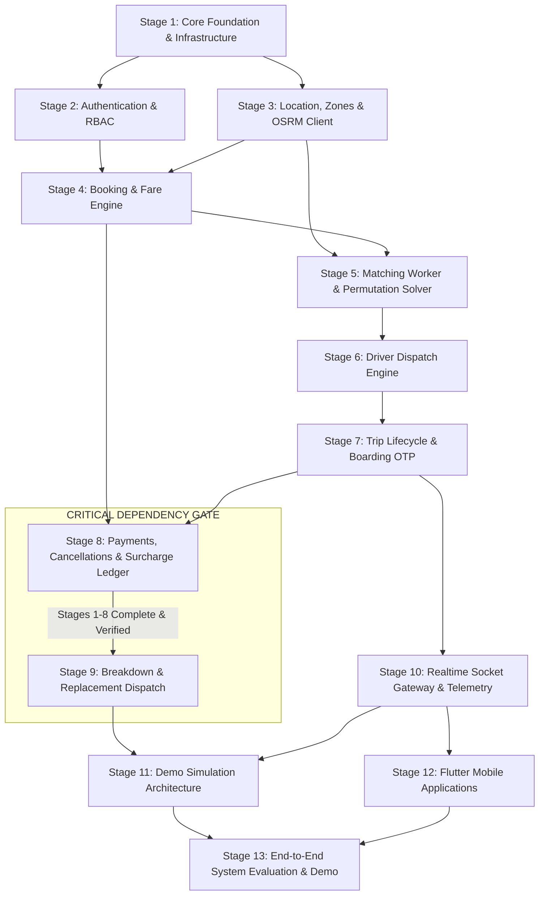

# Implementation Roadmap and Dependency Gates

## On-Demand Aggregation Platform for Last-Mile Connectivity Using Shared Micro-Mobility

---

## 1. Roadmap Architecture and Governance Rules

This document establishes the official high-level implementation sequence for the 4–6 week minor project. 

### Mandatory Governance Rules:
1. **Strict Dependency Gating:** An implementation stage cannot begin until all prerequisite stages have passed their designated verification gates.
2. **Explicit Stage 9 Dependency Lock:** **Do not start Stage 9 (Breakdown Management & Replacement Dispatch) implementation planning until its prerequisite dependencies (Stages 1 through 8) are fully completed and verified.**
3. **No Premature Code Scaffolding:** Scaffolding and coding must proceed strictly against the approved specifications documented in `docs/`.

---

## 2. High-Level Implementation Stages

### Stage 1: Core Foundation and Database Schema
- **Scope:** Initialize NestJS modular monolith; configure Prisma ORM with PostgreSQL 16 and PostGIS 3.4; execute baseline migrations; establish Redis 7.2 connection and BullMQ queue factory.
- **Dependencies:** None.
- **Verification Gate:**
  - PostgreSQL database initialized with PostGIS extension (`CREATE EXTENSION postgis;`).
  - Prisma migrations apply cleanly, including all 11+ partial unique indexes and GiST spatial indexes.
  - Redis connection verified; BullMQ queue initialized without errors.

### Stage 2: Authentication, Sessions and Role-Based Access Control
- **Scope:** Google OAuth 2.0 ID token verification against Google JWKS; JWT access token issuance (15m); rotating refresh tokens with family tracking in `user_sessions`; NestJS JWT and RBAC guards.
- **Dependencies:** Stage 1.
- **Verification Gate:**
  - Mocked and real Google ID tokens verified successfully.
  - Refresh token rotation works atomically; replay of revoked tokens invalidates token family.
  - Unapproved driver accounts blocked from driver endpoints by RBAC guards.

### Stage 3: Location Services, Geofencing and OSRM Integration
- **Scope:** PostGIS geofence validation for PDEU pickup hub (150m radius) and Gandhinagar service polygon; local OSRM HTTP client wrapping `/table/v1` and `/route/v1` with retry backoff and circuit breaker.
- **Dependencies:** Stage 1.
- **Verification Gate:**
  - Coordinates outside 150m of PDEU rejected with `PICKUP_OUTSIDE_GEOFENCE`.
  - Coordinates outside Gandhinagar rejected with `DESTINATION_OUTSIDE_SERVICE_AREA`.
  - Local OSRM server returns sub-millisecond travel-time matrices for Gandhinagar coordinates.

### Stage 4: Booking Engine and Fare Allocation Core
- **Scope:** Versioned tariff configuration; 2-minute fare quote generation; booking creation with upfront consent; Transactional Outbox pattern writing to `outbox_events`.
- **Dependencies:** Stage 2, Stage 3.
- **Verification Gate:**
  - `POST /api/v1/fares/quotes` returns private fare and shared range within 350ms.
  - Exactly one active booking enforced per passenger via partial unique index.
  - Booking insertion atomically writes to `outbox_events` in the same transaction.

### Stage 5: Matching Worker and Permutation Route Solver
- **Scope:** BullMQ batch matching worker executing every 60s; distributed zone lease (`lease:matching:pdeu`); greedy candidate clustering; local evaluation of all $k! \le 24$ permutations; 25% detour filter; group persistence.
- **Dependencies:** Stage 3, Stage 4.
- **Verification Gate:**
  - Evaluates 24 permutations for a 4-person cluster in $< 0.1\text{ ms}$ in-memory.
  - Strictly rejects routes with individual passenger detour $> 25\%$.
  - Group creation commits `ride_groups`, `group_members`, and immutable `group_route_versions`.

### Stage 6: Driver Dispatch Engine
- **Scope:** Sequential 1-to-1 driver dispatch with 20s BullMQ timeout jobs; OSRM ETA driver ranking; driver multi-offer capability; atomic reservation transaction (`SELECT ... FOR UPDATE` + conditional CAS).
- **Dependencies:** Stage 5.
- **Verification Gate:**
  - Dispatch offers sent to exactly one driver at a time.
  - Timeout after 20s cleanly marks offer `EXPIRED` and cascades to next driver without dissolving group.
  - Concurrent acceptance by two drivers resolves cleanly: one succeeds, one receives `OFFER_ALREADY_TAKEN`.

### Stage 7: Trip Lifecycle and Boarding Verification
- **Scope:** Driver arrival tracking (`driver_arrived_at`); secure 4-digit hashed OTP generation and verification; waiting charge calculation ($W_i = 5 \times \lceil\max(0, T_i - 5)\rceil$); vehicle trip start and stop.
- **Dependencies:** Stage 6.
- **Verification Gate:**
  - Boarding OTP verified against SHA-256 hash; max 3 failed attempts enforced.
  - Waiting charge accumulates correctly after 5 free minutes.
  - Multi-stop trip executes drop-offs sequentially.

### Stage 8: Payments, Cancellations and Late Fee Recovery
- **Scope:** State-dependent cancellation logic (₹0 before assignment, ₹30 after assignment); 10m no-show declaration (flat ₹30 fee); physical cash collection confirmation; surcharge recovery ledger on subsequent ride.
- **Dependencies:** Stage 4, Stage 7.
- **Verification Gate:**
  - Late cancellation inserts ₹30 into `cancellation_fees` as `OUTSTANDING`.
  - Next ride quote automatically surcharges outstanding fee.
  - Cash confirmation marks fee `COLLECTED` and enforces no-duplicate collection constraint.

---

> [!IMPORTANT]
> ### STAGE 9 DEPENDENCY LOCK
> **Do not begin Stage 9 implementation planning or scaffolding until Stages 1 through 8 have passed all verification gates.** Stage 9 relies fundamentally on the operational stability of trips, driver dispatch, fares, and financial ledgers.

---

### Stage 9: Driver Breakdown and Replacement Dispatch
- **Scope:** Mid-trip breakdown reporting (`POST /trips/:id/report-breakdown`); trip status transition to `'INTERRUPTED'`; immutable manifest snapshotting; replacement driver dispatch ranked by OSRM ETA; automatic 10% discount on trip resumption (`trip.resumed`); ₹0 fare abortion and refund ledger.
- **Dependencies:** **Stages 1 through 8 (Mandatory).**
- **Verification Gate:**
  - Breakdown captures immutable snapshot of remaining onboard passengers.
  - Replacement driver receives remaining manifest and navigation stops.
  - Successful replacement applies 10% fare discount to onboard passengers.
  - Failed replacement marks trip `ABORTED`, sets onboard fares to ₹0, and audits full cash refunds.

### Stage 10: Realtime Socket Gateway and GPS Telemetry
- **Scope:** Socket.IO gateway (`/realtime`); single-use 60s socket ticket verification; room management; high-frequency driver GPS streaming (3–5s) to Redis (30s TTL); durable PostgreSQL location snapshots (15–30s); exponential backoff reconnect and REST `/sync`.
- **Dependencies:** Stage 7.
- **Verification Gate:**
  - Single-use socket ticket validated and burned upon connection.
  - GPS updates stream smoothly to passenger rooms; Redis key expires after 30s.
  - Disconnect and reconnect triggers `POST /api/v1/sync` and restores state cleanly.

### Stage 11: Demo Simulation Architecture and Control Center
- **Scope:** Next.js Demo Control Center (`/admin/simulation`); virtual passenger and driver agent pool; GPS route playback engine; time acceleration (1x, 2x, 4x); interactive breakdown and timeout injection; demo data reset.
- **Dependencies:** Stage 9, Stage 10.
- **Verification Gate:**
  - Simulation runs entirely against real REST APIs and real database schema.
  - Evaluator can trigger happy path, driver rejection, breakdown, and no-show interactively.
  - Demo reset wipes only `is_demo = true` records without corrupting base data.

### Stage 12: Cross-Platform Mobile Applications (Flutter)
- **Scope:** Flutter single codebase; Provider state management; go_router; Dio auth interceptors; flutter_secure_storage; passenger booking flow with upfront consent; driver offer receipt, turn-by-turn route display, and cash confirmation screens.
- **Platform Execution Priority:**
  - *Phase 1:* iOS Simulator and physical iPhone.
  - *Phase 2:* Android Studio, Android Emulator, and physical Android device.
- **Dependencies:** Stage 10.
- **Verification Gate:**
  - Native 60fps UI performance on iOS Simulator and physical devices.
  - Real-time map displays moving vehicle marker and route polyline via `flutter_map`.

### Stage 13: End-to-End System Evaluation and Final Demonstration
- **Scope:** Comprehensive end-to-end rehearsal on local Apple Silicon Mac; verification of zero-cost operation; execution of university evaluation scenarios; documentation finalization.
- **Dependencies:** Stages 1 through 12.
- **Verification Gate:**
  - System executes reliably over shared local Wi-Fi with zero crashes.
  - All 11+ database invariants hold under high concurrency.
  - Final project report and architecture pack aligned with live software.

---

*End of Implementation Roadmap and Dependency Gates*
