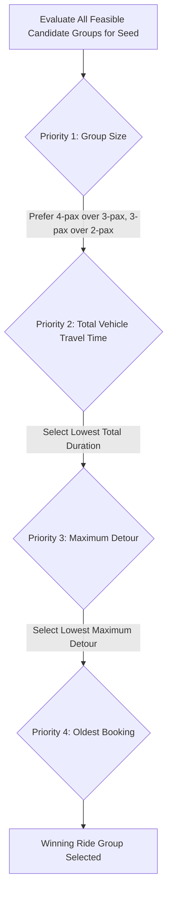

# Matching and Routing Algorithm Specification

## On-Demand Aggregation Platform for Last-Mile Connectivity Using Shared Micro-Mobility

---

## 1. Algorithmic Overview and Core Rationale

The matching and routing engine solves the on-demand spatial pooling challenge: grouping multiple commuters departing a shared transit hub (PDEU Main Gate) along common corridors, optimizing the vehicle's drop-off sequence, ensuring strict detour limits, and selecting the optimal driver.

### 1.1 The Selected Approach
The platform strictly implements:
$$\textbf{Greedy Candidate Grouping} + \textbf{OSRM Travel-Time Matrix} + \textbf{Exhaustive Local Permutation Optimization}$$

```mermaid
flowchart TD
    subgraph Step1 [Phase 1: Candidate Pool Filtering]
      Pool[Filter SEARCHING bookings at PDEU<br/>Within 120s deadline & compatible min group preference]
    end

    subgraph Step2 [Phase 2: Seed & Candidate Clusters]
      Seed[Pick Seed: Oldest / Most Urgent Booking]
      Cluster[Generate Bounded Candidate Groups containing Seed<br/>Size: 2 to 4 passengers, max 50 groups per batch]
    end

    subgraph Step3 [Phase 3: OSRM Travel-Time Matrix]
      TableAPI[Call OSRM Table API ONCE per candidate group<br/>Get (k+1) x (k+1) road-network duration matrix]
    end

    subgraph Step4 [Phase 4: Exhaustive Permutation Solver]
      Perm[Evaluate all k! drop-off sequences locally in memory<br/>k <= 4 implies at most 24 permutations]
      Detour[Filter sequences: Individual detour <= 25% for ALL members]
      BestSeq[Select sequence minimizing total vehicle travel time]
    end

    subgraph Step5 [Phase 5: Route Geometry & Persistence]
      RouteAPI[Call OSRM Route API ONCE for selected sequence<br/>Fetch turn-by-turn geometry & legs]
      Ceiling[Verify individual fare <= agreed fare ceiling]
      Persist[(Commit ride_group & group_members in PostgreSQL)]
    end

    Pool --> Seed --> Cluster --> TableAPI --> Perm --> Detour --> BestSeq --> RouteAPI --> Ceiling --> Persist
```

### 1.2 Explicit Clarification on Road-Network Routing (Debunking A*)
- **We DO NOT implement a custom road-network shortest-path algorithm.**
- The platform does not construct in-memory graph adjacency lists or execute custom A* search over road nodes.
- All road-network routing is delegated to a local instance of the **Open Source Routing Machine (OSRM 5.27+)**, which utilizes pre-processed OpenStreetMap road networks using **Contraction Hierarchies (CH)** or **Multi-Level Dijkstra (MLD)**.
- Any architectural claim that our application code implements A* is factually incorrect and rejected.

### 1.3 Why This Algorithm Was Selected
1. **Mathematical Tractability for Micro-Mobility ($k \le 4$):**
   The vehicle capacity is capped at 4 paying passengers. The maximum number of drop-off permutations is:
   $$4! = 4 \times 3 \times 2 \times 1 = 24 \text{ permutations}$$
   Evaluating 24 permutations against a pre-fetched $5 \times 5$ duration matrix takes **less than 0.1 milliseconds** of CPU time in Node.js. An exhaustive local search is therefore computationally trivial and guarantees the true optimal drop-off order.
2. **True Road-Network Accuracy via OSRM:**
   Using OSRM's `/table/v1` and `/route/v1` APIs guarantees that calculations account for real road connectivity, one-way streets, divided highway U-turns, and speed limits, rather than fabricated Euclidean straight-line distances.
3. **Bounded Greedy Heuristic:**
   Operating on bounded candidate clusters (maximum 6 companions per seed, maximum 50 groups per batch) ensures the algorithm terminates deterministically in $< 1.2$ seconds, fitting easily within the 60-second batch window.

### 1.4 Alternatives Considered and Rejected
- **Custom Road-Network A* Implementation:** Rejected. Building, indexing, and maintaining an OpenStreetMap road graph in TypeScript would consume months of engineering, create massive memory bloat, and perform worse than OSRM's optimized C++ engine.
- **Unbounded Combinatorial Optimization (Full MIP / VRP):** Rejected. Formulating a global Mixed-Integer Linear Program across hundreds of un-clustered riders introduces exponential complexity, solver license requirements, and unpredictable execution latency.
- **Bipartite Maximum-Weight Matching:** Rejected. Bipartite matching is suited for 1-to-1 pairings (e.g. 1 passenger to 1 driver); it does not natively solve multi-stop vehicle drop-off routing.
- **Marginal Cost Greedy Insertion:** Rejected. For $k \le 4$, exhaustive permutation evaluation is faster and guarantees finding the optimal sequence, whereas greedy insertion can get trapped in sub-optimal local minima.

---

## 2. Step-by-Step Matching Pipeline

### 2.1 Step 1: Candidate Pool Extraction
At the start of a 60-second matching cycle, the worker claims the zone batch lock (`lease:matching:pdeu`, TTL 30s) and queries all eligible bookings:
- `pickup_point_id = :pdeuHubId`
- `status = 'SEARCHING'`
- `requested_type = 'SHARED'`
- `max_wait_deadline > NOW()` (strictly within 120s from original creation)
- No active group membership (`NOT EXISTS (SELECT 1 FROM group_members gm WHERE gm.booking_id = bookings.id AND gm.is_active_member = true)`)

### 2.2 Step 2: Seed Selection
The candidate pool is ordered by `created_at ASC` (oldest booking first). The oldest unassigned booking is selected as the **Seed Booking ($B_{\text{seed}}$)**. Prioritizing the oldest booking guarantees FIFO fairness and prevents starvation for commuters nearing their 120-second deadline.

### 2.3 Step 3: Candidate Group Generation
From the remaining eligible pool, the algorithm filters companions compatible with $B_{\text{seed}}$:
1. **Group Preference Compatibility:**
   - If $B_{\text{seed}}$ chose `minGroupPreference = 3`, candidate groups of size 2 are disqualified.
   - If a companion chose `minGroupPreference = 4`, that companion can only be included in a 4-passenger group.
2. **Spatial Shortlisting:**
   Using PostGIS spatial indexing, the system selects the 6 nearest companion destinations to $B_{\text{seed}}$'s destination:
   ```sql
   SELECT b.id, b.destination_location 
   FROM bookings b
   WHERE b.id != :seedId AND b.status = 'SEARCHING'
   ORDER BY b.destination_location <-> :seedDestination
   LIMIT 6;
   ```
3. **Combinatorial Candidate Formation:**
   Combinations of sizes 2, 3, and 4 containing $B_{\text{seed}}$ and the shortlisted companions are enumerated. Configurable safety bound: maximum 50 candidate groups evaluated per seed.

### 2.4 Step 4: OSRM Travel-Time Matrix Call
For each candidate group $C = \{B_{\text{seed}}, B_1, \dots, B_{k-1}\}$ (where $k \in \{2, 3, 4\}$):
- The algorithm extracts coordinates for the Pickup Origin ($P_0$) and all member destinations ($D_1, D_2, \dots, D_k$).
- A single HTTP GET call is made to the local OSRM Table API:
  ```http
  GET http://127.0.0.1:5000/table/v1/driving/lng_P0,lat_P0;lng_D1,lat_D1;...;lng_Dk,lat_Dk?annotations=duration,distance
  ```
- OSRM returns a $(k+1) \times (k+1)$ matrix containing road travel times ($M_{i,j}$) and distances between all points.

### 2.5 Step 5: Permutation Enumeration and Detour Evaluation
The algorithm enumerates all $k!$ permutations of the destination indices $\{1, 2, \dots, k\}$.
For each permutation $\pi = (\pi_1, \pi_2, \dots, \pi_k)$:
1. **Total Shared Vehicle Duration:**
   $$T_{\text{total}}(\pi) = M_{0, \pi_1} + \sum_{j=1}^{k-1} M_{\pi_j, \pi_{j+1}}$$
2. **Individual Shared Duration:**
   For passenger $\pi_m$ dropped off at step $m$:
   $$T_{\text{shared}, \pi_m}(\pi) = M_{0, \pi_1} + \sum_{j=1}^{m-1} M_{\pi_j, \pi_{j+1}}$$
3. **Individual Direct Duration:**
   Pre-calculated solo direct travel time from pickup to destination: $T_{\text{direct}, \pi_m} = M_{0, \pi_m}$.
4. **Individual Detour Calculation:**
   $$\text{Detour}_{\pi_m}(\pi) = \frac{T_{\text{shared}, \pi_m}(\pi) - T_{\text{direct}, \pi_m}}{T_{\text{direct}, \pi_m}} \times 100\%$$
5. **Hard Constraint Check:**
   If $\text{Detour}_{\pi_m}(\pi) > 25.00\%$ for **any** passenger in the group, the permutation $\pi$ is **strictly rejected as infeasible**.

### 2.6 Step 6: Sequence Optimization and Tie-Breaking
Among all feasible permutations for candidate group $C$:
1. Select the sequence $\pi^*$ that minimizes total vehicle travel time: $\min T_{\text{total}}(\pi)$.
2. **Tie-Break Rule 1:** If two sequences have identical total travel times, select the one with the **lower maximum individual detour**: $\min \max_m \text{Detour}_{\pi_m}$.
3. **Tie-Break Rule 2:** If still tied, preserve the order of the oldest booking creation timestamp.

---

## 3. Group Selection Priority

When multiple feasible candidate groups containing $B_{\text{seed}}$ exist, the algorithm applies the following hierarchical priority:



### 3.1 Rationale for Prioritizing Largest Group Size
- **Environmental & Congestion Impact:** Filling vehicle seats to capacity (4 passengers) reduces the number of vehicles required at campus gates, directly lowering traffic congestion and emissions.
- **Financial Savings:** Higher pooling occupancy lowers per-passenger fares, delivering 35%–40% savings for 4-passenger groups versus 20%–25% for 2-passenger groups.
- **Trade-off:** Prioritizing group size is heuristic and locally greedy; it does not guarantee global Pareto efficiency across the entire city, but provides an optimal, explainable result within the bounded 60s window.

---

## 4. Route Geometry and Transactional Persistence

Once the winning group and optimal sequence are chosen:
1. **OSRM Route API Call:**
   The algorithm makes a single call to the OSRM Route API for the winning sequence ($P_0 \rightarrow D_{\pi_1} \rightarrow \dots \rightarrow D_{\pi_k}$):
   ```http
   GET http://127.0.0.1:5000/route/v1/driving/coords...?overview=full&geometries=geojson&steps=true
   ```
   This retrieves the exact polyline geometry (`LineString`), turn-by-turn navigation steps, and road distance ($D_{\text{shared}}$).
2. **Fare Calculation & Ceiling Verification:**
   `FaresService` calculates individual allocated fares $F_i$ using the proportional formula. If any $F_i > \text{AgreedCeiling}_i$, the group is rejected.
3. **Atomic ACID Transaction:**
   Inside a single PostgreSQL transaction:
   - Insert `ride_groups` (status: `'DISPATCHING'`, version: 1).
   - Insert `group_members` (sequence order, allocated fares, detours).
   - Insert `group_route_versions` (GeoJSON geometry snapshot).
   - Update `bookings` status from `'SEARCHING'` to `'MATCHED'`.
   - Insert `outbox_events` (`GROUP_FORMED`).
4. **Repeat for Unclaimed Bookings:**
   The worker removes the claimed bookings from memory and repeats the seeding process for remaining unassigned bookings.

---

## 5. Driver Selection and Dispatch Ranking

Once a ride group is created, it moves immediately into **Sequential 1-to-1 Driver Dispatch**:

```mermaid
sequenceDiagram
    autonumber
    participant D_Mod as DispatchModule
    participant DB as PostgreSQL 16
    participant OSRM as OSRM Engine
    participant Redis as Redis (BullMQ)
    participant D1 as Driver 1 (Rank #1)
    participant D2 as Driver 2 (Rank #2)

    D_Mod->>DB: Query approved, online, available drivers with capacity >= group_size
    DB-->>D_Mod: Returns candidate drivers [D1, D2, D3]
    D_Mod->>OSRM: Query travel-time matrix: [Driver GPS locations] -> [PDEU Pickup Hub]
    OSRM-->>D_Mod: Returns ETAs: D1 (2.4 min), D2 (3.8 min), D3 (5.1 min)
    Note over D_Mod: Rank drivers by OSRM ETA. D1 is Rank #1.

    D_Mod->>DB: INSERT driver_dispatch_offers (Driver: D1, Status: PENDING, Expires: NOW() + 20s)
    D_Mod->>Redis: BullMQ.add('dispatch-timeout', { offerId, driverId: D1 }, delay: 20000)
    D_Mod->>D1: Socket: driver.offer.created (G1, 20s timer)

    alt Driver 1 Rejects or Times Out
      D1->>D_Mod: POST /offers/:id/reject (or 20s BullMQ job triggers)
      D_Mod->>DB: UPDATE offer SET status = 'REJECTED' / 'EXPIRED'
      Note over D_Mod: Driver 1 excluded strictly for this group version.<br/>Group cascades immediately to Driver 2.
      D_Mod->>DB: INSERT driver_dispatch_offers (Driver: D2, Status: PENDING, Expires: NOW() + 20s)
      D_Mod->>D2: Socket: driver.offer.created (G1, 20s timer)
    else Driver 1 Accepts within 20s
      D1->>D_Mod: POST /offers/:id/accept
      Note over D_Mod: Atomic Reservation Transaction
      D_Mod->>DB: BEGIN TX: SELECT FOR UPDATE ride_groups; UPDATE driver_profiles SET operational_status = 'RESERVED'
      D_Mod->>DB: Set offer ACCEPTED; create driver_assignments; withdraw D1's other offers
      D_Mod->>DB: COMMIT TX
      D_Mod->>D1: Returns Assigned Trip & Navigation Route
    end
```

### 5.1 Driver Ranking Criteria
Eligible drivers must satisfy:
1. `verification_status = 'APPROVED'` (Admin approved).
2. `is_online = true` and `operational_status = 'AVAILABLE'`.
3. Not suspended or blacklisted.
4. Active vehicle seating capacity $\ge$ group passenger count.
5. No active assignment (`NOT EXISTS (SELECT 1 FROM driver_assignments da WHERE da.driver_id = d.id AND da.status IN ('RESERVED', 'ACTIVE'))`).

**Ranking Metric:** Ranked strictly by **OSRM road travel time (ETA)** from the driver's latest cached GPS fix to the PDEU pickup hub, **NOT** straight-line Euclidean distance.

### 5.2 Multi-Offer Capability vs. 1-to-1 Dispatch
- **1-to-1 Group Dispatch Invariant:** A ride group is offered to **EXACTLY ONE driver at a time**. Never broadcast a group to multiple drivers concurrently.
- **Driver Multi-Offer Receipt:** A driver **MAY receive multiple pending offers** for different groups if they are the closest candidate for each.
- **Atomic Conflict Resolution:** The instant a driver accepts an offer, an atomic PostgreSQL transaction reserves the driver (`RESERVED`), assigns the group, marks that offer `ACCEPTED`, marks the driver's other offers `WITHDRAWN`, and marks competing offers for that group `WITHDRAWN`.

---

## 6. Concurrency, Performance Bounds and Circuit Breakers

### 6.1 Performance Bounds and Tuning Parameters

| Parameter Name | Configuration Key | Default Value | Rationale |
|---|---|---|---|
| **Matching Batch Cycle** | `MATCHING_BATCH_INTERVAL_MS` | `60000` (60s) | Allows sufficient demand accumulation at campus gates. |
| **Max Wait Deadline** | `MAX_SHARED_WAIT_DEADLINE_MS` | `120000` (120s) | Maximum acceptable commuter wait before alternative options. |
| **Max Permutations** | `MAX_PERMUTATIONS` | `24` ($4!$) | Absolute ceiling for 4-passenger vehicles. |
| **Max Individual Detour** | `MAX_DETOUR_PERCENT` | `25.00%` | Disclosed commuter fairness limit. |
| **Max Shortlist Companions**| `MAX_COMPANIONS_SHORTLIST` | `6` | Bounds OSRM matrix size to $7 \times 7$. |
| **Max Groups per Batch** | `MAX_CANDIDATE_GROUPS_PER_BATCH`| `50` | Prevents CPU event loop starvation. |
| **Driver Offer Timeout** | `DRIVER_OFFER_TIMEOUT_SEC` | `20` | Rapid cascade to prevent commuter delays. |

### 6.2 OSRM Resilience and Circuit Breakers
- **No Straight-Line Fallbacks:** If OSRM fails, the platform **does not fabricate** straight-line routes or estimated fares. Fabricating straight-line travel risks routing vehicles across uncrossable river boundaries (Sabarmati River) or restricted zones.
- **Circuit Breaker Policy:**
  - After 3 consecutive HTTP timeouts ($> 2000\text{ ms}$) to local OSRM, the circuit breaker opens.
  - Active matching batches fail safely with status `'FAILED'`.
  - Claimed bookings remain in `'SEARCHING'` status until the circuit breaker resets (half-open after 10 seconds).

---

*End of Matching and Routing Algorithm Specification*
