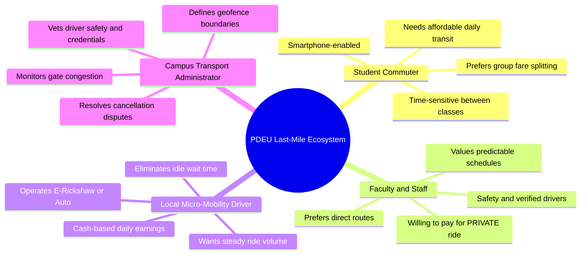
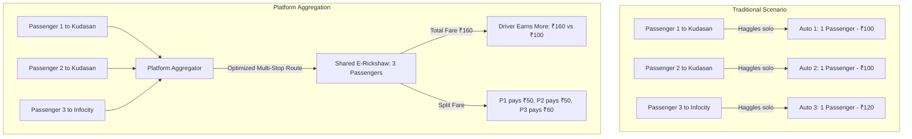
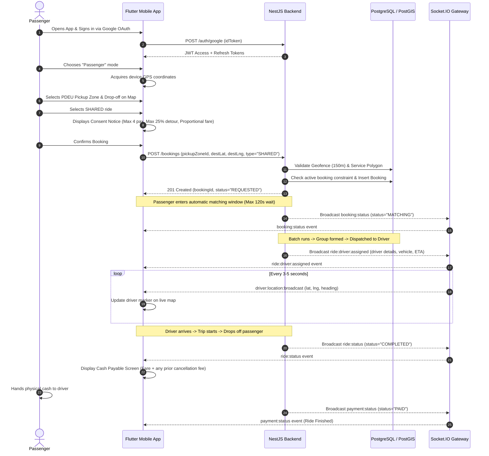
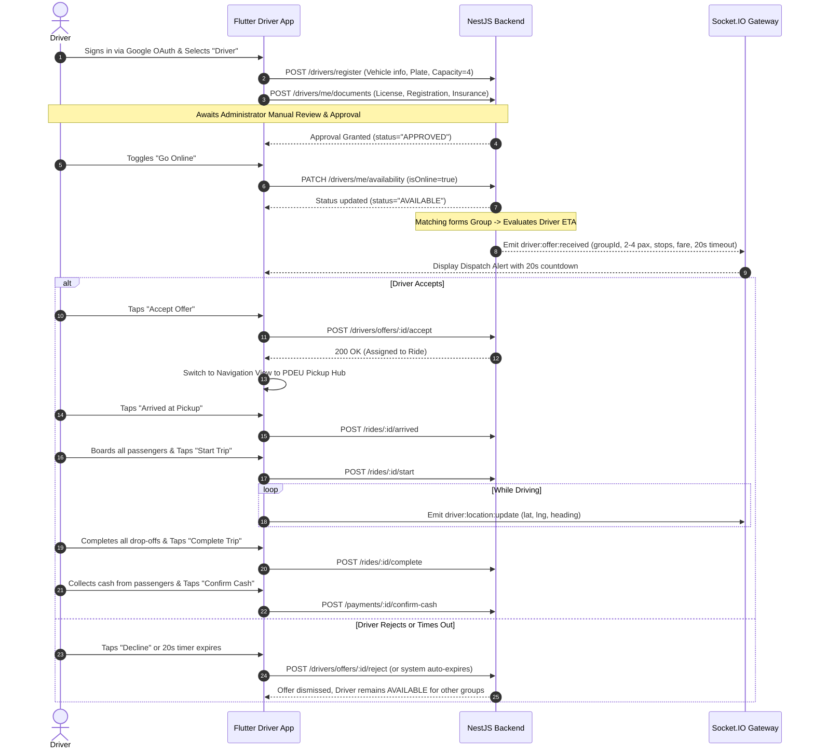
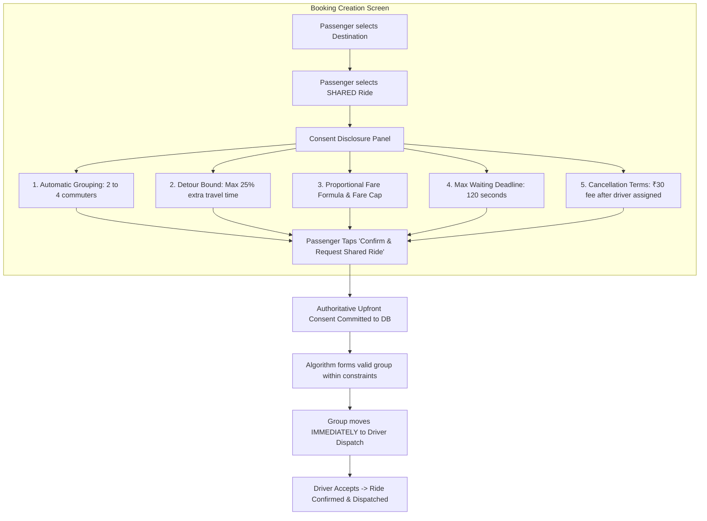
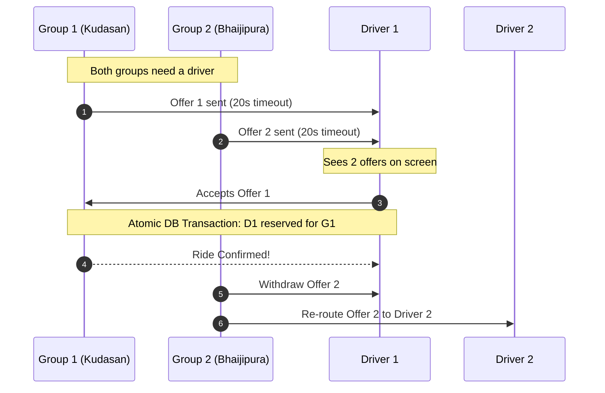
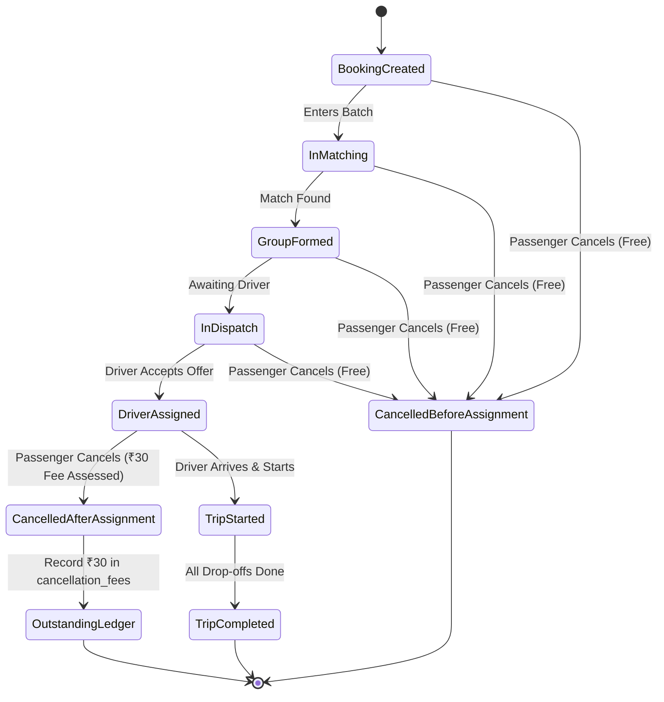

# Product Requirements Document (PRD)

## On-Demand Aggregation Platform for Last-Mile Connectivity Using Shared Micro-Mobility

---

## 1. Executive Summary and Vision

### 1.1 Project Summary
The **On-Demand Aggregation Platform for Last-Mile Connectivity** is an intelligent, real-time shared micro-mobility aggregation platform designed to solve the critical "last-mile" transportation gap connecting transit nodes, campus gates, and transport hubs to final residential, commercial, and educational destinations. 

By pooling commuters leaving a common origin with overlapping corridors into dynamic, shared vehicle groups (such as 4-passenger electric rickshaws, bike taxis, or micro-shuttle vans), the platform accomplishes three vital socio-economic and logistical goals:
1. **Dramatically lowers per-passenger commute costs** compared to private point-to-point taxis or solo autos.
2. **Maximizes driver earning efficiency and vehicle seat utilization** by filling vehicle capacity in single coordinated multi-drop journeys.
3. **Reduces campus-gate traffic congestion, vehicular emissions, and chaotic street bargaining** through automated spatial clustering, deterministic transparent fare allocation, and real-time dispatching.

The initial operational prototype and live demonstration are specifically designed around the **Pandit Deendayal Energy University (PDEU)** campus transit and main gate zone in Gandhinagar, Gujarat.

### 1.2 Target Audience and Personas
The system serves four primary user personas operating in and around the PDEU campus ecosystem:



1. **Aarav — Daily Student Commuter:**
   - *Profile:* CSE student commuting daily between PDEU Main Gate and Bhaijipura / Kudasan / Koba Circle apartments.
   - *Pain Points:* High cost of solo auto rides (₹80–₹120), long delays haggling at the gate, unpredictable vehicle availability.
   - *Platform Need:* Tap and request a SHARED ride, know upfront maximum detour and capped fare, get aggregated automatically with classmates, and pay in cash upon arrival.

2. **Dr. Mehta — Faculty Member:**
   - *Profile:* Visiting professor needing reliable, punctual transit from PDEU to Infocity or Gandhinagar Railway Station.
   - *Pain Points:* Cannot risk detours or picking up multiple students when running late for external meetings.
   - *Platform Need:* Directly request an exclusive PRIVATE ride with guaranteed direct routing, or receive an explicit private alternative if shared matching finds no companions.

3. **Ramesh — E-Rickshaw Driver Partner:**
   - *Profile:* Local driver owning a 4-passenger electric rickshaw operating around PDEU and Raysan.
   - *Pain Points:* Spends 30–45 minutes idling at the campus gate waiting to fill 4 seats; passengers bargain aggressively.
   - *Platform Need:* Simple driver app with audio/visual alerts; receives batch offers for pre-aggregated groups of 2 to 4 passengers; guaranteed multi-passenger total fare; accepts offers in one tap; receives cash directly from passengers.

4. **Campus Transport Administrator:**
   - *Profile:* Campus facility officer responsible for safety, gate traffic management, and transport provider vetting.
   - *Pain Points:* Unverified commercial vehicles loitering inside campus gates; rogue drivers overcharging students; passenger harassment complaints.
   - *Platform Need:* Central web dashboard to vet driver identity and vehicle documents, approve or suspend driver accounts, inspect operational ride logs, configure geofences, and adjudicate late-cancellation fee disputes.

---

## 2. Core Problem and Market Opportunity

### 2.1 The Last-Mile Inefficiency at Major Campuses
Transit hubs and suburban university campuses such as PDEU face a structural transportation dilemma:
- **Mass Dispersal from a Single Origin:** Hundreds of commuters exit campus gates simultaneously after lecture blocks.
- **Overlapping Corridors:** Over 75% of these commuters head towards a small number of well-defined corridors (e.g., Bhaijipura Cross Road, Raysan Petrol Pump, Kudasan, Infocity, PDPU Bridge).
- **Suboptimal Utilization:** Commuters either take individual private auto-rickshaws (spending ₹80–₹120 each and congesting the road with low-occupancy vehicles) or engage in informal, chaotic sidewalk bargaining to find peers heading the same direction.
- **The "Empty Return" Cost:** Drivers returning empty to campus factor the deadhead cost into their outbound fares, inflating prices for students.



### 2.2 The Solution
The platform replaces manual sidewalk coordination with an automated, algorithmically driven micro-dispatch system:
- Aggregates real-time demand at a designated, geofenced campus pickup hub.
- Executes rapid batch-matching windows (60 seconds) to find geographically compatible destinations.
- Enforces strict quality-of-service guarantees (maximum 25% individual detour and hard waiting deadlines).
- Automatically bundles passengers and dispatches an available, verified micro-mobility driver.
- Calculates fair, mathematically sound proportional cost sharing.

---

## 3. Product Scope and MVP Boundaries

### 3.1 In-Scope for Minimum Viable Product (MVP)
The MVP is designed to be fully implemented, tested, and demonstrated by a team of 2–3 CSE students within a 4–6 week timeline under a strict ₹0 infrastructure budget:

1. **Authentication & Identity:**
   - Google OAuth 2.0 integration for seamless login on Flutter mobile clients.
   - Dual-role flow (Passenger and Driver) with server-side authorization enforcement.
   - Administrator authentication for Next.js web portal.
2. **Driver Onboarding & Verification:**
   - Driver profile, vehicle metadata (registration number, capacity), and document submission.
   - Administrator review portal with approval, rejection, and suspension capabilities.
   - Strict gatekeeping: unapproved or suspended drivers cannot toggle online or receive ride dispatches.
3. **Geospatial & Zone Management:**
   - Named PDEU campus pickup zone with a strict backend-enforced 150m geofence radius.
   - PostGIS polygon validation for allowed drop-off service regions (preventing requests outside the service boundary).
4. **Booking & Consent Management:**
   - Single active booking constraint per passenger enforced at the database level.
   - Choice of `SHARED` or `PRIVATE` ride type.
   - **Upfront Consent Workflow:** Passengers explicitly consent to automated grouping, maximum detour limits, capacity limits, and proportional fare models at the time of booking.
5. **Batch Matching & Route Optimization:**
   - Scheduled 60-second zone-level matching batches protected by database leases.
   - Permutation-based drop-off route solver using local OSRM road-network travel time matrices ($k! \le 24$ permutations for up to 4 passengers).
   - Strict individual detour constraint ($\le 25\%$) and maximum 120-second wait deadline from booking creation.
6. **Sequential 1-to-1 Driver Dispatch:**
   - Offering a formed group to one ranked driver at a time with a 20-second countdown timer.
   - Drivers may receive multiple offers for different groups, but accepting one atomically locks the driver and withdraws competing offers.
   - Driver rejection or timeout keeps the passenger group intact, excludes the driver from that group version, and cascades to the next eligible driver.
7. **Trip Lifecycle & Real-Time Telemetry:**
   - Driver arrival, trip start, per-stop drop-off tracking, and trip completion.
   - High-frequency GPS updates (every 3–5 seconds) cached in Redis with short TTL and broadcast via Socket.IO.
   - Low-frequency durable database location snapshots (every 15–30 seconds) in PostgreSQL.
8. **Cash Payment & Cancellation Ledger:**
   - End-of-trip cash payment workflow with driver confirmation.
   - Post-assignment passenger cancellation fee of ₹30 tracked in a durable `cancellation_fees` ledger.
   - Automatic cash surcharge on the passenger's subsequent ride with atomic collection marking.
9. **Admin Dashboard:**
   - Driver verification, live ride monitoring, matching batch inspection, and cancellation fee waiver adjudications.

### 3.2 Explicitly Out-of-Scope (Deferred to Future Releases)
To preserve the ₹0 budget and guarantee timely delivery, the following features are excluded from the MVP:
- **Digital Payment Gateways:** No Razorpay, Stripe, Paytm, or UPI deep-linking integrations. All transactions are cash-settled with system auditing.
- **Automated Payouts:** No banking or driver wallet withdrawal integrations.
- **Multiple Simultaneous Pickup Hubs:** The MVP is strictly scoped to the PDEU pickup zone.
- **Dynamic Surge Pricing & Machine Learning:** No algorithmic surge multipliers or predictive demand forecasting.
- **Microservices & Kubernetes:** No distributed service orchestration, API gateways (Kong/Apisix), or Docker swarm deployments.
- **Passenger Group Acceptance Rounds:** Unanimous voting or passenger confirmation rounds have been permanently eliminated in favor of upfront booking consent.

---

## 4. User Roles and Key Journeys

### 4.1 Passenger Journey



### 4.2 Driver Journey



### 4.3 Administrator Journey
1. **Driver Vetting:** Admin logs in to Next.js portal, views submitted driving licenses, vehicle RC books, and vehicle photographs. Reviews identity, sets background check status, and clicks **Approve** or **Reject**.
2. **Live Operations Monitoring:** Observes real-time dashboard displaying active bookings, pending matching batches, formed groups in dispatch, and active rides moving on an OpenStreetMap overview.
3. **Cancellation & Dispute Review:** Inspects the `cancellation_fees` ledger. If a passenger disputes an assessed ₹30 late-cancellation fee (e.g., claiming the driver was delayed or an emergency occurred), the admin reviews GPS tracking audit logs and clicks **Waive Fee** with an audited reason.
4. **Geofence & Zone Management:** Modifies the PDEU campus pickup geofence radius (e.g., expanding from 150m to 200m during peak rain) or updates the Gandhinagar service region polygon coordinates.

---

## 5. Detailed Product Features and Business Rules

### 5.1 Authentication and Role Gatekeeping
- **Google OAuth Baseline:** All users authenticate using Google OAuth on Flutter. Flutter obtains the Google ID token and sends it via `POST /auth/google`.
- **Backend Token Verification:** NestJS validates the token’s cryptographic signature, issuer (`accounts.google.com`), audience (client ID), and expiration against Google’s public JWKS keys.
- **Identity Stability:** The user is indexed and uniquely retrieved using Google’s immutable subject identifier (`sub`).
- **Session Issuance:** NestJS issues short-lived JWT access tokens (15 minutes) and cryptographically random refresh tokens (7 days). Tokens are stored on mobile using `flutter_secure_storage` (iOS Keychain / Android KeyStore).
- **Zero Frontend Trust:** Choosing "Passenger" or "Driver" in the UI is purely an interface preference. The backend enforces role-based access control (RBAC). A user cannot execute driver endpoints unless their `driver_profiles` record exists and has status `APPROVED`.

### 5.2 Pickup and Service Region Geospatial Validation
- **Named Pickup Hub:** The passenger selects the configured "PDEU Main Gate" pickup hub.
- **Authoritative Backend Geofence Check:** The mobile client sends its real-time GPS coordinates. The backend executes a PostGIS spatial query checking whether:
  $$\text{ST\_DWithin}(\text{passenger\_location}, \text{zone\_center}, \text{radius\_meters}) = \text{TRUE}$$
  Initial pilot geofence radius is **150 meters** (configurable). If the passenger is outside this boundary, booking creation fails with `422 Unprocessable Entity (OUTSIDE_PICKUP_GEOFENCE)`.
- **Destination Polygon Check:** Drop-off coordinates must reside strictly inside the configured multi-point service area polygon:
  $$\text{ST\_Contains}(\text{service\_polygon\_geometry}, \text{destination\_point}) = \text{TRUE}$$
  Arbitrary destinations outside Gandhinagar / campus transit bounds are rejected.

### 5.3 Ride Preferences: SHARED vs. PRIVATE
- **SHARED Ride:**
  - Enters the automated batch matching queue.
  - Aggregated with 1 to 3 other commuters heading along the same corridor.
  - Eligible for dynamic cost splitting.
- **PRIVATE Ride:**
  - Bypasses the matching batch algorithm entirely.
  - Generates an immediate 1-passenger group and dispatches directly to eligible drivers.
  - Priced at the full solo tariff.
- **Failed Shared Ride Fallback:**
  - If a SHARED booking cannot be matched within the 120-second wait window or if dispatch exhausts all drivers, the system prompts the user with an explicit option:
    1. Continue waiting (if within extension policy).
    2. Switch to an exclusive PRIVATE ride at the stated solo price.
    3. Cancel request with zero penalty.
  - **Absolute Rule:** The platform **never silently converts** a SHARED request into a PRIVATE ride without explicit passenger confirmation.

### 5.4 Shared Ride Capacity and Matching Limits
The platform enforces the following operational constraints:

| Parameter | MVP Pilot Value | Description | Status |
|---|---:|---|---|
| Minimum Group Size | 2 passengers | Minimum paying passengers required to form a shared ride | APPROVED |
| Maximum Group Size | 4 passengers | Maximum paying passengers allowed per vehicle | APPROVED |
| Vehicle Capacity | 4 passengers + driver | Physical vehicle limit for standard E-Rickshaw | APPROVED |
| Batch Matching Window | 60 seconds | Periodic window to accumulate and match requests | APPROVED |
| Maximum Shared Wait Time | 120 seconds | Hard deadline from original booking creation | APPROVED |
| Driver Offer Timeout | 20 seconds | Countdown for driver to accept/reject an offer | APPROVED |
| Maximum Individual Detour | 25% | Maximum extra time allowed over direct travel time | APPROVED |
| Geofence Radius | 150 meters | Spatial tolerance around PDEU pickup hub | PROPOSED |
| Max Total Trip Duration | Undecided | Absolute cap on multi-stop journey length | PENDING |

**Critical Waiting Invariant:** If a passenger's group dissolves due to a co-passenger's pre-assignment cancellation, the passenger is returned to the matching pool. The system **must preserve the original booking creation timestamp**; rematching never resets the 120-second deadline.

---

## 6. The Matching Paradigm: Upfront Consent vs. Acceptance Rounds

### 6.1 Rationale for Removing Passenger Group Acceptance Rounds
In earlier prototype iterations, once a shared group was algorithmically computed, every passenger in the group was sent a proposed group offer requiring unanimous acceptance within a 20-second window. Comprehensive operational analysis revealed that this mechanism introduced severe failure cascades:
- **The "N-Passenger Fragility" Problem:** In a 4-passenger group, if 3 passengers accept within 5 seconds but the 4th passenger hesitates, steps away, or rejects, the entire group offer collapses.
- **Combinatorial Retry Storms:** Rejection by 1 passenger forced the algorithm to dissolve the group, re-release the 3 compliant passengers, compute new permutations, and trigger another round of acceptance votes, rapidly exhausting the 120-second wait budget.
- **Driver Idle Delays:** Drivers could not be dispatched until all passengers finished voting, leaving drivers waiting and passengers frustrated at the gate.

### 6.2 The Upfront Passenger Consent Contract
The approved architecture completely eliminates the post-matching passenger acceptance round. Instead, passenger consent is captured upfront at the moment of booking creation:



### 6.3 Fare Transparency and Protection Against Material Changes
By removing the intermediate acceptance vote, the platform assumes a strict legal and architectural duty to protect the passenger:
1. **Fare Cap Guarantee:** The final fare charged to the passenger can never exceed the estimated solo fare disclosed at booking, and will typically be 25%–40% lower based on group size.
2. **Detour Bound Guarantee:** The route permutation solver strictly discards any route where the passenger's drop-off delay exceeds 25% of their direct trip time.
3. **Material Change Escape Valve:** If a co-passenger cancels after matching, forcing a route recalculation that materially alters the drop-off time or fare beyond disclosed bounds, the affected passenger is immediately notified and given an opportunity to cancel without any cancellation fee. *(The exact numerical threshold defining a "material change" is currently PENDING).*

---

## 7. Driver Dispatch and Multi-Offer Architecture

### 7.1 Sequential 1-to-1 Group Dispatching
To ensure high driver acceptance rates without creating phantom ride conflicts:
- **A group is offered to ONLY ONE driver at a time.**
- The platform never "broadcast blasts" a single group to all drivers simultaneously (which creates race conditions and driver frustration).
- Eligible drivers are filtered based on:
  1. Administrative approval (`status = 'APPROVED'`).
  2. Active online state (`isOnline = true`).
  3. No active trip assignment (`status = 'AVAILABLE'`).
  4. Vehicle capacity $\ge$ group passenger count.
- Eligible drivers are ranked by estimated OSRM road-network travel time (ETA) to the PDEU pickup hub.
- The highest-ranked driver receives an exclusive 20-second dispatch offer.

### 7.2 Driver Multi-Offer Capability
While a group is offered to only one driver, an active, available driver **may receive multiple pending offers for different groups**:
- *Scenario:* Group G1 (3 passengers heading to Kudasan) and Group G2 (2 passengers heading to Bhaijipura) are formed simultaneously. Driver D1 is the closest available driver to both groups.
- D1's device displays cards for both G1 and G2.
- The moment D1 taps **Accept** on G1:
  - An atomic PostgreSQL transaction conditionally updates D1's status from `AVAILABLE` to `RESERVED` and assigns D1 to G1.
  - D1's pending offer for G2 is atomically **withdrawn**.
  - Group G2 is immediately offered to the next highest-ranked available driver (D2).



### 7.3 Driver Rejection and Timeout Scenarios
- **Explicit Rejection:** The driver taps "Decline". The dispatch offer is marked `REJECTED`.
- **Offer Timeout:** The 20-second timer elapses with no response. The dispatch offer is marked `EXPIRED`.
- **System Action:**
  - The passenger group G1 **remains completely intact**. Passengers are NOT sent back to matching.
  - Driver D1 is added to an exclusion list **scoped strictly to that group version and dispatch attempt**.
  - The dispatch engine immediately selects the next eligible driver (D2) and issues a fresh 20-second offer.
- **Scoped Exclusion Invariant:** If Group G1 subsequently changes its membership (e.g., Passenger B cancels, reducing the group to A and C), this constitutes a **new group version**. Driver D1 becomes eligible again to receive an offer for the modified group.

---

## 8. Passenger Cancellation Policy and Late Fee Ledger

### 8.1 State-Dependent Cancellation Rules



### 8.2 Cancellation Before Driver Assignment
If a passenger cancels while the booking is `REQUESTED`, `MATCHING`, or `DISPATCHING` (before any driver has formally accepted):
- Booking status transitions to `CANCELLED`.
- No cancellation fee is assessed.
- If the passenger was part of a formed group:
  - The passenger is removed from `group_members`.
  - The backend recalculates route feasibility, detour constraints, and fares for the remaining passengers.
  - If the remaining group has $\ge 2$ passengers and satisfies all constraints, the group is preserved and dispatch continues.
  - If the remaining group drops below 2 passengers or violates detour limits, the group is dissolved; the remaining compliant passengers are returned to matching, **strictly retaining their original booking timestamps**.

### 8.3 Cancellation After Driver Assignment (Late Cancellation Fee)
If a passenger cancels after a driver has accepted and been assigned:
- Driver time, fuel, and opportunity have been committed. A fixed late-cancellation fee of **₹30** is assessed against the passenger.
- **Exemptions (Fee Waived / Set to ₹0):**
  1. *Driver Inactivity / Delay:* Driver GPS exhibits zero progress towards PDEU pickup hub for $> 5$ minutes past estimated ETA.
  2. *Platform / Routing Failure:* System technical error or unannounced road closure.
  3. *Material Route Alteration:* The system adjusted the route or fare beyond disclosed bounds due to another member's departure.
  4. *Administrative Discretion:* Campus administrator manually waives the fee based on documented student emergency.

### 8.4 Cash-Only Fee Ledger and Subsequent Ride Recovery
Because the MVP operates without digital payment gateways, cancellation fees cannot be charged to a credit card or digital wallet. Instead, fees are managed via an audit ledger:
1. **Ledger Recording:** An assessed fee is inserted into `cancellation_fees` with status `OUTSTANDING` and amount `30.00`.
2. **Subsequent Ride Surcharge:** When the passenger next opens the app and books a ride, the UI queries `GET /passengers/cancellation-fees/outstanding`.
3. **Transparent Upfront Breakdown:** The booking confirmation screen prominently displays the fare breakdown:
   - *Current Shared Ride Fare:* ₹45.00
   - *Past Unpaid Cancellation Fee:* ₹30.00
   - *Total Cash Due at Drop-off:* ₹75.00
4. **Atomic Collection:** When the driver confirms cash collection at the end of the subsequent ride (`POST /payments/:id/confirm-cash`), a single database transaction marks the ride payment as `PAID` and updates the cancellation fee record to `COLLECTED` with `collected_at = NOW()` and `collected_booking_id = <new_booking_id>`.
5. **No Double Collection Invariant:** Partial unique indexes and database conditional locks guarantee that a cancellation fee can never be added to multiple active rides or collected twice.

---

## 9. Functional Acceptance Criteria

To declare the MVP feature-complete, the implementation must satisfy the following verified acceptance criteria:

1. **Authentication:**
   - Valid Google ID token produces application JWT and profile.
   - Client selection of "Driver" mode does not allow driver API execution without backend `driver_profiles.status = 'APPROVED'`.
2. **Geofencing:**
   - Booking with coordinates 160m from PDEU center is rejected with code `OUTSIDE_PICKUP_GEOFENCE`.
   - Booking with destination coordinates outside the Gandhinagar service polygon is rejected with code `DESTINATION_OUTSIDE_SERVICE_AREA`.
3. **Active Booking Invariant:**
   - A passenger attempting to create a second booking while one is active (`REQUESTED`, `MATCHING`, `CONFIRMED`, `IN_PROGRESS`) receives `409 Conflict (ACTIVE_BOOKING_EXISTS)`.
4. **Automated Matching:**
   - 2 to 4 eligible shared bookings in PDEU hub form a ride group within 60 seconds without requiring passenger acceptance clicks.
   - Formed groups never violate the 25% individual passenger detour limit.
5. **Driver Dispatch Races:**
   - When a group is offered to a driver, competing drivers cannot accept it.
   - When a driver accepts one group, their pending offers for other groups are instantly withdrawn.
6. **Driver Rejection Handling:**
   - When a driver rejects an offer, the group remains intact and is immediately offered to the next closest eligible driver.
7. **Late Cancellation Ledger:**
   - Cancelling after driver assignment creates an `OUTSTANDING` ₹30 record.
   - The subsequent booking includes the ₹30 surcharge in the cash breakdown.
   - Confirming cash on the subsequent ride transitions the fee to `COLLECTED` atomically.
8. **Real-Time GPS:**
   - Driver location emitted every 3–5 seconds updates the passenger's Flutter map within 1 second over local Wi-Fi.
   - Disconnecting the driver app displays a "Stale GPS" indicator on the passenger app after 15 seconds.

---

## 10. University Minor Project Demonstration Script

The live evaluation demo will run on a local Mac host connected to physical iPhones over the same campus Wi-Fi router:

```mermaid
timeline
    title University Minor Project Evaluation Demo Flow
    00:00 : Setup : Mac runs PostgreSQL, Redis, OSRM, NestJS API/Worker, Next.js Admin
    00:30 : Authentication : Evaluator signs in as Passenger 1, Passenger 2, and Driver
    01:00 : Geofence Test : Passenger 1 attempts booking from outside PDEU (Fails gracefully)
    01:30 : Valid Bookings : P1 and P2 book SHARED rides from PDEU pickup hub
    02:00 : Matching Batch : 60s timer expires; algorithm solves route; group formed
    02:30 : Driver Dispatch : Driver iPhone rings with 20s offer; Driver reviews route & accepts
    03:00 : Live Tracking : Driver simulates GPS movement; P1 and P2 view live vehicle marker
    03:30 : Trip Execution : Driver arrives at PDEU, boards passengers, marks drop-offs
    04:00 : Cash Settlement : Driver collects cash, confirms in app; Admin views audit log
    04:30 : Cancellation Test : P1 books new ride, Driver accepts, P1 cancels -> ₹30 fee recorded
    05:00 : Fee Recovery : P1 books next ride -> ₹30 surcharge shown and settled
```

---

*End of Product Requirements Document (PRD)*

