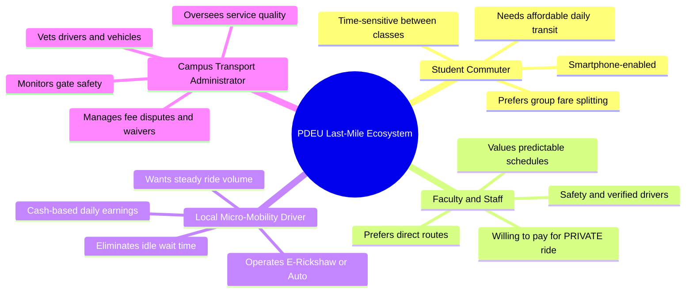
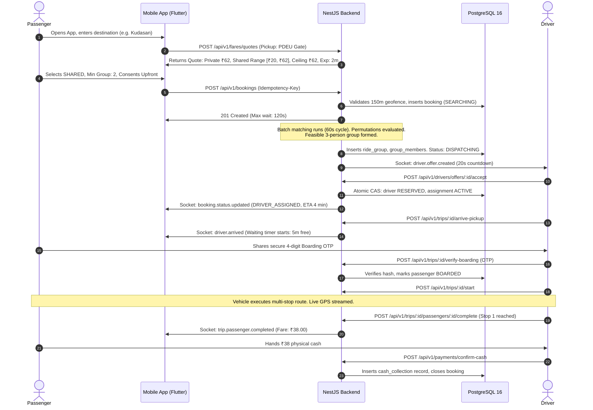

# Project Overview and Product Requirements Document (PRD)

## On-Demand Aggregation Platform for Last-Mile Connectivity Using Shared Micro-Mobility

---

## 1. Executive Summary and Vision

### 1.1 Problem Statement
Suburban university campuses, business parks, and suburban transit hubs—most notably **Pandit Deendayal Energy University (PDEU)** in Gandhinagar, Gujarat—suffer from severe "last-mile" transportation inefficiencies:
- **Transit Node Disconnect:** While trunk transit lines (state highways, regional buses, and the Ahmedabad-Gandhinagar Metro) bring commuters near campus, the final 2 to 8 km leg to residential neighborhoods (Bhaijipura, Kudasan, Koba Circle, Raysan, Infocity, Sector 1–30) remains poorly served.
- **Economic Inefficiency & High Commuter Cost:** Commuters face an unpalatable choice: pay ₹80–₹150 for private point-to-point auto-rickshaws or app-based cabs, or spend 20–40 minutes walking along unshaded, pedestrian-unfriendly arterial roads.
- **Low Vehicle Utilization & Traffic Congestion:** Traditional auto-rickshaws departing university gates frequently carry a single passenger, tripling vehicular traffic, road congestion, and carbon emissions while leaving other commuters stranded.
- **Chaotic Campus Gate Dynamics:** Informal street bargaining and manual coordination at transit gates create sidewalk crowding, price gouging, and unpredictable departure times.

### 1.2 The Platform Solution
This platform automates real-time, on-demand demand aggregation for shared micro-mobility vehicles (4-passenger electric rickshaws, bike taxis, and micro-shuttle vans):
1. **Campus Geofenced Aggregation:** Authenticates commuters at designated physical transit aggregation hubs (e.g., PDEU Main Transit Gate) via strict 150-meter backend GPS geofencing.
2. **Upfront Consent & Automatic Grouping:** Commuters give upfront consent at booking to automated grouping, vehicle capacity limits ($\le 4$ passengers), capped fares, and maximum 25% individual detours. Fragile post-matching passenger voting rounds are completely eliminated.
3. **Road-Network Routing & Drop-Off Optimization:** Uses local Open Source Routing Machine (OSRM) travel-time matrices to evaluate all $k! \le 24$ drop-off permutations, selecting the sequence that minimizes total vehicle travel time while respecting individual detour caps.
4. **Proportional Solo-Fare Allocation:** Equitably splits the shared vehicle trip fare based on benchmark solo travel costs, delivering 25%–40% fare savings to passengers while preserving fair driver compensation.
5. **Sequential 1-to-1 Driver Dispatch:** Offers formed groups to available, verified drivers one at a time with a 20-second timeout, ensuring zero driver confusion and atomic reservation locks.
6. **Cash-Only Financial Settlement:** Fully integrates with the physical cash ecosystem of Indian transit, utilizing an auditable ₹30 late-cancellation and no-show fee recovery ledger collected as a surcharge on subsequent rides.

---

## 2. Target Audience and Personas



### 2.1 Persona Details

| Persona | Role & Demographics | Key Goals | Pain Points & Constraints | System Interaction |
|---|---|---|---|---|
| **Aarav (Student Commuter)** | 20-year-old CSE undergraduate living in Kudasan (4.2 km from PDEU). | Minimize daily travel expenses; reach hostel quickly; avoid haggling with drivers. | Strict monthly budget; limited patience for 20-minute street negotiations; hates missing classes. | Uses Flutter mobile app in Passenger mode; selects SHARED booking; consents upfront; pays cash upon drop-off. |
| **Dr. Mehta (Faculty Member)** | 42-year-old professor residing in Infocity (7.5 km from PDEU). | Direct, private, non-stop transit; predictable departure; verified safe driver. | Cannot afford detour delays due to conference calls; desires private seating. | Uses Flutter mobile app; selects PRIVATE booking; accepts solo fare quote; boards immediately. |
| **Ramesh (E-Rickshaw Driver)** | 38-year-old micro-mobility operator driving a 4-seater Mahindra Treo. | Maximize daily cash earnings; minimize empty return runs; avoid long idle queues at campus gates. | Non-technical; cannot manage complex digital payment apps; loses income when passengers cancel late. | Uses Flutter mobile app in Driver mode; receives 1-to-1 audio/visual offers; follows turn-by-turn sequence; collects cash. |
| **Vikram (Campus Admin)** | 48-year-old PDEU security and facility transport officer. | Maintain orderly gate traffic; ensure only verified drivers enter campus; handle commuter disputes. | Cannot manually inspect every auto; vulnerable to student complaints regarding unauthorized overcharging. | Accesses Next.js Admin Dashboard; approves/rejects driver document submissions; reviews cancellation fee waivers. |

---

## 3. System Scope: MVP vs. Future Enhancements

```mermaid
flowchart TD
    subgraph MVP Scope [Approved B.Tech Minor Project MVP]
      M1[NestJS Modular Monolith API & Worker]
      M2[Flutter Single-Codebase App - Passenger & Driver]
      M3[Next.js 14+ Administration Portal]
      M4[PostgreSQL 16 + PostGIS 3.4 Authoritative Store]
      M5[Redis 7.2 Ephemeral GPS Cache & BullMQ Queues]
      M6[Local OSRM on OpenStreetMap Gandhinagar Road Network]
      M7[Upfront Consent Matching & 24-Permutation Optimizer]
      M8[Proportional Solo-Fare Allocation Engine]
      M9[Sequential 1-to-1 Driver Dispatch with 20s Timers]
      M10[Mid-Trip Breakdown & Replacement Dispatch Engine]
      M11[Cash Settlement & ₹30 Next-Ride Surcharge Ledger]
      M12[Demo Simulation Architecture & Control Center]
    end

    subgraph Future Enhancements [Out of Scope for MVP]
      F1[Digital Payment Gateways UPI / Razorpay / Stripe]
      F2[Dynamic Congestion-Based Surge Pricing]
      F3[Multi-Campus Network Expansion beyond Gandhinagar]
      F4[Driver Multi-Hop En-Route Pickups]
      F5[Real-time Shared Destination Alteration En Route]
      F6[Microservices Architecture & Kubernetes Clusters]
    end

    MVP Scope -->|Future Commercial Expansion| Future Enhancements
```

### 3.1 In-Scope Deliverables (Approved MVP)
1. **Core Matching Engine:** Automated spatial pooling for groups of 2 to 4 passengers departing PDEU pickup hub within a strict 60-second batch window and 120-second maximum wait deadline.
2. **Permutation Route Solver:** Local evaluation of $k! \le 24$ drop-off sequences against road-network matrices obtained from local OSRM, enforcing a strict 25% maximum individual detour limit.
3. **Proportional Solo-Fare Allocation:** Calculation of individual passenger fares proportional to their benchmark solo direct-route costs, rounded to whole rupees with deterministic group reconciliation.
4. **Fare Quote & Ceiling Enforcement:** 2-minute valid fare quotes displaying shared range [₹20, solo fare], with the solo fare serving as the immutable agreed ceiling.
5. **Waiting Charge & No-Show Engine:** First 5 minutes free, ₹5 per started minute thereafter; 10-minute wait marks no-show with a flat ₹30 fee and ₹0 waiting surcharge.
6. **Cancellation & Recovery Ledger:** Fee-free cancellation before driver assignment; ₹30 late fee after assignment; automated recovery via cash surcharge on the passenger's subsequent ride.
7. **Mid-Trip Driver Breakdown & Replacement:** Safe trip interruption, immutable passenger manifest snapshot, replacement driver dispatch based on OSRM travel time, 10% discount on trip resumption, and ₹0 fare with full refund if aborted.
8. **Realtime Telemetry & Sockets:** Socket.IO gateway with 3–5s GPS streaming to Redis (30s TTL) and 15–30s durable PostgreSQL snapshots.
9. **Role-Based Authorization:** Google OAuth 2.0 verification, JWT access tokens (15m), rotating refresh tokens (30d max), and administrator verification for drivers.
10. **Demo Simulation Architecture:** Dedicated simulation engine and Next.js control center for running reproducible evaluative demonstrations with virtual passengers, drivers, and GPS playback.

### 3.2 Out-of-Scope (Deferred Post-MVP)
- Paid commercial APIs (Google Maps Platform, Mapbox, Twilio SMS, Stripe).
- Digital in-app payments (UPI, credit/debit cards).
- Dynamic surge pricing or weather multiplier algorithms.
- En-route passenger hail or multi-hop pickup re-optimization.
- Mid-trip shared destination editing.
- Microservices, service meshes, Kafka clusters, Docker/Kubernetes container orchestration.

---

## 4. End-to-End User Journeys

### 4.1 Passenger Shared Ride User Journey


### 4.2 Driver Operational Lifecycle Journey
```mermaid
sequenceDiagram
    autonumber
    actor D as Driver
    participant App as Mobile App (Flutter)
    participant API as NestJS Backend
    participant DB as PostgreSQL 16

    D->>App: Logs in via Google OAuth
    App->>API: POST /api/v1/auth/google
    API->>DB: Verifies driver approval (status = APPROVED)
    API->>App: Issues JWT tokens (Role: DRIVER)
    D->>App: Toggles switch: GO ONLINE
    App->>API: PATCH /api/v1/drivers/status (is_online: true)
    API->>DB: Sets operational_status = AVAILABLE
    Note over API: Matching forms Group G1.<br/>Driver D1 ranked #1 by OSRM ETA.
    API->>App: Socket: driver.offer.created (G1, 3 passengers, ₹114 total fare, 20s timer)
    D->>App: Clicks ACCEPT within 20s
    App->>API: POST /api/v1/drivers/offers/:id/accept
    API->>DB: Atomic Reservation: Offer ACCEPTED, Driver RESERVED
    API->>App: Returns Assigned Trip manifest and turn-by-turn navigation route
    D->>App: Drives to PDEU pickup hub; clicks I HAVE ARRIVED
    App->>API: POST /api/v1/trips/:id/arrive-pickup
    Note over D: Verifies passenger OTPs upon boarding
    D->>App: Clicks START TRIP
    App->>API: POST /api/v1/trips/:id/start
    Loop Every 3-5 seconds
        App->>API: Socket: driver.location.update (lat, lng, heading, speed)
    end
    Note over D: Completes each passenger drop-off sequentially
    D->>App: Clicks COMPLETE DROP-OFF for Passenger 1
    App->>API: POST /api/v1/trips/:id/passengers/:id/complete
    D->>App: Confirms cash collection (₹38.00)
    App->>API: POST /api/v1/payments/confirm-cash
    Note over D: All drop-offs finished
    D->>App: Clicks END TRIP
    App->>API: POST /api/v1/trips/:id/complete
    API->>DB: Marks trip COMPLETED, operational_status = AVAILABLE
```

---

## 5. Approved Business and Operational Rules

### 5.1 Booking Types and Group Size Preferences
- **Booking Types:** Passengers select either `SHARED` or `PRIVATE`. Only `SHARED` bookings enter the automated pooling engine. If shared matching fails, the passenger may be offered a separately priced `PRIVATE` ride with explicit consent. The system **never automatically converts** a shared booking to private.
- **Group Capacity:** Shared vehicles accommodate between 2 and 4 paying passengers (plus 1 driver).
- **Group Size Preference:** Commuters choose a minimum acceptable group size at booking:
  - `Minimum 2`: Permits group sizes of 2, 3, or 4.
  - `Minimum 3`: Permits group sizes of 3 or 4.
  - `Minimum 4`: Permits exactly 4 passengers.
  - *Default Preference:* 2.
  - *Invariant:* All grouped members' preferences must be simultaneously satisfied. A passenger's preference is never downgraded automatically.

### 5.2 Matching Deadlines and Upfront Consent
- **Batch Matching Window:** 60 seconds per zone.
- **Maximum Shared Waiting Time:** 120 seconds from the original booking creation timestamp.
- **Driver Offer Timeout:** 20 seconds.
- **Deadline Persistence:** If a group is dissolved or rematched, the original 120-second deadline **never resets**.
- **Upfront Consent:** Commuters give irrevocable upfront consent to automatic grouping within disclosed constraints ($\le 4$ capacity, $\le 25\%$ detour, agreed fare ceiling). No post-matching voting exists.

### 5.3 Fare Engine, Quotes, and Ceilings
- **Approved Tariff:** Base fare $B = \text{₹}20$, Distance rate $R = \text{₹}10/\text{km}$, Minimum fare per passenger = ₹20.
- **Proportional Allocation Formula:**
  $$S_i = B + D_i \times R \quad (\text{Solo reference fare for passenger } i)$$
  $$G = B + D_{\text{shared}} \times R \quad (\text{Total shared vehicle fare})$$
  $$F_i = G \times \frac{S_i}{\sum_{j} S_j} \quad (\text{Individual allocated fare})$$
- **Fare Quote Validity:** Exactly 2 minutes. Displays shared range [₹20, solo estimated fare].
- **Agreed Fare Ceiling:** The passenger's private estimated fare serves as the hard ceiling. An allocated fare can never exceed this ceiling.
- **Rounding:** Rounded to whole rupees (₹0.50 rounds upward) with deterministic remainder reconciliation against group fare $G$.
- **Waiting Charges:** First 5 minutes free. ₹5 per started minute thereafter ($W_i = 5 \times \lceil\max(0, T_i - 5)\rceil$). Individual charge; never part of group fare.
- **No-Show Policy:** Unboarded after 10 minutes from driver arrival $\rightarrow$ `NO_SHOW`, flat ₹30 fee, ₹0 additional waiting charge.

### 5.4 Cancellation and Late Fee Recovery
- **Before Driver Assignment:** Fee-free cancellation (₹0). Remaining group is evaluated; preserved if $\ge 2$ passengers and detour $\le 25\%$; otherwise dissolved and rematched preserving original timestamps.
- **After Driver Assignment:** Fixed ₹30 late cancellation fee inserted into `cancellation_fees` as `OUTSTANDING`.
- **Cash Recovery:** Surcharged on the passenger's subsequent ride. Disclosed before booking confirmation. Atomic single collection in cash.

### 5.5 Driver Breakdown and Mid-Trip Interruption
- **Trip Interrupted:** Trip marked `INTERRUPTED`. Immutable manifest snapshot recorded.
- **Replacement Search:** Searches available approved drivers ranked by OSRM travel time to breakdown location.
- **Replacement Success:** Resumes trip (`trip.resumed` event). Onboard passengers receive an explicit 10% discount on final fare.
- **Replacement Failure:** Marked `ABORTED`. Onboard passengers pay ₹0. Full refund if cash collected. Platform absorbs cost.

### 5.6 Early Drop-Off
- **Shared Ride:** Passenger can request early drop-off at an on-route safe point. Driver confirms. Passenger marked `COMPLETED`. Original allocated fare remains unchanged. Other passengers' fares unchanged.
- **Private Ride:** Destination alteration allowed en route; backend recalculates route and fare; passenger confirms updated fare.

---

## 6. Functional Requirements (FRs)

| Req ID | Domain | Requirement Statement | Priority | Verification Method |
|---|---|---|---|---|
| **FR-01** | Identity | System shall authenticate passengers and drivers via Google OAuth 2.0 and issue platform JWTs. | P0 | Automated Integration Test |
| **FR-02** | Geofence | System shall validate that pickup coordinates fall within 150m of PDEU zone center using PostGIS `ST_DWithin`. | P0 | PostGIS Spatial Query Test |
| **FR-03** | Boundaries | System shall validate drop-off coordinates against the Gandhinagar service region polygon using `ST_Contains`. | P0 | Boundary Polygon Test |
| **FR-04** | Booking Invariant | System shall enforce exactly one active booking per passenger via a PostgreSQL partial unique index. | P0 | Concurrency Race Test |
| **FR-05** | Fare Quote | System shall generate a 2-minute valid fare quote displaying shared range [₹20, private fare] and locking the ceiling. | P0 | Unit & E2E Test |
| **FR-06** | Batch Pool | System shall aggregate SEARCHING bookings into 60s batches protected by an atomic Redis lease. | P0 | Worker Simulation Test |
| **FR-07** | Permutation Solver | System shall evaluate all $k! \le 24$ drop-off sequences via OSRM matrices, enforcing $\le 25\%$ individual detour. | P0 | Permutation Unit Test |
| **FR-08** | Proportional Fare | System shall calculate individual fares using the approved proportional formula with whole-rupee reconciliation. | P0 | Mathematical Audit Test |
| **FR-09** | 1-to-1 Dispatch | System shall dispatch a formed group to exactly one driver at a time with a 20-second timeout. | P0 | Dispatch State Machine Test |
| **FR-10** | Driver Multi-Offer | System shall allow drivers to receive multiple offers for different groups, atomically resolving acceptance. | P0 | Concurrency Acceptance Test |
| **FR-11** | OTP Boarding | System shall verify individual passenger boarding via secure 4-digit hashed OTPs before trip start. | P0 | Security Verification Test |
| **FR-12** | Telemetry | System shall stream driver GPS every 3–5s to Redis (30s TTL) and persist PostgreSQL breadcrumbs every 15–30s. | P1 | Socket & DB Telemetry Test |
| **FR-13** | Late Fee | System shall assess a ₹30 fee for cancellations after driver assignment and recover it on the next ride. | P0 | Financial Ledger Test |
| **FR-14** | Breakdown Engine | System shall handle driver breakdowns, dispatch replacements, and apply 10% discounts or ₹0 abortions. | P0 | Breakdown Simulation Test |
| **FR-15** | Cash Confirmation | System shall allow drivers to confirm cash collections per passenger independently of vehicle trip completion. | P0 | Cash Ledger E2E Test |

---

## 7. Non-Functional Requirements (NFRs)

### 7.1 Performance and Latency
- **Fare Quote Response:** $\le 350\text{ ms}$ (including OSRM single-pair routing).
- **Matching Batch Execution:** $\le 1200\text{ ms}$ for a batch of 50 bookings and 24-permutation evaluations.
- **Driver Offer Socket Notification:** $\le 250\text{ ms}$ from group formation to mobile client delivery.
- **GPS Telemetry Latency:** $\le 150\text{ ms}$ from driver device broadcast to passenger map marker update.

### 7.2 Data Integrity and ACID Concurrency
- **Zero Financial Discrepancies:** All monetary amounts represented in integer paise; fractional rounding deterministically reconciled so $\sum F_i = G$.
- **Zero Phantom Drivers:** Atomic conditional updates and row-level locks prevent double-booking drivers or double-assigning groups.
- **Fail-Closed Operations:** If PostgreSQL is unreachable, all mutating operations fail closed; no business state is persisted in ephemeral storage.

### 7.3 Budget and Deployment Constraints
- **Strict ₹0 Budget:** Zero subscriptions to paid cloud services, proprietary map APIs, SMS gateways, or payment gateways.
- **Hardware Portability:** Entire backend, database, cache, routing engine, and admin dashboard must run locally on an Apple Silicon Mac host.

---

*End of Project Overview and Product Requirements Document (PRD)*
