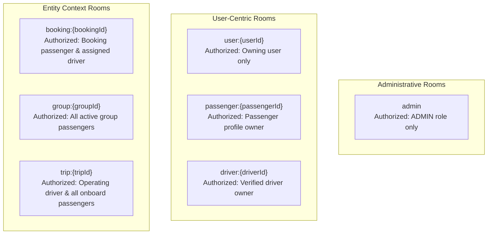
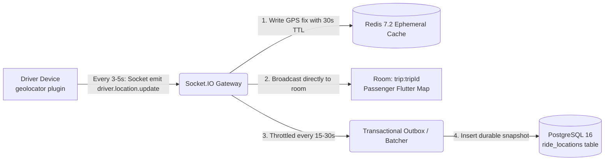

# Realtime Socket.IO Gateway Specification

## On-Demand Aggregation Platform for Last-Mile Connectivity Using Shared Micro-Mobility

---

## 1. Realtime Architectural Principles

1. **REST is Authoritative; Socket.IO is Notification-Only:** All business state mutations (booking creation, offer acceptances, OTP verifications, fee assessments, and cash collections) must execute through authoritative REST endpoints. WebSockets are strictly utilized for high-speed downstream notifications and GPS telemetry broadcasts.
2. **Outbox-Driven Reliability:** Critical domain events are inserted into `outbox_events` within the primary PostgreSQL ACID transaction, guaranteeing that notifications are never lost due to socket gateway crashes.
3. **Idempotency and Version Handling:** Clients process events idempotently. Each business event carries an `entityVersion`. Clients discard events where `entityVersion <= localVersion`. If a version gap is detected (`entityVersion > localVersion + 1`), the client fetches the authoritative state via REST (`POST /api/v1/sync`).

---

## 2. Gateway Connection Lifecycle and Authentication

### 2.1 Transport and Addressing
- **Protocol:** WebSocket (with polling fallback).
- **Endpoint:** `ws://127.0.0.1:3000/realtime` (Local) / `wss://<mac-ip>:3000/realtime` (LAN).
- **Namespace:** Default `/` namespace.

### 2.2 Short-Lived Socket Ticket Authentication
To prevent long-lived JWT leakage over WebSocket handshake query strings, authentication utilizes **single-use socket tickets**:
1. Client calls REST `GET /api/v1/auth/socket-ticket` with its JWT Bearer token.
2. Backend generates a cryptographically random ticket stored in Redis with a 60-second TTL:
   `socket_ticket:<ticket_uuid> -> { userId, role, activeSessionId }`.
3. Client connects to Socket.IO, passing the ticket in `auth`:
   ```javascript
   const socket = io('http://192.168.1.50:3000/realtime', {
     auth: { ticket: 'single-use-ticket-uuid' },
     transports: ['websocket']
   });
   ```
4. NestJS `SocketGateway` validates and burns the ticket atomically (one-time use). If invalid or expired, the connection is immediately terminated with HTTP 401 Unauthorized.

### 2.3 Heartbeat and Ping/Pong Cadence
- **Ping Interval:** 25 seconds.
- **Ping Timeout:** 60 seconds.
- If no pong response is received within 60 seconds, the server terminates the socket, marks the driver's GPS as stale, and logs the disconnection.

---

## 3. Room Hierarchy and Access Control

Clients are automatically joined to authorized rooms upon connection based on their authenticated identity and active bookings/trips:



### 3.1 Room Membership Specifications

| Room Name Pattern | Authorized Participants | Permitted Broadcasts |
|---|---|---|
| `user:{userId}` | The specific authenticated user. | Personal account alerts, session revocations, token expiry notices. |
| `passenger:{passengerId}` | Active commuter. | Direct booking updates, wait deadline countdowns, matching status changes. |
| `driver:{driverId}` | Verified micro-mobility driver. | 1-to-1 dispatch offers (`driver.offer.created`), withdrawal notices, approval updates. |
| `booking:{bookingId}` | Passenger and assigned driver. | Booking cancellations, fee assessments, arrival notices. |
| `group:{groupId}` | All members of a formed shared ride group. | Group membership alterations, updated route geometries, recalculation notices. |
| `trip:{tripId}` | Active driver and all passengers enrolled on trip. | High-frequency driver GPS updates (3–5s), arrival notices, breakdown alerts (`trip.interrupted`, `trip.resumed`). |
| `admin` | Campus transport safety officers. | Real-time fleet telemetry, breakdown incident alerts, driver document submissions. |

---

## 4. Standard Event Envelope

All domain events broadcast across Socket.IO adhere to the standard business envelope:

```json
{
  "eventId": "c8b4e720-410a-4221-872c-d90048cb1512",
  "event": "trip.status.updated",
  "entityType": "TRIP",
  "entityId": "550e8400-e29b-41d4-a716-446655440000",
  "entityVersion": 3,
  "occurredAt": "2026-11-17T12:00:00.000Z",
  "data": {
    "previousStatus": "AT_PICKUP",
    "newStatus": "IN_PROGRESS",
    "tripId": "550e8400-e29b-41d4-a716-446655440000",
    "totalPassengersBoarded": 3
  }
}
```

### 4.1 Envelope Field Descriptions
- `eventId`: Unique UUIDv4 identifying this transmission (for client-side deduplication).
- `event`: Canonical domain event name in dot notation.
- `entityType`: Core domain aggregate: `'BOOKING'`, `'RIDE_GROUP'`, `'DRIVER_OFFER'`, `'TRIP'`, `'INCIDENT'`.
- `entityId`: Primary key of the aggregate entity.
- `entityVersion`: Monotonically incrementing integer representing the state version.
- `occurredAt`: Authoritative UTC ISO 8601 timestamp of database commit.
- `data`: Typed JSON payload containing contextual attributes.

---

## 5. Master Realtime Event Catalogue

| Event Name | Producer | Target Room | Frequency | Description & Purpose |
|---|---|---|---|---|
| `booking.status.updated` | BookingsModule | `passenger:{id}`, `booking:{id}` | State changes | Emitted when booking transitions: `MATCHING`, `CONFIRMED`, `COMPLETED`, `CANCELLED`, `EXPIRED`. |
| `group.updated` | MatchingModule | `group:{id}` | On membership change | Broadcasts revised route geometry, updated drop-off sequence, and recalculated fares after a cancellation. |
| `driver.offer.created` | DispatchModule | `driver:{id}` | On group formation | Pushes 1-to-1 dispatch offer to single driver with 20-second countdown timer and trip details. |
| `driver.offer.withdrawn` | DispatchModule | `driver:{id}` | On timeout/competing accept | Notifies driver that a pending offer has been withdrawn or accepted by another assignment. |
| `driver.location.updated` | DriversModule | `trip:{id}`, `admin` | Every 3–5 seconds | High-frequency telemetry stream containing driver coordinate, heading, and speed for live map animation. |
| `driver.gps.stale` | LocationsModule | `trip:{id}`, `admin` | Upon 10s missing fix | Warns passengers that the driver device has not reported GPS for $> 10\text{ seconds}$. |
| `driver.arrived` | TripsModule | `trip:{id}`, `passenger:{id}` | Driver arrival click | Notifies passengers of driver arrival at PDEU hub; starts individual 5-minute free waiting timer. |
| `passenger.boarded` | TripsModule | `trip:{id}`, `passenger:{id}` | Successful OTP check | Confirms passenger OTP verification; stops individual waiting charge timer. |
| `trip.interrupted` | IncidentsModule | `trip:{id}`, `admin` | Breakdown report | Alerts passengers and campus admin of mid-trip vehicle failure; initiates replacement dispatch. |
| `trip.resumed` | IncidentsModule | `trip:{id}`, `admin` | Replacement handover | Emitted when replacement driver accepts; notifies remaining passengers of 10% fare discount. |
| `trip.completed` | TripsModule | `trip:{id}` | Final drop-off | Notifies participants of vehicle trip finalization and triggers cash settlement prompts. |
| `admin.driver.submitted` | DriversModule | `admin` | On document upload | Prompts admin dashboard that a new driver document is pending verification. |

---

## 6. GPS Telemetry Streaming and Persistence Cadence



### 6.1 Telemetry Intervals and Rates

| Operating State | Device GPS Sampling Rate | Socket Emit Frequency | Redis Cache TTL | PostgreSQL Snapshot Cadence |
|---|---|---|---|---|
| **Active Trip (In-Progress)** | Every 2–3 seconds | **Every 3–5 seconds** | 30 seconds | **Every 15–30 seconds** (or upon passenger drop-off) |
| **At Pickup Hub (Waiting)** | Every 5 seconds | **Every 5–10 seconds** | 30 seconds | On arrival and departure only |
| **Online & Available (Idle)** | Every 10 seconds | **Every 15–30 seconds** | 30 seconds | None (ephemeral only) |
| **Offline** | Disabled (0 Hz) | Disabled | Key deleted | None |

### 6.2 Stale GPS Fix Detection
- **Warning Threshold (10 seconds):** If no GPS fix is received from an active driver for 10 seconds, the backend emits `driver.gps.stale` to the `trip:{tripId}` room. The passenger mobile map alters the vehicle marker to semi-transparent yellow.
- **Stale State Threshold (30 seconds):** If no fix is received for 30 seconds, Redis automatically evicts the GPS key (`EXPIRE`). The vehicle marker displays a "Connection Interrupted" banner.
- **Active Trip Protection Invariant:** The system **does not automatically reassign** an in-progress trip merely because GPS is stale, preventing dangerous physical confusion while passengers are physically inside the vehicle.

---

## 7. Reconnection and State Reconciliation Protocol

Mobile clients operating over cellular data networks experience frequent network transitions (Wi-Fi $\rightarrow$ LTE, cell tower handovers, tunnel signal losses). The client implements **Exponential Backoff Reconnection with REST Reconciliation**:

```mermaid
sequenceDiagram
    autonumber
    participant App as Mobile Client (Flutter)
    participant Socket as Socket.IO Gateway
    participant REST as NestJS REST API (/api/v1/sync)
    participant DB as PostgreSQL 16

    Note over App,Socket: Network connection severed (Cell tower dead zone)
    Socket->>Socket: Socket terminates; joins removed from memory
    App->>App: Detects disconnect; starts reconnection backoff (1s, 2s, 5s, 10s, max 30s with jitter)
    Note over App: Network connectivity restored
    App->>REST: GET /api/v1/auth/socket-ticket (Fetch fresh ticket)
    REST-->>App: Returns new single-use ticket
    App->>Socket: Connect to /realtime with new ticket
    Socket-->>App: Connection established; auto-joins user room
    App->>REST: POST /api/v1/sync { lastKnownEntityVersion: 3, activeTripId: "..." }
    REST->>DB: Query authoritative state of bookings, groups, and trips
    REST-->>App: Returns full current state snapshot (EntityVersion: 5, status: IN_PROGRESS)
    App->>App: Reconciles missed events; updates UI state deterministically
```

### 7.1 Reconnection Rules
1. **Backoff Schedule:** 1s, 2s, 5s, 10s, 20s, capped at a maximum of 30 seconds, randomized with $\pm 20\%$ jitter to prevent reconnection thundering herds.
2. **Fresh Ticket Mandate:** Sockets must never attempt reconnection using an expired or already-burned ticket. The client must call `GET /api/v1/auth/socket-ticket` prior to re-establishing the WebSocket.
3. **Mandatory `/sync` Execution:** Following reconnection, the client **must immediately invoke** `POST /api/v1/sync` to pull any missed state transitions (such as passenger cancellations, driver assignment, or breakdown declarations) that occurred during the blackout window.

---

*End of Realtime Socket.IO Gateway Specification*
