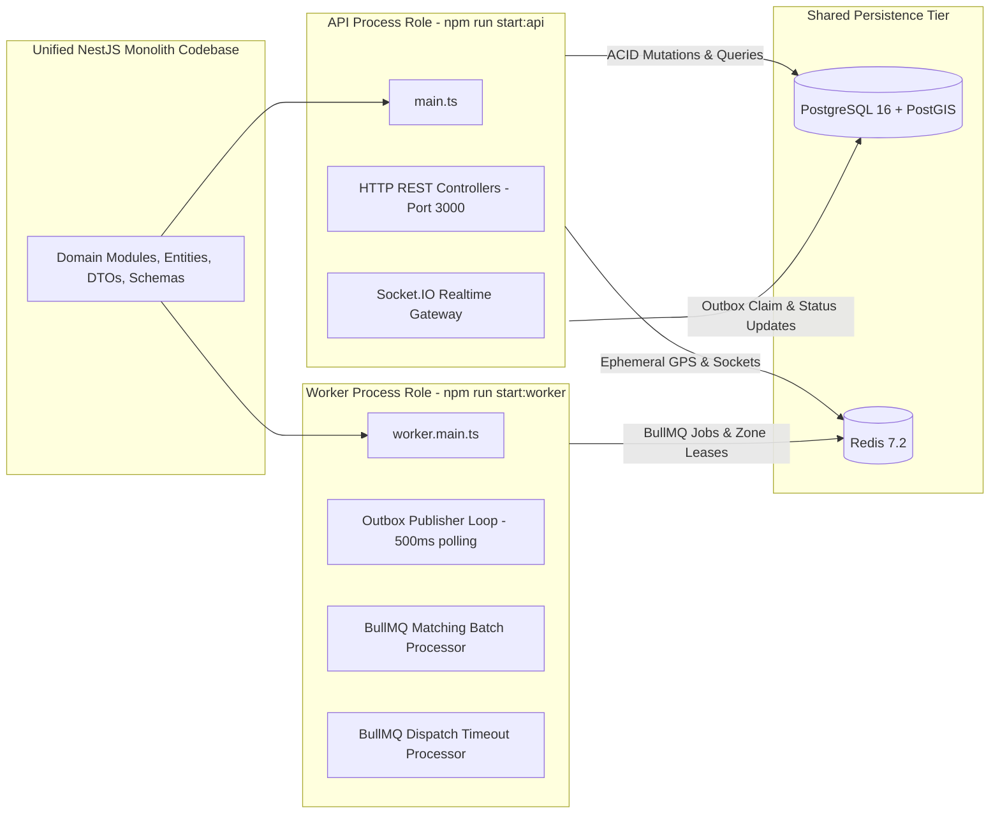
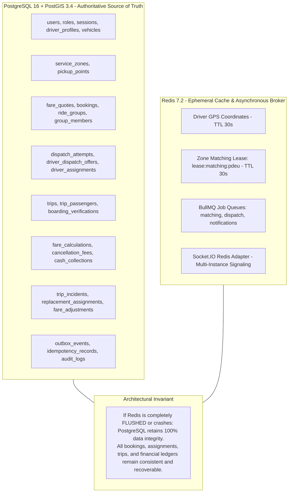
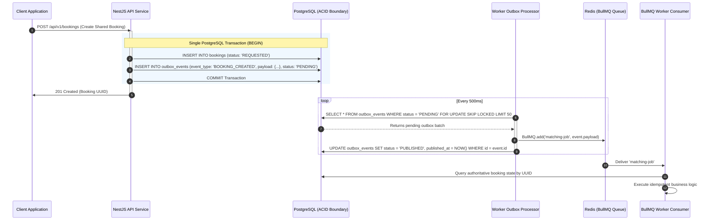
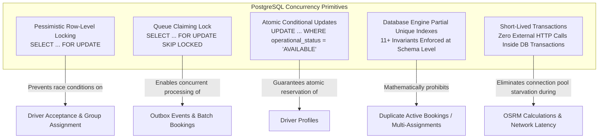

# System Architecture Specification

## On-Demand Aggregation Platform for Last-Mile Connectivity Using Shared Micro-Mobility

---

## 1. Modular Monolith Architecture

The backend architecture is strictly implemented as a **NestJS Modular Monolith** located within `apps/backend`. Microservices, independent gRPC clusters, and distributed service meshes are explicitly forbidden to ensure rapid development, ACID consistency, and strict compliance with the ₹0 budget.

```mermaid
graph TD
    subgraph ClientInterface [External Interface Layer]
      REST[REST API Controllers - /api/v1]
      WS[Socket.IO Realtime Gateway - /realtime]
      CLI[Internal Queue Workers & Schedulers]
    end

    subgraph SecurityLayer [Security & Interception Pipeline]
      AuthGuard[JWT Auth Guard]
      RBACGuard[Role-Based Access Control Guard]
      IdemGuard[Idempotency Verification Interceptor]
      AuditInterceptor[Admin Audit Logging Interceptor]
    end

    subgraph DomainModules [Core Domain Modules]
      AuthMod[AuthModule]
      UserMod[UsersModule & PassengerProfilesModule]
      DrivMod[DriversModule & VehiclesModule]
      LocaMod[LocationsModule & ServiceZonesModule]
      FareMod[FaresModule]
      BookMod[BookingsModule]
      MatcMod[MatchingModule]
      RoutMod[RoutingModule]
      DispMod[DispatchModule]
      TripMod[TripsModule]
      InciMod[IncidentsModule]
      PaymMod[PaymentsModule]
      NotiMod[NotificationsModule]
      AdmiMod[AdminModule]
    end

    subgraph InfrastructureTier [Core Infrastructure Layer]
      PrismaSvc[Prisma Database Service - PostgreSQL 16 + PostGIS]
      RedisSvc[Redis Cache & Queue Service - Redis 7.2]
      BullMQSvc[BullMQ Job Orchestrator]
      OutboxSvc[Transactional Outbox Engine]
      OSRMSvc[OSRM HTTP Client Wrapper]
    end

    ClientInterface --> SecurityLayer
    SecurityLayer --> DomainModules
    DomainModules --> InfrastructureTier
```



---

## 2. Comprehensive Domain Module Deep-Dives

The modular monolith encapsulates domain logic into 16 distinct modules. Inter-module communication executes via synchronous in-memory TypeScript service interfaces, while asynchronous processing uses the Transactional Outbox.

### 2.1 Domain Module Directory and Ownership Matrix

| Module Name | NestJS Directory | Exported Services | Injected Dependencies | Core Domain Responsibility |
|---|---|---|---|---|
| **AuthModule** | `src/modules/auth/` | `AuthService`, `JwtStrategy`, `GoogleStrategy` | `UsersModule`, `InfrastructureModule` | Validates Google ID tokens; signs JWT access tokens; hashes and rotates refresh tokens; issues 60s socket tickets. |
| **UsersModule** | `src/modules/users/` | `UsersService` | `InfrastructureModule` | Manages core `users` and `user_roles` records; handles user profile updates and account state. |
| **PassengerProfilesModule** | `src/modules/passengers/` | `PassengerProfilesService` | `UsersModule`, `InfrastructureModule` | Tracks passenger ride history, outstanding cancellation fees, and default group preferences. |
| **DriversModule** | `src/modules/drivers/` | `DriversService` | `VehiclesModule`, `InfrastructureModule` | Manages driver onboarding, document submissions, operational availability status (`OFFLINE`, `AVAILABLE`, `RESERVED`, `ON_TRIP`), and administrator approval. |
| **VehiclesModule** | `src/modules/vehicles/` | `VehiclesService` | `InfrastructureModule` | Stores vehicle registration numbers, makes, models, and certified passenger seating capacities (default: 4). |
| **LocationsModule** | `src/modules/locations/` | `LocationsService` | `InfrastructureModule` | Executes PostGIS spatial validations: validates pickup points within 150m of PDEU zone center; validates drop-offs within Gandhinagar polygon. |
| **ServiceZonesModule** | `src/modules/service-zones/`| `ServiceZonesService` | `InfrastructureModule` | Configures geographic polygons, active operating hours, and authorized campus transit hubs. |
| **FaresModule** | `src/modules/fares/` | `FaresService` | `RoutingModule`, `InfrastructureModule` | Computes benchmark solo fares, shared total fares, proportional allocations, ceiling checks, waiting charges, and deterministic rounding reconciliations. |
| **BookingsModule** | `src/modules/bookings/` | `BookingsService` | `FaresModule`, `LocationsModule`, `InfrastructureModule` | Manages booking creation with upfront consent, 120s wait deadlines, passenger cancellations, and active booking invariants. |
| **MatchingModule** | `src/modules/matching/` | `MatchingService`, `PermutationSolver` | `RoutingModule`, `FaresModule`, `BookingsModule`, `InfrastructureModule` | Executes 60s zone batches; evaluates $k! \le 24$ permutations via OSRM matrices; enforces $\le 25\%$ detour; creates `ride_groups`. |
| **RoutingModule** | `src/modules/routing/` | `RoutingService`, `OsrmClient` | `InfrastructureModule` | Wraps local OSRM Table and Route REST APIs; executes circuit breakers, retry backoffs, and travel-time matrix caching. |
| **DispatchModule** | `src/modules/dispatch/` | `DispatchService` | `DriversModule`, `BookingsModule`, `InfrastructureModule` | Manages sequential 1-to-1 dispatch offers (20s timers), driver multi-offer coordination, atomic acceptance locking, and rejection cascades. |
| **TripsModule** | `src/modules/trips/` | `TripsService` | `BookingsModule`, `DispatchModule`, `InfrastructureModule` | Tracks driver arrival, individual passenger OTP boarding verification, multi-stop progression, early drop-offs, and vehicle trip completion. |
| **IncidentsModule** | `src/modules/incidents/` | `IncidentsService` | `DispatchModule`, `FaresModule`, `InfrastructureModule` | Manages driver mid-trip breakdowns, snapshotting immutable manifests, dispatching replacement drivers, applying 10% discounts, or ₹0 abortions. |
| **PaymentsModule** | `src/modules/payments/` | `PaymentsService` | `BookingsModule`, `InfrastructureModule` | Audits physical cash collections, maintains the ₹30 late-fee ledger (`OUTSTANDING` $\rightarrow$ `COLLECTED`), and enforces no-duplicate collection invariants. |
| **NotificationsModule** | `src/modules/notifications/`| `NotificationsService` | `InfrastructureModule` | Emits realtime WebSocket events to authorized Socket.IO rooms (`user`, `driver`, `booking`, `trip`, `admin`). |
| **AdminModule** | `src/modules/admin/` | `AdminService` | All Domain Modules | Provides administrative endpoints for driver document approval, real-time fleet monitoring, fee waivers, and system audit logging. |
| **InfrastructureModule** | `src/modules/infrastructure/`| `PrismaService`, `RedisService`, `OutboxService` | None (Leaf) | Exports Prisma ORM client, raw SQL execution helpers, ioredis clients, BullMQ job queue factories, and outbox publisher loops. |

---

## 3. Application Boundaries and Process Topology

The backend codebase generates two independent runnable process roles from a single unified repository:



### 3.1 Process Separation Rules
1. **Zero Shared In-Memory State:** The API process and Worker process share **zero in-memory variables**. Coordination occurs exclusively through PostgreSQL row states, Redis BullMQ queues, and distributed locks.
2. **Unified Single-Process Fallback:** For local development on resource-constrained environments, both entry points can run within a single Node.js instance (`npm run start:dev`) by mounting the BullMQ processors alongside the HTTP controllers.
3. **Dedicated Responsibilities:**
   - **API Process (`main.ts`):** Handles client HTTP connections, JWT authentication, geofence validation, and WebSocket client connections. Must never block its event loop on heavy combinatorial math or long delays.
   - **Worker Process (`worker.main.ts`):** Executes 60s matching batches, OSRM permutation evaluations, 20s dispatch countdown timers, and outbox event publishing.

---

## 4. PostgreSQL vs. Redis Architectural Separation



### 4.1 Tier Distinction Principles
- **PostgreSQL is Authoritative:** All state transitions (booking status, group version, driver operational status, cash collections, and cancellation fees) are committed strictly to PostgreSQL under ACID transaction boundaries.
- **Redis is Ephemeral:** Redis stores volatile data that can be re-derived or discarded without data loss:
  - Driver GPS telemetry (cached with an automated 30s TTL).
  - Active distributed leases (e.g., matching zone locks).
  - Delayed job schedules in BullMQ.
- **Fail-Closed Persistence:** Mutating endpoints fail closed if PostgreSQL is unreachable; mutations are never acknowledged based solely on Redis memory writes.

---

## 5. Transactional Outbox Pattern

To eliminate dual-write vulnerabilities between PostgreSQL and Redis, all asynchronous event-driven workflows utilize the **Transactional Outbox Pattern**:



### 5.1 Outbox Guarantees
1. **At-Least-Once Delivery:** An event committed to the database is guaranteed to be pushed to BullMQ. If the outbox worker crashes mid-push, the event remains `PENDING` and is retried upon restart.
2. **`FOR UPDATE SKIP LOCKED`:** Multiple worker processes can poll `outbox_events` concurrently without locking conflicts or deadlocks.
3. **Consumer Idempotency:** Background workers must verify the current state of the authoritative record in PostgreSQL before executing side-effects, ignoring stale or duplicate jobs.

---

## 6. Concurrency and Locking Strategy

High-concurrency ride platforms face extreme race conditions: simultaneous driver offer acceptance, concurrent passenger cancellations, and duplicate booking submissions. The system enforces strict concurrency guarantees using PostgreSQL primitives:



### 6.1 Concurrency Rules
1. **Transaction Isolation:** PostgreSQL default `READ COMMITTED` isolation is used in combination with explicit pessimistic row locks (`SELECT ... FOR UPDATE`).
2. **Never Hold Transactions Open for External I/O:** Database transactions must **never remain open** while awaiting external OSRM HTTP responses, Socket.IO broadcasts, or user input. Data must be gathered *before* opening the transaction, and external notifications must be dispatched *after* the transaction commits.
3. **Atomic Driver Acceptance:**
   ```sql
   -- Atomic conditional compare-and-swap update
   UPDATE driver_profiles 
   SET operational_status = 'RESERVED' 
   WHERE id = :driverId AND operational_status = 'AVAILABLE';
   ```
   If zero rows are updated, the driver has already been claimed by another assignment, and the transaction aborts cleanly with an `OFFER_ALREADY_TAKEN` error.

---

## 7. Comprehensive Failure Handling and Resilience Matrix

| Failure Mode | Root Cause | System Detection | Authoritative Fail-Safe Action | Data Recovery Procedure |
|---|---|---|---|---|
| **PostgreSQL Database Outage** | Process crash, disk exhaustion, host reboot. | Health check failure; Prisma connection timeout. | System fails closed. All mutating REST endpoints return HTTP 503 Service Unavailable. Sockets notify users of service degradation. | PostgreSQL restarts; WAL replay restores consistent state. BullMQ re-reads authoritative rows. |
| **Redis Cache Outage** | Redis crash, out of memory, connection severed. | ioredis error events; BullMQ queue disconnection. | REST mutations continue (writing to PostgreSQL + Outbox). GPS streaming degrades to in-memory broadcast. Background jobs pause. | Redis restarts; BullMQ re-establishes queues; Outbox worker re-publishes pending events from PostgreSQL. |
| **OSRM Routing Engine Outage** | OSRM daemon crash, bad map data file. | HTTP 500 / connection refused on port 5000. | Circuit breaker trips after 3 consecutive failures. Matching batches fail safely with status `FAILED`. No fabricated straight-line fares are issued. | OSRM service restarted locally. Bookings remain in `SEARCHING` until OSRM circuit breaker closes. |
| **NestJS API Process Crash** | Unhandled exception, memory leak, Node OOM. | OS process exit; socket disconnects. | Mobile clients detect socket closure and initiate exponential backoff reconnect. Operating system restarts API process. | Clients reconnect, obtain new socket ticket, and call `POST /api/v1/sync` to restore state. |
| **NestJS Worker Process Crash** | Worker fatal error during batch processing. | Redis lease expiration (`lease:matching:pdeu`). | BullMQ stalled job detector reclaims stalled jobs. Redis zone lease expires after 30 seconds, allowing next batch run. | Outbox worker resumes polling with `SKIP LOCKED`. Incomplete batches mark status `FAILED` and release claimed bookings. |
| **Driver Drops Network En Route** | Mobile dead zone, device battery depletion. | Missing Socket.IO ping heartbeat (60s timeout); stale GPS fix ($>30\text{s}$). | Vehicle marked `GPS_STALE` on passenger map. Active trip **is NOT reassigned** automatically to prevent physical confusion. | Driver app reconnects, syncs state via `POST /sync`, and flushes cached GPS points. |
| **Mid-Trip Driver Vehicle Breakdown** | Mechanical flat tire, engine failure, collision. | Driver clicks `REPORT BREAKDOWN` or admin reports incident. | Trip marked `INTERRUPTED`. Immutable passenger manifest captured. Replacement driver searched via OSRM ETA. | Replacement driver accepts: trip resumes with 10% discount. No driver found: trip marked `ABORTED`, ₹0 fare, full cash refund. |
| **Driver Offer Acceptance Race** | Two drivers accept offers for different groups simultaneously involving conflicting capacity. | PostgreSQL row-lock conflict on `driver_profiles`. | First transaction to execute conditional CAS claims the driver (`RESERVED`). Second transaction receives `OFFER_ALREADY_TAKEN`. | Losing driver receives HTTP 409 Conflict; group cascades to next ranked driver in dispatch queue. |

---

*End of System Architecture Specification*
