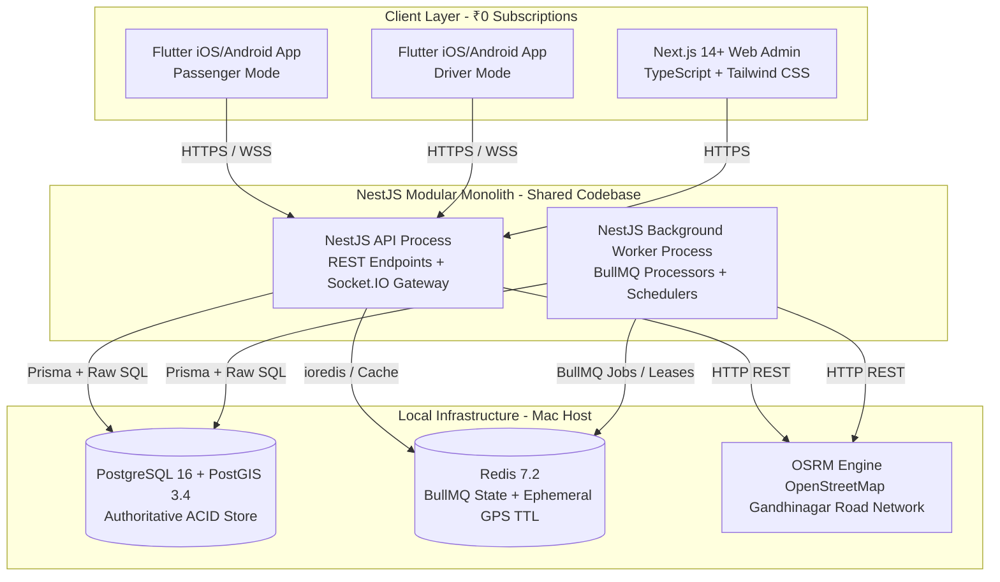
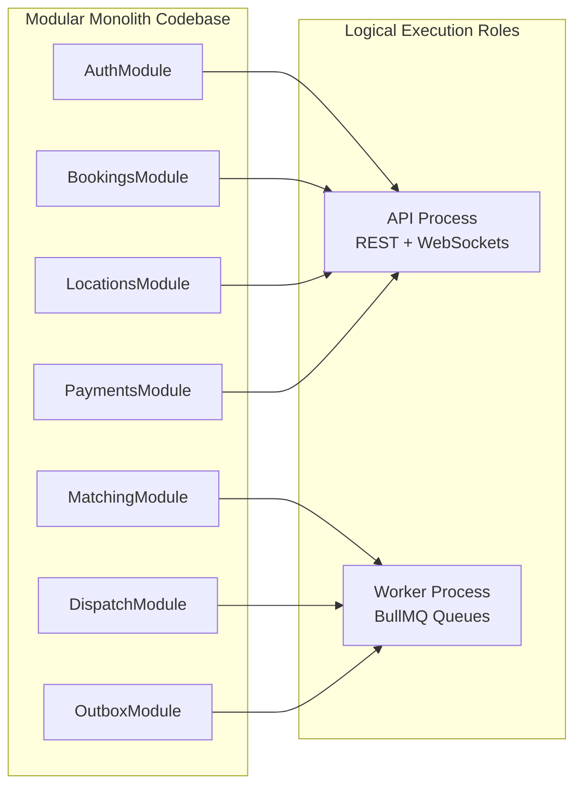
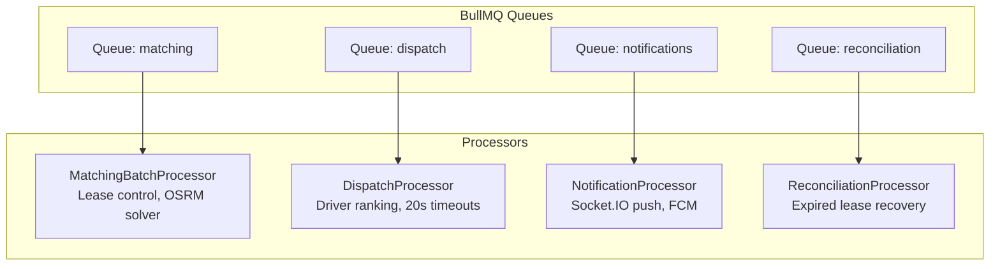
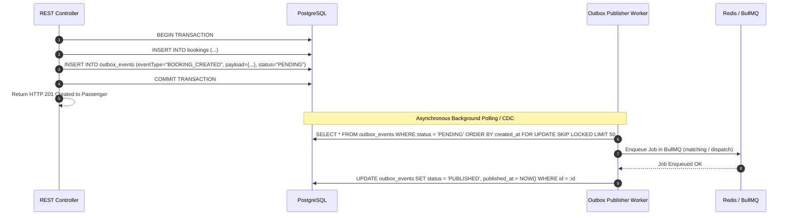
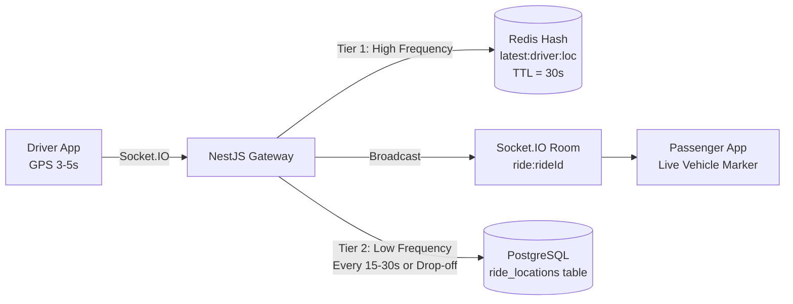
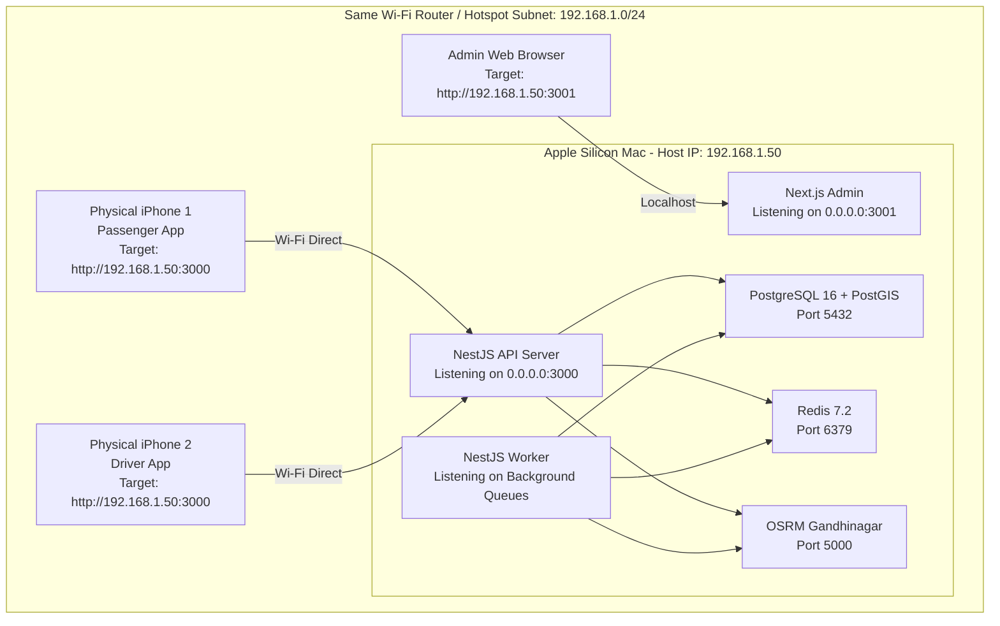

# Technical Requirements Document (TRD)

## On-Demand Aggregation Platform for Last-Mile Connectivity Using Shared Micro-Mobility

---

## 1. Technology Selection and Justifications

The selected technology stack is strictly optimized for a team of 2–3 CSE students building an enterprise-grade distributed platform within 4–6 weeks, subject to a strict **₹0 infrastructure and subscription budget constraint**.



### 1.1 Technology Stack Matrix

| Architectural Layer | Selected Technology | Version Baseline | Rationale & Architectural Justification | Alternatives Considered & Rejected |
|---|---|---|---|---|
| **Mobile Application** | **Flutter / Dart** | Flutter 3.22+ / Dart 3.4+ | Single cross-platform codebase compiling to native iOS and Android. Rich ecosystem for low-level location streaming, hardware sensors, and reactive UI. Role-specific flows (Passenger & Driver) exist in one compiled binary. | **React Native:** Bridge overhead, fragile native module linking, and worse background GPS performance.<br>**Native Swift/Kotlin:** Requires maintaining two distinct codebases; impractical for 2–3 developers in 4–6 weeks. |
| **Mobile State & Routing** | **Provider & go_router** | Latest stable | `Provider` offers clean, decoupled dependency injection and reactive state with minimal boilerplate. `go_router` provides declarative, deep-link-friendly URL routing and strict auth redirect guards. | **Bloc / Riverpod:** Unnecessary boilerplate and steeper learning curve for a 4-week timeline.<br>**GetX:** Poor architectural discipline, excessive hidden global state. |
| **Mobile Networking & Sockets** | **Dio & socket_io_client** | Latest stable | `Dio` provides interceptors for automatic JWT refresh token rotation, request cancellation, and idempotency headers. `socket_io_client` delivers resilient WebSocket connections with automatic reconnection and heartbeat ping/pong. | **Standard http package:** Lacks interceptors, form-data streaming, and unified retry handlers.<br>**Raw WebSockets:** Requires custom framing, manual reconnection logic, and heartbeat handling. |
| **Mobile Storage & GPS** | **flutter_secure_storage & geolocator** | Latest stable | `flutter_secure_storage` encrypts JWTs via iOS Keychain and Android KeyStore. `geolocator` provides battery-efficient, high-precision GPS positioning with accuracy filters. | **SharedPreferences:** Insecure plaintext storage vulnerable to device extraction.<br>**location package:** Less reliable background lifecycle management on iOS. |
| **Map Visualization** | **flutter_map & OpenStreetMap** | Latest stable | Open-source Leaflet-compatible tile renderer using free OpenStreetMap tile servers. Completely avoids commercial map API costs or credit card locks. | **Google Maps Flutter SDK:** Requires credit card registration, billing risk, and API key restrictions.<br>**Mapbox SDK:** Paid token quotas and complex SDK initialization. |
| **Admin Dashboard** | **Next.js (App Router) & Tailwind CSS** | Next.js 14+ / TypeScript 5+ | Fast server-side rendering, React Server Components for secure data fetching, and Tailwind CSS for rapid, responsive UI styling. TypeScript guarantees end-to-end type safety with shared backend DTOs. | **Vite + React SPA:** Lacks built-in SSR, SEO, and optimized server action security boundaries.<br>**Angular / Vue:** Slower component development speed for the team. |
| **Backend Framework** | **NestJS (Modular Monolith)** | NestJS 10+ / TypeScript 5+ | Enterprise-grade architectural framework. Built-in dependency injection, modular encapsulation, unified validation pipes (`class-validator`), lifecycle hooks, and dual deployment entry points (API vs Worker). | **Express.js:** Unstructured, prone to spaghetti code and lack of domain boundaries.<br>**Fastify bare:** High performance but lacks NestJS’s out-of-the-box architectural structure.<br>**Django / FastAPI:** Python lacks the strict static typing and shared ecosystem synergies of TypeScript. |
| **Authoritative Database** | **PostgreSQL & PostGIS** | PostgreSQL 16+ / PostGIS 3.4+ | Uncompromising ACID durability, row-level locking (`SELECT FOR UPDATE`), partial unique indexing, and native spatial computation (`ST_DWithin`, `ST_Contains`). Authoritative single source of truth. | **MongoDB:** Weak multi-document ACID transactions, no native spatial join optimization, risks concurrency corruption.<br>**MySQL:** PostGIS spatial capabilities and partial index support are vastly superior in PostgreSQL. |
| **Data Access & ORM** | **Prisma ORM + Controlled Raw SQL** | Prisma 5.14+ | Type-safe queries, automatic TypeScript type generation, and declarative schema migrations. Selective raw SQL (`$queryRaw`) is utilized strictly for PostGIS spatial math, row-level locks, and complex partial index operations. | **TypeORM:** Fragmented active-record / data-mapper implementation with severe migration bugs.<br>**Drizzle ORM:** Excellent, but Prisma’s migration engine and schema tooling are more mature for the timeline. |
| **Asynchronous Jobs & Queues** | **BullMQ & Redis** | BullMQ 5+ / Redis 7.2+ | Production-grade Redis-backed job queue supporting delayed jobs (matching batch windows, 20s offer timeouts), automatic retries with exponential backoff, rate limiting, and distributed worker leasing. | **RabbitMQ / Kafka:** Massive infrastructure overhead, Java/Erlang dependencies, entirely unsuited for ₹0 local demo.<br>**In-memory setTimeout:** Fatal flaw: lost upon process restarts, non-distributed, causes race conditions. |
| **Telemetry & State Cache** | **Redis** | Redis 7.2+ | High-throughput in-memory key-value cache for driver real-time GPS locations (with TTL expiration) and distributed zone-matching locks. Ephemeral data only; PostgreSQL remains authoritative. | **Memcached:** Lacks data structures (hashes, sets) and cannot back BullMQ queues.<br>**In-memory Node.js Maps:** Not shared between API and Worker processes. |
| **Routing & Optimization** | **OSRM (Open Source Routing Machine)** | OSRM 5.27+ (Car/Rickshaw Profile) | High-speed, C++ based routing engine running locally on OpenStreetMap road network data. Provides OSRM Table API (many-to-many travel time matrices) and OSRM Route API (turn-by-turn geometry) in sub-millisecond times without external API limits. | **Google Directions / Distance Matrix API:** Prohibitively expensive, strict query limits, requires billing credit card.<br>**GraphHopper:** Java-based, heavier memory consumption compared to OSRM C++ binaries. |

---

## 2. System Architecture: Modular Monolith vs. Microservices

### 2.1 The Case Against Microservices
Microservices are emphatically rejected for this project. In a 4–6 week development timeframe executed by 2–3 engineers, microservices introduce catastrophic operational friction:
1. **Distributed Transaction Hell:** Commuter booking, group aggregation, driver reservation, and payment auditing require atomic consistency. In microservices, this demands two-phase commit (2PC) or distributed Saga patterns, introducing partial failure states and extreme debugging complexity.
2. **Infrastructure Overhead:** Running 6+ independent microservices (Auth, Booking, Matching, Dispatch, Telemetry, Billing) requires service meshes, API gateways, independent CI/CD pipelines, container orchestration (Kubernetes), and distributed tracing (Jaeger/Zipkin)—violating the ₹0 budget and team capacity.
3. **Network Latency & Serialization:** Inter-service REST/gRPC hops add latency to real-time 60-second batch matching windows.

### 2.2 The Modular Monolith Architectural Pattern
The backend is designed as an enterprise **Modular Monolith**:
- **Single Deployable Codebase:** All modules live in one repository (`apps/backend`) sharing standard configuration, utility libraries, and database migrations.
- **Strict Domain Encapsulation:** Modules (e.g., `BookingsModule`, `MatchingModule`, `DispatchModule`) interact strictly through well-defined public TypeScript service interfaces. No module directly queries or mutates another module’s private database tables.
- **Dual Process Roles from One Codebase:**
  - `npm run start:api` boots the HTTP REST controllers and Socket.IO gateways (`api.module.ts`).
  - `npm run start:worker` boots the BullMQ queue consumers, batch processors, and scheduled reconciliation cron jobs (`worker.module.ts`).
  - *Unified Fallback:* On severely constrained hardware or single-core hosting, both roles can boot within a single unified process (`npm run start:all`) without altering a single line of business logic.



---

## 3. Geospatial Architecture (PostGIS & OSRM)

### 3.1 Authoritative Spatial Validation with PostGIS
The platform enforces a strict separation between client-side map rendering (which uses lightweight OpenStreetMap tiles) and backend spatial authorization:
- **Spatial Reference System:** All spatial data is standardized on **SRID 4326** (WGS 84 latitude/longitude).
- **Geofence Boundary Check (Pickup Zone):**
  The PDEU campus pickup zone is configured with a central coordinate $(23.1558^\circ\text{ N}, 72.6669^\circ\text{ E})$ and a 150-meter radius. When a passenger creates a booking, the backend validates their device's GPS fix:
  ```sql
  SELECT ST_DWithin(
    ST_SetSRID(ST_MakePoint(:passengerLng, :passengerLat), 4326)::geography,
    center_geometry::geography,
    radius_meters
  ) AS is_inside
  FROM pickup_zones
  WHERE id = :pickupZoneId AND is_active = true;
  ```
  If `is_inside` is false, the booking is rejected immediately. The system never relies on client assertions of being at the gate.
- **Service Polygon Containment Check (Destination):**
  The permitted drop-off region covering Gandhinagar and surrounding transit corridors is stored as a PostGIS `POLYGON` or `MULTIPOLYGON`:
  ```sql
  SELECT ST_Contains(
    boundary_geometry,
    ST_SetSRID(ST_MakePoint(:destLng, :destLat), 4326)
  ) AS is_permitted
  FROM service_regions
  WHERE is_active = true;
  ```
  This guarantees that passengers cannot request drop-offs outside operational service boundaries. Both queries are accelerated using PostgreSQL **GiST (Generalized Search Tree)** spatial indexes.

### 3.2 Road-Network Routing with OSRM
Straight-line (Euclidean or Haversine) distances are strictly forbidden for routing, detour estimation, and driver ranking:
1. **OSRM Table API:** Given a candidate pickup point and up to 4 drop-off coordinates, a single HTTP call to `/table/v1/driving/{coords}` returns an $N \times N$ symmetric duration and distance matrix. This enables local permutation evaluation in microseconds.
2. **OSRM Route API:** Once the optimal permutation is selected, a single call to `/route/v1/driving/{coords}?overview=full&geometries=geojson` fetches the turn-by-turn polyline geometry, total road distance, and exact road transit duration.
3. **Resilience & Circuit Breaking:** If OSRM crashes or fails to respond within 2500ms, a circuit breaker trips to `OPEN`. The platform pauses matching batches rather than fabricating imaginary straight-line travel times.

---

## 4. Asynchronous Queue Architecture (BullMQ & Outbox)

### 4.1 Queue Topography
Asynchronous operations are segregated into dedicated BullMQ queues backed by Redis:



1. **`matching` Queue:**
   - Job: `process-zone-batch` (Triggered every 60s or upon batch volume threshold).
   - Job: `expire-stale-bookings` (Checks bookings reaching the 120s max-wait deadline).
2. **`dispatch` Queue:**
   - Job: `dispatch-group-to-driver` (Calculates driver ETAs and creates 1-to-1 dispatch offers).
   - Job: `handle-driver-offer-timeout` (Delayed job scheduled for $+20$ seconds; marks unaccepted offers as `EXPIRED` and triggers cascade to next driver).
3. **`notifications` Queue:**
   - Job: `broadcast-socket-event` (Offloads Socket.IO payload dispatch from the core transaction path).
4. **`reconciliation` Queue:**
   - Job: `audit-stuck-batches` (Recovers batches abandoned by crashed workers).
   - Job: `republish-stuck-outbox` (Scans for unpublished outbox records $> 30$ seconds old).

### 4.2 The Transactional Outbox Pattern
To prevent dual-write inconsistencies (e.g., database commits booking, but Redis crashes before BullMQ enqueues the matching job), the platform strictly implements the **Transactional Outbox Pattern**:



- **Guaranteed At-Least-Once Delivery:** Even if the server process dies mid-execution, unread outbox events remain safely committed in PostgreSQL and are processed immediately upon reboot.
- **Idempotency Requirement:** Because network hiccups may trigger duplicate job enqueueing, all BullMQ processors must be strictly **idempotent**, querying authoritative PostgreSQL state by UUID before executing state changes.

---

## 5. Real-Time Telemetry and GPS Pipeline

### 5.1 Dual-Tier Location Storage Strategy
High-frequency vehicle tracking presents a major architectural challenge: writing driver GPS updates to PostgreSQL every 3 seconds overwhelms the database write-ahead log (WAL) and exhausts disk I/O. The system implements a **dual-tier telemetry pipeline**:



1. **Tier 1 — Ephemeral In-Memory Cache (Redis):**
   - High frequency: emitted every 3–5 seconds during an active trip.
   - Written to Redis with a 30-second TTL:
     `SET driver:location:<driverId> '{"lat":23.155,"lng":72.667,"heading":180,"updatedAt":"..."}' EX 30`
   - Immediately relayed to the active ride's Socket.IO room (`ride:<rideId>`).
   - If a driver loses connectivity, the Redis key automatically expires after 30 seconds.
2. **Tier 2 — Durable Audit Snapshots (PostgreSQL):**
   - Low frequency: throttled snapshot written to `ride_locations` every **15 to 30 seconds**, or upon critical lifecycle events (Trip Start, Passenger Drop-off, Trip Completion).
   - Preserves historical breadcrumb trails for route auditing, distance verification, and dispute resolution without overloading database I/O.

### 5.2 Realtime Socket.IO Gateway Architecture
- **Authentication Handshake:** Sockets authenticate during the initial handshake by validating the JWT Bearer token in the `auth.token` payload. Unauthenticated connections are severed immediately.
- **Strict Room Authorization:**
  Clients can only join rooms authorized for their user identity:
  - `user:<userId>`: Private notifications, booking status transitions.
  - `driver:<driverId>`: Direct 1-to-1 dispatch offers.
  - `ride:<rideId>`: Live GPS streaming for passengers and drivers currently assigned to that active ride.
  - `admin:monitoring`: Privileged monitoring channel for Next.js admin dashboard.
- **REST as Authoritative Truth:** Sockets are strictly a transport mechanism for real-time notifications, never an authoritative store. If a mobile device reconnects after losing signal, it **must invoke REST endpoints** (`GET /bookings/active`, `GET /rides/:id`) to re-synchronize its state machine.

---

## 6. Concurrency Control and Transaction Isolation

### 6.1 Transaction Isolation Level Rationale
The platform runs on PostgreSQL **`READ COMMITTED`** isolation:
- **Why NOT `SERIALIZABLE`:** While `SERIALIZABLE` guarantees complete isolation, it does so by aborting transactions whenever read/write dependencies conflict (throwing `40001 serialization_failure`). In a high-concurrency shared mobility system where multiple drivers race to accept rides and batches claim bookings, `SERIALIZABLE` causes excessive transaction rollbacks, retry storms, and unpredictable latency.
- **The Chosen Approach:** Combine `READ COMMITTED` with **explicit row-level pessimistic locking (`SELECT FOR UPDATE`)**, **atomic conditional updates**, and **database-enforced partial unique indexes**.

### 6.2 Concurrency Primitives
1. **Pessimistic Row Locking:** Used during atomic driver reservation and cancellation recalculations:
   ```sql
   SELECT * FROM ride_groups WHERE id = :groupId FOR UPDATE;
   ```
2. **Conditional Updates (Compare-and-Swap):** Used to prevent race conditions when drivers accept offers:
   ```sql
   UPDATE driver_profiles 
   SET status = 'RESERVED', updated_at = NOW() 
   WHERE id = :driverId AND status = 'AVAILABLE';
   ```
   If the update affects 0 rows, the driver was already claimed by another group or went offline; the transaction immediately aborts with `409 Conflict`.
3. **Partial Unique Indexes:** PostgreSQL physical invariants that prevent illegal states regardless of application-level bugs:
   - *One Active Booking per Passenger:*
     `CREATE UNIQUE INDEX idx_unique_active_passenger_booking ON bookings (passenger_id) WHERE status IN ('REQUESTED', 'MATCHING', 'DISPATCHING', 'CONFIRMED', 'IN_PROGRESS');`
   - *One Active Assignment per Driver:*
     `CREATE UNIQUE INDEX idx_unique_active_driver_assignment ON ride_assignments (driver_id) WHERE status IN ('ASSIGNED', 'ARRIVED', 'IN_PROGRESS');`
   - *One Active Assignment per Ride:*
     `CREATE UNIQUE INDEX idx_unique_active_ride_assignment ON ride_assignments (ride_id) WHERE status IN ('ASSIGNED', 'ARRIVED', 'IN_PROGRESS');`

---

## 7. Security, Privacy, and Token Lifecycle

### 7.1 Authentication & Token Lifecycle
1. **Google ID Token Exchange:**
   - Flutter signs in via Google SDK, receiving a cryptographically signed Google ID token.
   - Flutter POSTs token to `/api/v1/auth/google`.
   - Backend verifies token via Google API client libraries, validating issuer (`https://accounts.google.com`), audience (`GOOGLE_CLIENT_ID`), and expiry.
   - Backend maps Google `sub` to internal `users.id`.
2. **Dual-Token System:**
   - **Access Token:** JWT signed with HMAC-SHA256 (`JWT_SECRET`), 15-minute lifespan. Payload contains `{ sub: userId, email: user.email, role: user.role }`.
   - **Refresh Token:** 256-bit cryptographically secure random string, hashed via SHA-256 before storage in `refresh_tokens` table, 7-day lifespan.
3. **Token Rotation & Revocation:**
   - Every invocation of `POST /auth/refresh` revokes the old refresh token and issues a new pair.
   - `POST /auth/logout` deletes the active refresh token row, terminating the session.

### 7.2 Data Privacy and Least Privilege
- **Driver Document Protection:** Uploaded driver documents (driver's licenses, vehicle registration certificates) are accessible strictly to the owning driver and verified administrators. They are never returned in passenger-facing API payloads.
- **Location Obfuscation & Minimization:** Passengers can only track a driver's GPS coordinates while the ride status is actively `CONFIRMED`, `ARRIVED`, or `IN_PROGRESS`. Once a passenger is dropped off, their socket leaves `ride:<rideId>`, instantly severing location streaming.

---

## 8. Zero-Cost Infrastructure and Deployment Architecture

### 8.1 The Hard ₹0 Budget Constraint
The project has an absolute infrastructure budget of **₹0.00**. It requires zero paid cloud subscriptions, zero paid API keys, and zero mandatory third-party software licenses.

### 8.2 Local Same-Wi-Fi Demonstration Architecture
For academic evaluation and local demonstration, the entire distributed system runs locally on a development host (Apple Silicon Mac) and connects to physical iPhone / Android devices over a shared local Wi-Fi network:



### 8.3 Network and Connectivity Rules for Local Demo
1. **No `localhost` on Mobile Clients:** Mobile devices running Flutter cannot resolve `localhost` or `127.0.0.1` to the Mac host. All mobile configuration files must specify the host Mac's local area network (LAN) IP (e.g., `http://192.168.1.50:3000`).
2. **Interface Binding (`0.0.0.0`):** NestJS and Next.js dev servers must bind to `0.0.0.0` rather than `127.0.0.1` to accept incoming socket and HTTP requests across the Wi-Fi subnet.
3. **macOS Firewall Configuration:** Inbound connections on ports `3000` (API/Sockets), `3001` (Admin Web), and `5000` (OSRM) must be explicitly permitted in macOS System Settings $\rightarrow$ Network $\rightarrow$ Firewall.
4. **Google OAuth Internet Requirement:** While the backend and databases run entirely locally, physical mobile devices require an active internet connection to authenticate with Google's public OAuth servers during login.

---

*End of Technical Requirements Document (TRD)*

