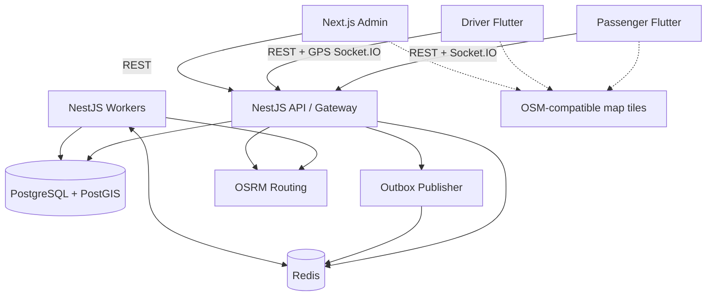

# High-Level Design (HLD)

## System context

## Style: modular monolith
One NestJS codebase divided into cohesive modules. Chosen because team is 2–3, timeline 4–6 weeks, business flows need transactional consistency, and microservices add distributed transactions, service discovery, monitoring and deployment overhead. Modules may be extracted later if boundaries/data ownership remain explicit.

## Logical components
- Passenger/driver Flutter app.
- Next.js admin dashboard.
- NestJS REST API + Socket.IO gateway.
- NestJS worker processes: matching, dispatch, notifications, reconciliation.
- PostgreSQL + PostGIS: durable business truth.
- Redis: BullMQ and ephemeral latest GPS.
- OSRM: route matrix/geometry.
- OSM-compatible tile source: map rendering, separate from routing.

## Backend modules
Auth, Users, Drivers, Vehicles, Bookings, Matching, Routing, Fares, Dispatch, Locations, Payments, Notifications, Admin, Infrastructure.

## Communication
| Mechanism | Purpose |
|---|---|
| REST | Commands/queries |
| Socket.IO | Live GPS, offer and ride events |
| BullMQ | Matching, dispatch, expiry, notification, reconciliation |
| PostgreSQL | Durable business state |
| Redis | Queue backend and ephemeral location |
| OSRM | Road-network travel estimates |

## API/worker deployment
Target `api` and `worker` process roles from same codebase. Worker queues can initially share one worker process. Free-host fallback: combine roles or run locally. No in-memory shared state between processes.

## Why not microservices?
Independent scaling is not worth distributed consistency and operational complexity at this stage. Modular monolith keeps booking/group/driver transactions simpler. Trade-off: modules share runtime and require disciplined boundaries.
