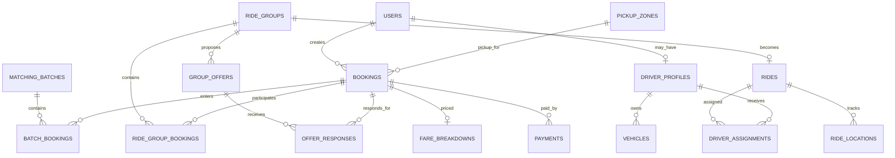

# Data Model and Database Design Plan

## Technology
PostgreSQL is durable source of truth; PostGIS for spatial validation; Prisma for ORM/migrations; selective raw SQL for partial indexes, spatial functions and row locks. Redis is not authoritative for booking/assignment/fare/payment.

## Table inventory
| Domain | Tables |
|---|---|
| Identity | `users`, `refresh_tokens` |
| Driver | `driver_profiles`, `vehicles`, `driver_documents`, `driver_approvals` |
| Geography | `pickup_zones`, `service_regions` |
| Booking | `bookings`, `cancellation_records`, `passenger_reliability` |
| Matching | `matching_batches`, `batch_bookings` |
| Groups/offers | `ride_groups`, `ride_group_bookings`, `group_offers`, `offer_responses` |
| Dispatch | `driver_dispatch_offers`, `driver_assignments`, `driver_offer_responses` |
| Ride | `rides`, `ride_locations` |
| Finance | `fare_breakdowns`, `payments` |
| Infrastructure | `outbox_events`, `notifications`, `idempotency_records` |

This is an entity inventory, not the final Prisma schema. Exact columns/types are intentionally deferred until DB initialization.

## Conceptual ERD

## Critical invariants
1. One active booking per passenger: partial unique index on passenger ID for active statuses (not unique across history).
2. One active assignment per driver: partial unique index for RESERVED/ASSIGNED/ON_TRIP.
3. One active driver assignment per ride.
4. One active claim per booking.
5. Unique passenger response per offer.
6. Unique idempotency key within user/operation scope.
7. Foreign keys for ownership/lifecycle.
8. Check positive vehicle capacity, nonnegative fares, valid coordinates.
9. GiST indexes on relevant PostGIS geometries.
10. Offer response must refer to booking that belongs to offer.

## Geospatial storage
- Pickup zone center/radius or configured geometry.
- Service region polygon/multipolygon.
- Destination as PostGIS Point SRID 4326.
- GiST spatial index.
- Validate pickup geofence and service polygon on backend.
- Tile provider and OSRM are separate systems.

## State separation
Booking, batch, group, offer, passenger response, driver assignment, ride and payment have separate lifecycles. Avoid one giant enum.

## Concurrency
READ COMMITTED + short transactions + row locks + atomic conditional updates + unique/partial constraints. Use `FOR UPDATE` for multi-record coordination and `SKIP LOCKED` for outbox claiming where appropriate. Use consistent lock order and bounded retries. Prisma `$transaction`; selective `$queryRaw` for locking/PostGIS. No transaction across network calls.

READ COMMITTED gives statement-level committed snapshots; it does not itself prevent business races. SERIALIZABLE was not selected because additional retry/serialization complexity is unnecessary for MVP.

## Exact schema tasks at DB initialization
Finalize column names/types, nullability/defaults, Prisma enums/relations, delete behavior, partial indexes/raw SQL migrations, PostGIS extension/geometries, active status sets, seed strategy and location/token retention.
