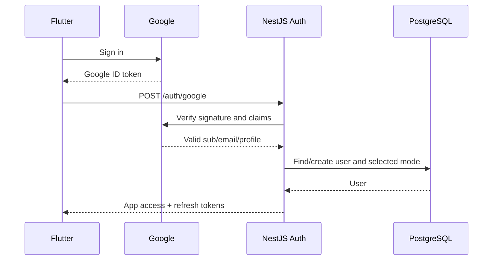
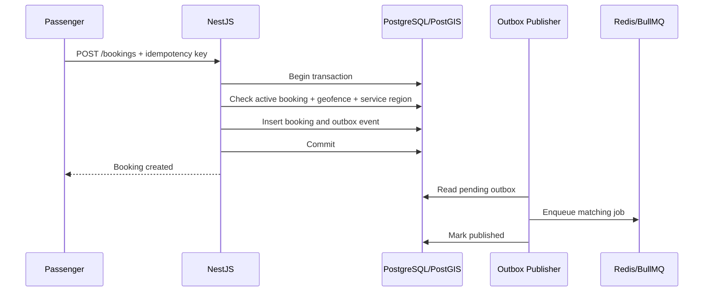

# End-to-End Request Flows

## 1. Google authentication

Google proves identity; platform JWT and DB roles authorize application actions.

## 2. Driver onboarding
1. User selects Driver and signs in.
2. `POST /drivers/register`.
3. Backend creates pending application.
4. Driver submits document references.
5. Admin reviews `/admin/drivers`.
6. Admin approves/rejects.
7. Driver checks application status.
8. Only approved, unsuspended driver can go online.

## 3. Booking creation

Backend validates passenger, one-active-booking, pickup GPS geofence, destination polygon, ride type and idempotency. SHARED enters matching; PRIVATE enters private dispatch path.

## 4. Matching and offer
1. Worker receives zone batch job and acquires lease.
2. Establish cutoff and explicit batch membership.
3. Claim eligible shared bookings.
4. Build bounded candidate groups.
5. Call OSRM Table API.
6. Enumerate drop-off permutations and compute feasibility.
7. Calculate detour and fare allocation.
8. Persist ride group, versioned offer and pending response rows.
9. Outbox publishes notifications.
10. Passengers receive `offer:new`, then fetch `GET /offers/active`.

## 5. Passenger acceptance
```mermaid
sequenceDiagram
 participant P as Passenger
 participant API as NestJS
 participant DB as PostgreSQL
 participant Q as BullMQ
 P->>API: POST /offers/{id}/accept
 API->>DB: Lock offer and passenger response
 API->>DB: Validate current, pending, not expired
 API->>DB: Record response idempotently
 alt Not all accepted
  API-->>P: Accepted; waiting for others
 else All accepted
  API->>DB: Mark offer accepted + outbox dispatch event
  API-->>P: Group accepted; driver search pending
  DB->>Q: Outbox publisher enqueues find-drivers
 end
```
Group acceptance does not confirm ride.

## 6. Driver dispatch
1. Worker finds approved, online, available drivers with sufficient capacity.
2. Rank by ETA to pickup.
3. Send driver offer to best candidate.
4. Driver accepts via REST.
5. Short DB transaction conditionally reserves driver and creates assignment/ride.
6. Unique constraints prevent double assignment.
7. Confirm ride only after successful driver acceptance.
8. Reject/timeout tries next candidate until deadline.
9. If none accepts, notify passengers and offer private fallback with consent.

## 7. GPS and trip
1. Driver marks arrived.
2. Driver starts trip; backend validates assignment/state.
3. Driver sends GPS over Socket.IO every 3–5 seconds.
4. Gateway authenticates, validates and writes latest Redis location with TTL.
5. Broadcast to authorized ride room.
6. Snapshot to PostgreSQL every 15–30 seconds and on key events.
7. Reconnecting passenger fetches REST ride state/location.
8. Driver completes ride via REST.

## 8. Cash payment
Ride completes → fare due stored → passenger pays cash → assigned driver calls `/payments/:id/confirm-cash` → backend records PAID, actor and timestamp. Payment confirmation does not control ride completion.

## 9. Cancellation
Before group acceptance: cancel booking and release claim. After acceptance: remove passenger, recompute route/fare/constraints; preserve feasible group or rematch. After driver assignment and before trip start: record late-cancellation policy if eligible; exempt driver/platform-caused failure; recompute remaining group and assignment. Any changed offer needs fresh acceptance.

## 10. Private fallback
Trigger only after defined shared failure/deadline. Calculate private fare separately, send explicit offer, wait for passenger consent. Decline means cancel/expire per policy. Never silently convert.
