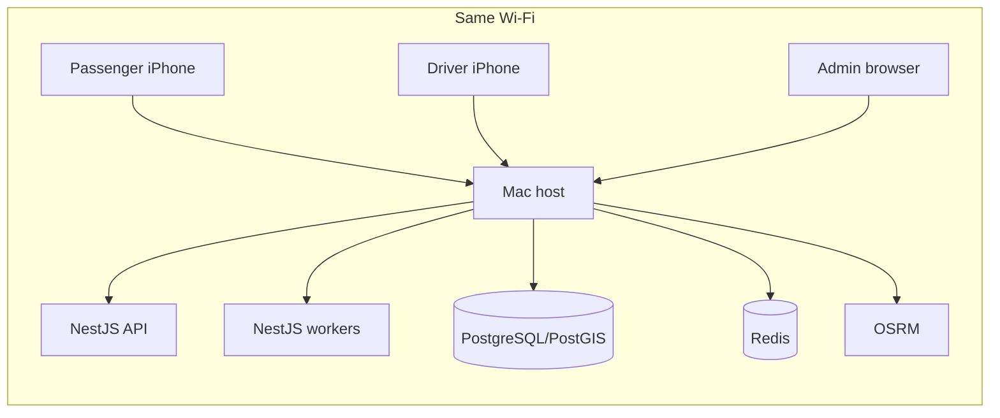

# Deployment and Demo Runbook

## Cost
Hard constraint: ₹0 infrastructure/subscription target. Initial demo is local-first and same-Wi-Fi. Do not assume always-on free cloud, public OSRM or public OSM tiles are unrestricted production services.

## Initial topology
Mac hosts NestJS API/Socket.IO, worker process, PostgreSQL+PostGIS, Redis, Next.js admin and optionally local OSRM. iPhones/browser connect over same Wi-Fi.

## Environment checklist
- Xcode opened and command-line tools selected; iOS Simulator runtime installed.
- Flutter/Dart, VS Code Flutter/Dart extensions.
- Node.js LTS/npm, Git.
- PostgreSQL + PostGIS.
- Redis.
- OSRM + regional OSM extract when local routing is ready.
- API client (Postman/Bruno).

Check existing tools before installing. Prefer native Apple Silicon ARM64. No Docker requirement.

## Same-Wi-Fi networking
- Find Mac LAN IP (interface may vary; `ipconfig getifaddr en0` is one possible check).
- Bind API to LAN-accessible interface, not only loopback.
- Flutter API/socket URL uses `http://<MAC_LAN_IP>:<PORT>`, not `localhost`.
- Admin opens `http://<MAC_LAN_IP>:<ADMIN_PORT>`.
- Allow local inbound traffic in macOS firewall.
- Ensure iPhone and Mac share reachable Wi-Fi; client isolation may block device-to-device traffic.
- Use HTTPS/WSS for non-local deployment.

## Google OAuth
Configure iOS and web OAuth clients, bundle ID, URL scheme/redirect handling and backend token audiences per current package/provider instructions. OAuth still needs internet although API is local. Verify on simulator and physical iPhone. Do not commit secrets.

## Startup order
1. PostgreSQL + PostGIS.
2. Redis.
3. OSRM if local.
4. Prisma migrations and seed pickup/service region/admin.
5. NestJS API.
6. NestJS worker.
7. Next.js admin.
8. Flutter apps.
9. Verify REST health and Socket.IO.

## Demo flow
1. Passenger A and B sign in.
2. Both create SHARED bookings from PDEU to compatible destinations.
3. Matching batch runs and computes route matrix/order.
4. Both receive same group offer and accept.
5. Approved driver receives and accepts dispatch.
6. Ride is confirmed; passengers see driver.
7. Driver arrives, starts trip and emits GPS.
8. Passenger sees live location.
9. Driver completes ride.
10. Passenger pays cash; driver confirms.
11. Admin sees ride/payment.
Demonstrate at least one rejection, cancellation, driver timeout or Redis/outbox recovery case.

## Cloud later
Before selecting provider, verify current free limits for continuous processes, sleep, CPU/RAM, monthly hours, WebSockets, Postgres/PostGIS, Redis, persistence, egress and terms. If separate always-on services are unavailable, combine roles or stay local. No cost without approval.
